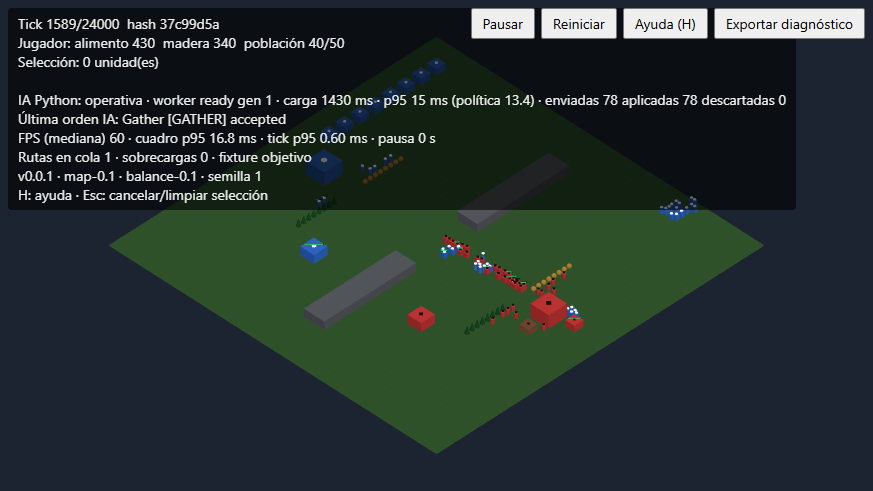
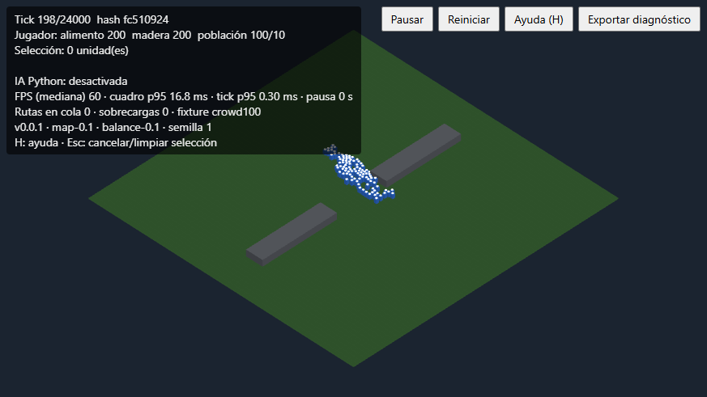
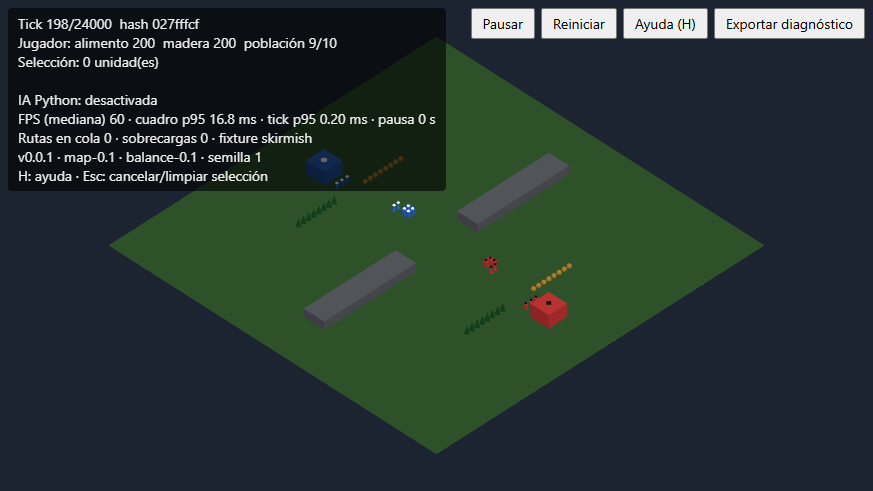
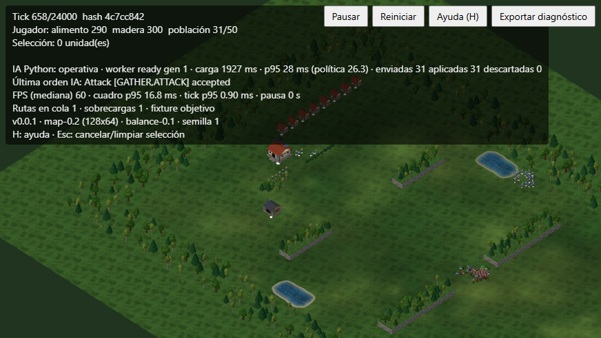
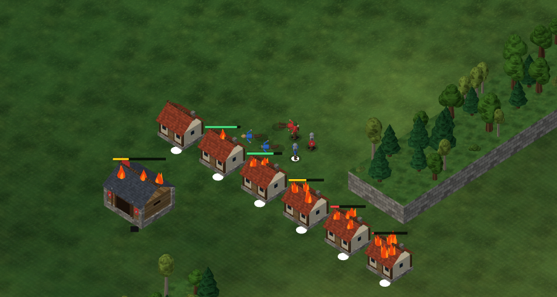
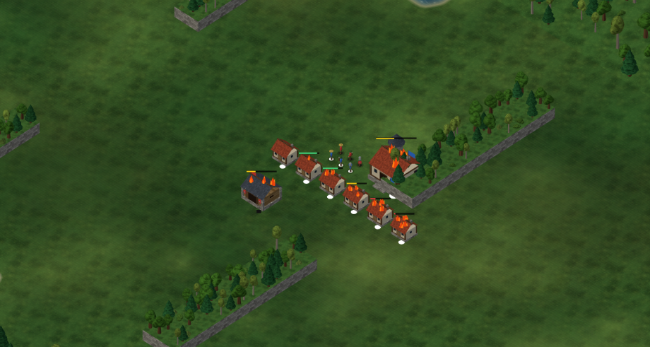
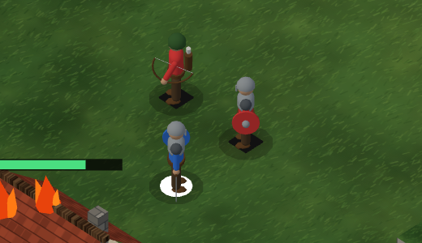

# RTS experimental

Prototipo de estrategia en tiempo real (RTS) que se ejecuta en el navegador. Un jugador humano se enfrenta a un rival controlado por una política escrita en **Python**, que corre dentro de un Web Worker mediante **Pyodide**. El proyecto sigue una especificación SDD y se construye por incrementos verificables.



## Resumen

- **Partida 1 contra 1** sobre un mapa de 128x64 celdas con terreno, agua y rocas que forman pasos estrechos y un paso central.
- **Aspecto (etapa 2):** edificios medievales (centro urbano, casa, cuartel), personajes humanoides por rol con animaciones de trabajo y combate, flechas cosméticas, vegetación y agua animada. Todo es procedural (sin recursos externos) y no altera las reglas.
- **Barras de vida:** unidades y edificios de ambos bandos (incluidas las obras) muestran barra solo cuando 0 < vida < máxima.
- **Daño visible:** los edificios completos muestran una llama más al bajar al 90 %, 75 %, 50 %, 25 % y 5 % de vida; las unidades caen al morir y su cuerpo desaparece a los 5 s. Es solo aspecto: no cambia las reglas.
- **Economía:** aldeanos que recolectan alimento y madera, construyen casas y cuarteles, y entrenan unidades con cola de producción y límite de población.
- **Combate:** soldados y arqueros con rango, enfriamiento y ataque automático a menos de 6 celdas. Gana quien destruye el centro urbano rival; el límite es de 20 minutos.
- **IA en Python:** una política sin estado decide hasta 4 órdenes cada segundo. Se ejecuta en un worker aislado y se comunica con el juego mediante un contrato de mensajes versionado (`contracts/worker-v2`).
- **Núcleo determinista:** la simulación es TypeScript puro, avanza a 20 ticks por segundo y puede reproducirse solo con la semilla y el registro de órdenes.
- **Diagnóstico:** el HUD muestra FPS, tiempo de cuadro y de tick; el botón «Exportar diagnóstico» descarga un JSON con versiones, rendimiento, intercambios con la IA y órdenes aplicadas.

## Capturas

| Cien unidades cruzando el paso central | Escaramuza sin IA |
|---|---|
|  |  |

Los bandos se distinguen por color y por una marca: disco blanco para el jugador (azul) y rombo oscuro para el rival (rojo).

### Etapa 2: mejoras visuales

Capturas posteriores a la etapa visual (especificación en `SDD_Etapa_2_Mejoras_Visuales.md`). Las anteriores se conservan para mostrar la evolución del aspecto.

| Combate contra la IA con agua orgánica y edificios medievales | Edificios con llamas según su vida y unidades caídas |
|---|---|
|  |  |

| Llamas adicionales al 90 %, 75 %, 50 %, 25 % y 5 % de vida | Personajes suavizados por rol (arquero, soldado, aldeano) |
|---|---|
|  |  |

Novedades de la etapa: edificios y personajes procedurales por rol, animaciones de trabajo y combate, agua con orilla suave y textura multiescala, llamas por daño, caída y desaparición de cuerpos a los 5 s, y desplazamiento de cámara por los bordes de la pantalla.

## Controles

| Acción | Entrada |
|---|---|
| Cámara | WASD o flechas, o cursor en el borde de la pantalla (24 px, 1,5 veces más rápido); rueda para acercar o alejar |
| Seleccionar | Clic o arrastre; Shift suma o quita; Esc limpia |
| Mover, recolectar, atacar, reanudar obra | Clic derecho según el objetivo |
| Construir | Seleccionar aldeanos y usar el panel inferior |
| Entrenar | Clic en un edificio propio |
| Ayuda | Tecla H o botón «Ayuda» |

## Puesta en marcha

Requisitos: Node.js 22 y, para las pruebas de la política, Python 3.

```bash
npm install
npm run dev
```

Abre <http://localhost:5173/>. El primer arranque copia Pyodide 0.27.7 a `public/vendor` (no se versiona).

Parámetros de URL útiles:

| Parámetro | Efecto |
|---|---|
| `?ai=0` | Desactiva la IA |
| `?graphics=low` | Modo gráfico reducido: sin antialias, sombras ni agua animada, con menos decoración y flechas simples |
| `?fixture=corridor20`, `crossing`, `crowd100`, `skirmish` | Escenas de prueba de navegación y combate, sin IA |
| `?fixture=objetivo` | Escena de carga con IA: 100 unidades, 20 edificios y combate |

## Comandos

| Comando | Descripción |
|---|---|
| `npm run dev` | Servidor de desarrollo |
| `npm run build` | Comprobación de tipos y build de producción |
| `npm run typecheck` | TypeScript estricto |
| `npm test` | Pruebas de TypeScript (Vitest) |
| `npm run test:py` | Pruebas de la política Python (`unittest`) |

## Arquitectura

```
src/
  core/         Simulación determinista (estado, órdenes, economía, combate, fixtures)
  navigation/   Rejilla, rutas y movimiento
  content/      Balance y versiones
  ai-client/    Director y proveedor del worker; contrato de mensajes
  ai-worker/    Worker que carga Pyodide y ejecuta la política
  app/          Sesión de juego y bucle de ticks
  rendering/    Escena Three.js
  input/        Cámara y control de ratón y teclado
  ui/           Panel de órdenes y mensajes
  diagnostics/  Métricas de rendimiento e informe exportable
python/policy/  Política de la IA (policy-0.2)
contracts/      Esquemas y fixtures del contrato del worker
tests/          Pruebas unitarias, de integración y de escenarios
```

El núcleo no depende del navegador ni de Three.js; el renderizado solo lee el estado. La IA nunca modifica la simulación directamente: sus decisiones se validan y se agendan como órdenes para el siguiente tick.

## Pila tecnológica

Vite 6, TypeScript 7 (modo estricto), Three.js 0.186, Pyodide 0.27.7 (Python 3.12), Ajv 8 y Vitest 4.

## Estado y mediciones

Incrementos completados: P0-A a P0-C (base, navegación, IA en worker), P1-A a P1-D (economía, combate, rival completo y estabilización) y la etapa 2 de mejoras visuales (P2-01 a P2-08).

Medición en un equipo con Ryzen 5 5600H y RTX 3050, Chromium, 1366x768, escena `objetivo` durante unos 6 minutos:

| Métrica | Resultado |
|---|---|
| FPS (mediana) | 60 |
| Cuadro p95 | 16,8 ms |
| Tick p95 | 0,5 ms |
| IA, ida y vuelta p95 | 12 ms (política 11,4 ms) |
| Partida de 24 000 ticks con dos IA | Sin violaciones de reglas y reproducible |
| Diez reinicios seguidos | Un solo worker y memoria estable |

Las mediciones de rendimiento son anteriores a la etapa 2 y no se han repetido con el nuevo aspecto.

Pruebas: 241 de TypeScript y 44 de Python.

## Limitaciones conocidas

- Solo se ha probado en Chromium; Firefox queda pendiente.
- No hay audio.
- Existe un único nivel de IA; no se ha medido la dificultad ni la diversión.
- La escena `objetivo` pierde unidades durante el combate, así que los p95 cubren toda la medición y no solo el pico de 100 unidades.
- Fuera de alcance por ahora: mantener posición, mover atacando, niebla de guerra y minimapa. Cada uno requiere su propia especificación.