# RTS Camilus (nombre provisional)

> Creado experimentalmente por Ing. Camilo A. Castañeda Galindo.

Prototipo de estrategia en tiempo real (RTS) que se ejecuta en el navegador. Un jugador humano se enfrenta a un rival controlado por una política escrita en **Python**, que corre dentro de un Web Worker mediante **Pyodide**. El nombre «RTS Camilus» es provisional y se muestra en el título de la pestaña y en la barra inferior del juego.

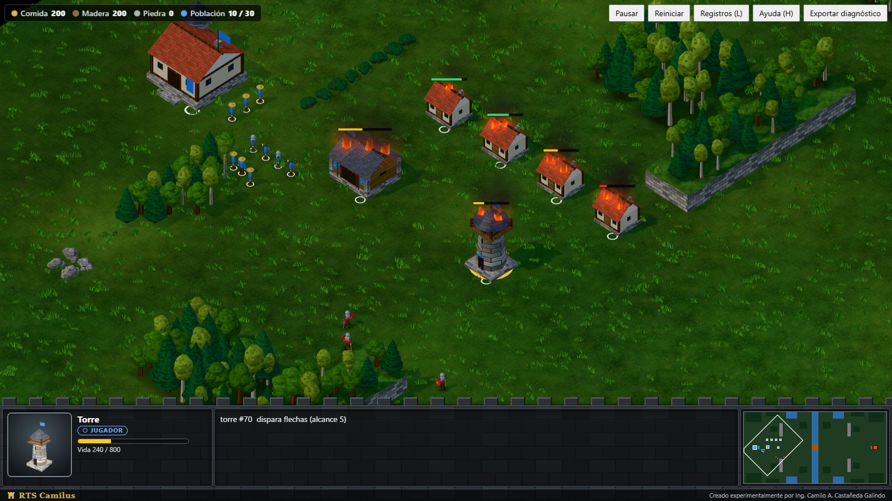

*Escena de pruebas `?fixture=realismo&ai=0`: edificios en llamas según su vida, humo, torre seleccionada con su retrato y barra de castillo con miniatura.*

## Contenido

- [Resumen](#resumen)
- [Metodología](#metodología)
- [Etapas y capturas](#etapas-y-capturas)
- [Controles](#controles)
- [Puesta en marcha](#puesta-en-marcha)
- [Comandos](#comandos)
- [Arquitectura](#arquitectura)
- [Estado y mediciones](#estado-y-mediciones)
- [Limitaciones conocidas](#limitaciones-conocidas)
- [Licencia](#licencia)

## Resumen

- **Partida 1 contra 1** sobre un mapa de 128x64 celdas con terreno, rocas, bosques y un río de lado a lado con un puente central (6 celdas) como único cruce. Cada bando parte con doce casas y dos torres ya construidas.
- **Economía:** aldeanos que recolectan comida, madera y piedra, construyen casas, cuarteles y torres, y entrenan unidades con cola de producción y límite de población.
- **Combate:** soldados y arqueros con rango, enfriamiento y ataque automático a menos de 6 celdas; las torres disparan flechas. Gana quien destruye el centro urbano rival; el límite es de 30 minutos (36 000 ticks) y, si ninguno cae, hay empate.
- **IA en Python:** una política sin estado decide hasta 4 órdenes cada segundo. Se ejecuta en un worker aislado y se comunica con el juego mediante un contrato de mensajes versionado (`contracts/worker-v2`). La IA nunca modifica la simulación directamente: sus decisiones se validan y se agendan como órdenes para el siguiente tick.
- **Núcleo determinista:** la simulación es TypeScript puro, avanza a 20 ticks por segundo y puede reproducirse solo con la semilla y el registro de órdenes.
- **Aspecto procedural:** edificios medievales y personajes humanoides por rol, agua con shader, iluminación con sombras, fuego y humo por daño, derrumbes con escombros, hierba y bosques con viento. No hay recursos gráficos externos.
- **Sonido procedural:** efectos, aves de fondo y música sintetizados con Web Audio (sin archivos de audio).
- **Interfaz:** barra inferior de castillo con recursos (Comida, Madera, Piedra y Población), retrato 3D de la selección con nombre, bando y barra de vida, botones con icono y coste, miniatura del mapa en tiempo real y avisos temporales. Ventana final con el resultado de la partida.
- **Diagnóstico:** el HUD muestra FPS, tiempo de cuadro y de tick; el botón «Exportar diagnóstico» descarga un JSON con versiones, rendimiento, intercambios con la IA y órdenes aplicadas.

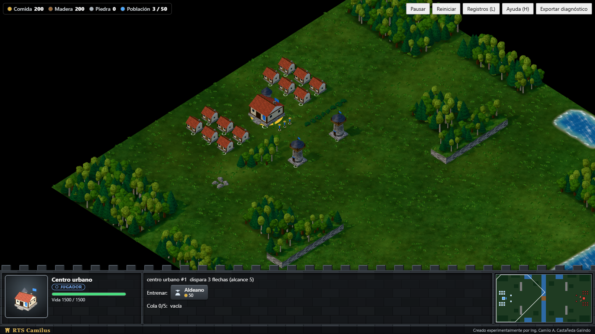

*Partida por defecto: aldea inicial con el centro urbano seleccionado, el puente al este y los bosques de alrededor.*

## Metodología

El proyecto se construye con **desarrollo guiado por especificaciones (SDD, Specification-Driven Development)**: cada etapa parte de una especificación escrita que fija el alcance, las reglas, los contratos y los criterios de aceptación, y se implementa en incrementos pequeños y verificables con pruebas automáticas (unitarias, de integración y de escenarios) antes de pasar al siguiente. Cada etapa se desarrolla en su propia rama y se integra mediante *pull request*. Las especificaciones son documentos de trabajo y no forman parte de este repositorio público.

## Etapas y capturas

| Etapa | Contenido |
|---|---|
| 0 y 1 | Base, navegación, IA en worker, economía, combate y rival completo |
| 2 | Mejoras visuales: edificios y personajes por rol, agua, llamas por daño |
| 3 | Defensa, recursos y legibilidad |
| 4 | Efectos de sonido y música ambiental procedurales |
| 5 | Realismo sonoro y visual (luz, sombras, humo, derrumbes) |
| 6 | Interfaz, río con puente, aldea inicial y ajustes de sonido |
| 7 | Bosques, aves, retratos de selección, 12 casas por bando, partida de 30 minutos, ventana final y barra de castillo |

Las etapas 3 y 4 no tienen captura propia: la defensa (torres con flechas) se ve en la imagen de portada y el sonido no se puede mostrar en imágenes. Las capturas de las etapas 0 a 2 conservan el aspecto de aquel momento para mostrar la evolución.

### Etapas 0 y 1: base, navegación y combate

| Cien unidades cruzando el paso central | Combate contra la IA |
|---|---|
|  |  |

Los bandos se distinguen por color y por una marca de contorno: anillo blanco para el jugador (azul) y rombo oscuro hueco para el rival (rojo).

### Etapa 2: mejoras visuales

| Combate contra la IA con agua orgánica y edificios medievales | Edificios con llamas según su vida y unidades caídas |
|---|---|
|  |  |

| Llamas adicionales al 90 %, 75 %, 50 %, 25 % y 5 % de vida | Personajes suavizados por rol (arquero, soldado, aldeano) |
|---|---|
|  |  |

Novedades: edificios y personajes procedurales por rol, animaciones de trabajo y combate, agua con orilla suave y textura multiescala, llamas por daño, caída y desaparición de cuerpos a los 5 s, y desplazamiento de cámara por los bordes de la pantalla.

### Etapa 5: realismo visual

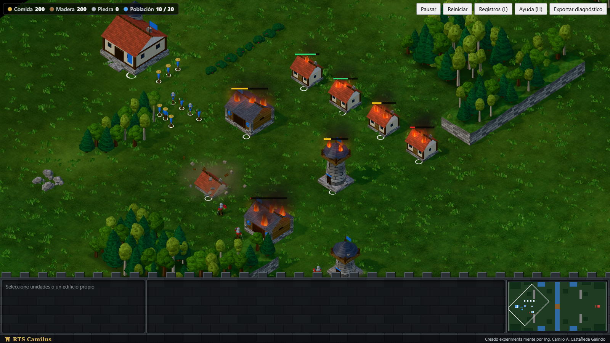

Escena `?fixture=realismo&ai=0`: fuego y humo con partículas, sombras proyectadas, materiales PBR, hierba y vegetación con viento, y derrumbes con polvo y escombros.

### Etapa 6: río, puente y aldea inicial

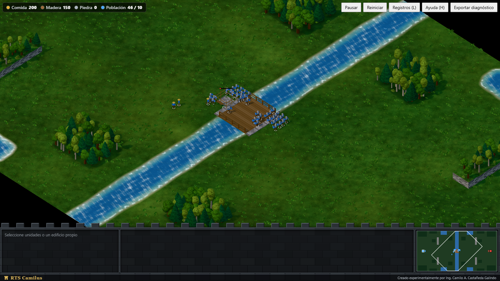

Escena `?fixture=rio&ai=0`: dos grupos de 20 unidades se cruzan por el puente, único paso entre las orillas.

### Etapa 7: bosques, retratos y barra de castillo

Capturas a 1600x900 con las escenas `?fixture=retratos` y `?fixture=sonidos`.

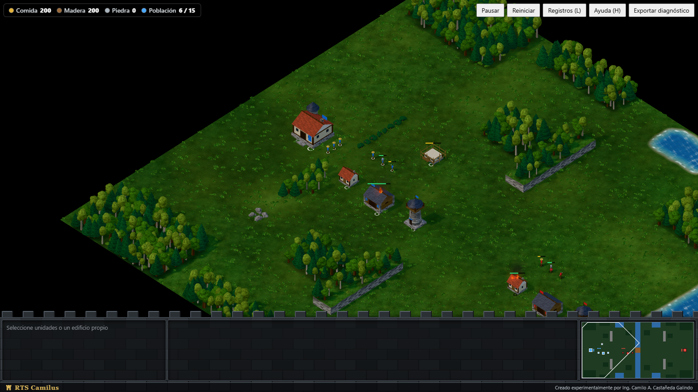

| Edificio propio seleccionado | Barra de castillo con retrato, panel y miniatura |
|---|---|
| 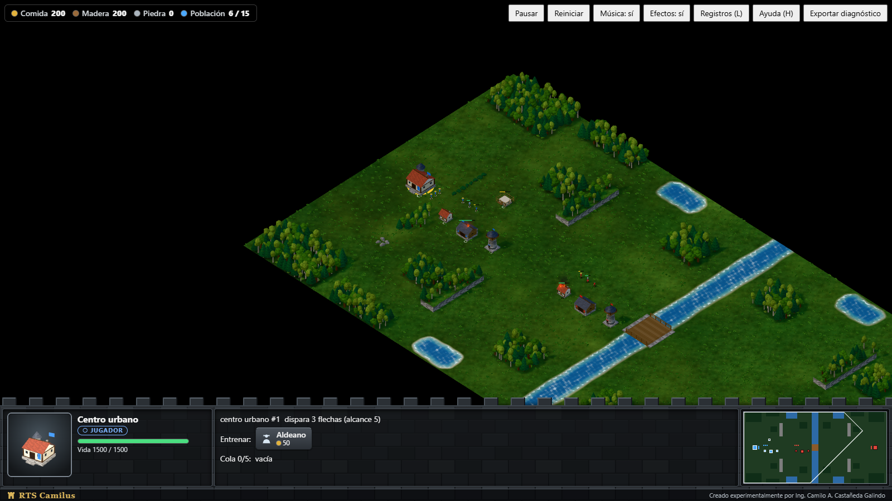 | 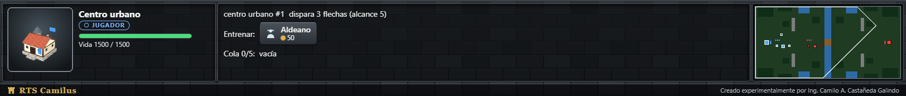 |

| Unidad propia | Recurso (naturaleza) | Edificio enemigo |
|---|---|---|
| 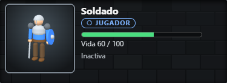 | 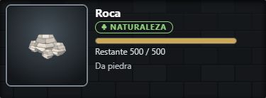 | 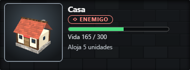 |

| Victoria | Derrota |
|---|---|
| 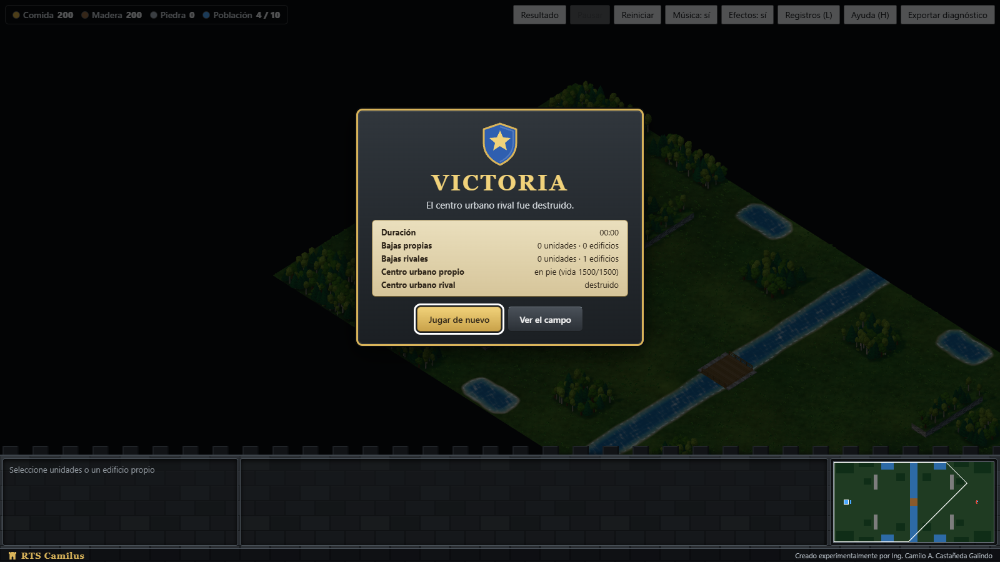 | 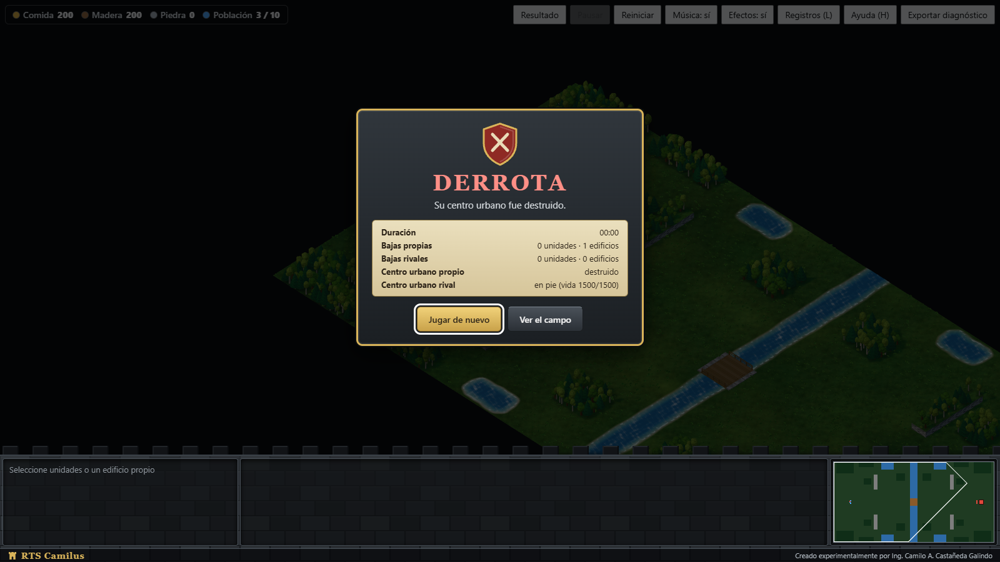 |

Indicador de recursos con nombre:


## Controles

| Acción | Entrada |
|---|---|
| Cámara | WASD o flechas, o cursor en el borde de la pantalla (24 px, 1,5 veces más rápido); rueda para acercar o alejar (hasta 5,5 veces); clic o arrastre en la miniatura |
| Registros técnicos | Tecla L o botón «Registros» |
| Seleccionar | Clic o arrastre; Shift suma o quita; Esc limpia (el clic en un edificio, enemigo o recurso solo muestra su retrato e información) |
| Ventana final | Tab recorre los botones, Intro reinicia, Esc cierra la ventana; el botón «Resultado» la reabre |
| Mover, recolectar, atacar, reanudar obra | Clic derecho según el objetivo |
| Construir | Seleccionar aldeanos y usar el panel inferior |
| Entrenar | Clic en un edificio propio |
| Ayuda | Tecla H o botón «Ayuda» |
| Audio | Tecla M silencia o reactiva todo; los botones «Música» y «Efectos» activan cada uno por separado (se recuerdan en el navegador) |

## Puesta en marcha

Requisitos: Node.js 22 y, para las pruebas de la política, Python 3.

```bash
npm install
npm run dev
```

Abre <http://localhost:5173/>. El primer arranque copia Pyodide 0.27.7 a `public/vendor` (no se versiona).

Parámetros de URL útiles:

| Parámetro | Efecto |
|---|---|
| `?ai=0` | Desactiva la IA |
| `?audio=0` | Desactiva todo el audio |
| `?graphics=low` | Modo gráfico reducido (aspecto de la etapa 4): sin antialias, sombras, agua animada ni partículas, con menos decoración y flechas simples |
| `?shadows=0` | Desactiva solo las sombras proyectadas del modo gráfico alto |
| `?fixture=realismo&ai=0` | Escena de la etapa 5: edificios en llamas, derrumbes de casa, cuartel y torre, unidades y agua al sur |
| `?fixture=rio&ai=0` | Escena de la etapa 6: dos grupos de 20 unidades se cruzan por el puente y tres aldeanos intentan construir sobre el puente, junto a él y en la orilla |
| `?fixture=retratos&ai=0` | Escena de la etapa 7: unidades propias y rivales con vidas variadas, casa, cuartel y torre propios y rivales, y una obra de casa al 45 % |
| `?fixture=sonidos&ai=0` | Escena breve para oír todos los efectos (martillo, espada, flecha e impacto de flecha incluidos); añade `&final=victoria` o `&final=derrota` para oír los sonidos de fin de partida |
| `?fixture=objetivo` | Escena de carga con IA: 100 unidades, 20 edificios y combate |
| `?fixture=corridor20`, `crossing`, `crowd100`, `skirmish` | Escenas de prueba de navegación y combate, sin IA |

## Comandos

| Comando | Descripción |
|---|---|
| `npm run dev` | Servidor de desarrollo |
| `npm run build` | Comprobación de tipos y build de producción |
| `npm run typecheck` | TypeScript estricto |
| `npm test` | Pruebas de TypeScript (Vitest) |
| `npm run test:py` | Pruebas de la política Python (`unittest`) |

## Arquitectura

```
src/
  core/         Simulación determinista (estado, órdenes, economía, combate, fixtures)
  navigation/   Rejilla, rutas y movimiento
  content/      Balance y versiones
  ai-client/    Director y proveedor del worker; contrato de mensajes
  ai-worker/    Worker que carga Pyodide y ejecuta la política
  app/          Sesión de juego y bucle de ticks
  rendering/    Escena Three.js; portrait.ts dibuja el retrato de la selección en un segundo renderizador
  input/        Cámara, selección (describeSelection) y control de ratón y teclado
  ui/           Panel de órdenes con tarjeta de selección, avisos temporales, miniatura, ventana final (end-dialog.ts) y barra de castillo (castle-bar.ts)
  audio/        Efectos, aves de fondo (ambient.ts) y música sintetizados con Web Audio; solo lee los eventos de la simulación
  diagnostics/  Métricas de rendimiento e informe exportable
python/policy/  Política de la IA (policy-0.4)
contracts/      Esquemas y fixtures del contrato del worker
tests/          Pruebas unitarias, de integración y de escenarios
```

El núcleo no depende del navegador ni de Three.js; el renderizado solo lee el estado.

Pila tecnológica: Vite 6, TypeScript 7 (modo estricto), Three.js 0.186, Pyodide 0.27.7 (Python 3.12), Ajv 8 y Vitest 4.

## Estado y mediciones

Incrementos completados: etapas 0 y 1 (base, navegación, IA en worker, economía, combate, rival completo y estabilización) y etapas 2 a 7 (mejoras visuales, defensa y recursos, sonido, realismo audiovisual, interfaz y mundo, bosques, retratos y castillo).

Pruebas: 415 de TypeScript y 59 de Python.

Medición en un equipo con Ryzen 5 5600H y RTX 3050, Chromium, 1366x768, escena `objetivo` durante unos 6 minutos (anterior a la etapa 2 y no repetida con el aspecto actual):

| Métrica | Resultado |
|---|---|
| FPS (mediana) | 60 |
| Cuadro p95 | 16,8 ms |
| Tick p95 | 0,5 ms |
| IA, ida y vuelta p95 | 12 ms (política 11,4 ms) |
| Partida de 24 000 ticks con dos IA | Sin violaciones de reglas y reproducible |
| Diez reinicios seguidos | Un solo worker y memoria estable |

En la etapa 7 solo se midió la fluidez de la partida por defecto en el navegador integrado de VS Code (ventana de unos 870x490 px, con IA, 8 s tras cargar): 300 cuadros con mediana de 16,7 ms, p95 de 16,8 ms y máximo de 17,1 ms (60 FPS). No se ha medido a 1920x1080 ni en una partida larga con 36 000 ticks en el navegador.

En simulación sin navegador (horizonte de 36 000 ticks): la IA gana al jugador pasivo en el tick 6 178 y dos IA enfrentadas terminan en el tick 24 596, sin violaciones de reglas y con el mismo hash al reproducir las órdenes.

## Limitaciones conocidas

- Solo se ha probado en Chromium; Firefox queda pendiente.
- El nombre «RTS Camilus» es provisional.
- Los retratos usan un segundo contexto WebGL; si no está disponible o se pierde, se muestra un dibujo 2D sencillo en su lugar.
- El audio es procedural y su mezcla está pendiente de la valoración auditiva del autor; el navegador solo lo activa tras el primer clic o tecla.
- Existe un único nivel de IA; no se ha medido la dificultad ni la diversión.
- La escena `objetivo` pierde unidades durante el combate, así que los p95 cubren toda la medición y no solo el pico de 100 unidades.
- Fuera de alcance por ahora: mantener posición, mover atacando y niebla de guerra.

## Licencia

Copyright © 2026 Camilo A. Castañeda Galindo. Publicado bajo la [PolyForm Strict License 1.0.0](LICENSE).

El código se puede leer, estudiar y ejecutar con fines no comerciales, pero **no se puede copiar, distribuir, modificar ni usar para crear obras derivadas** sin permiso escrito del autor. No es una licencia de código abierto: el repositorio se publica para mostrar el trabajo y servir de ejemplo.
