# RTS Camilus (nombre provisional)

> Creado experimentalmente por Ing. Camilo A. Castañeda Galindo.

Prototipo de estrategia en tiempo real (RTS) que se ejecuta en el navegador. Un jugador humano se enfrenta a un rival controlado por una política escrita en **Python**, que corre dentro de un Web Worker mediante **Pyodide**. El nombre «RTS Camilus» es provisional y se muestra en el título de la pestaña y en la barra inferior del juego.

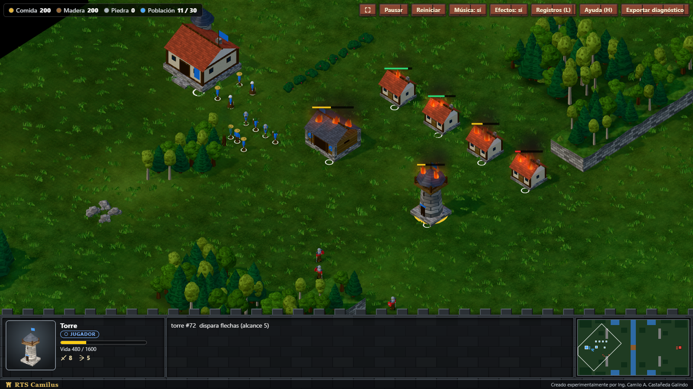

*Escena de pruebas `?fixture=realismo&ai=0` a 1600x900 con el aspecto actual (etapa 8): edificios en llamas según su vida, humo, torre seleccionada con retrato, ficha de ataque y alcance, barra de castillo con miniatura y botones de ladrillo.*

## Contenido

- [Resumen](#resumen)
- [Metodología](#metodología)
- [Etapas y capturas](#etapas-y-capturas)
- [Controles](#controles)
- [Puesta en marcha](#puesta-en-marcha)
- [Comandos](#comandos)
- [Arquitectura](#arquitectura)
- [Estado y mediciones](#estado-y-mediciones)
- [Limitaciones conocidas](#limitaciones-conocidas)
- [Licencia](#licencia)

## Resumen

- **Dos modos de juego**, elegidos en la ventana de bienvenida: **Modo villa** (economía, edificios y ejércitos, descrito abajo) y **Modo batalla** (solo ejércitos, etapa 10).
- **Modo villa: partida 1 contra 1** sobre un mapa de 128x64 celdas con terreno, rocas, bosques y un río de lado a lado con un puente central (6 celdas) como único cruce. Cada bando parte con doce casas y dos torres ya construidas, cuatro aldeanos y un pequeño destacamento (un soldado, un arquero, un caballero y un cañón).
- **Economía:** aldeanos y aldeanas que recolectan comida, madera y piedra, construyen casas, cuarteles y torres, y entrenan unidades con cola de producción y límite de población.
- **Combate:** soldados, arqueros, caballeros y cañones con rango, enfriamiento y ataque automático a menos de 6 celdas; las torres disparan flechas y los cañones, balas de daño de área. Los centros urbanos (3 000 de vida) y las torres (1 600) resisten el doble que en las primeras etapas. Gana quien destruye el centro urbano rival; el límite es de 30 minutos (36 000 ticks) y, si ninguno cae, hay empate.
- **IA en Python:** una política sin estado decide hasta 4 órdenes cada segundo. Se ejecuta en un worker aislado y se comunica con el juego mediante un contrato de mensajes versionado (`contracts/worker-v2`). La IA nunca modifica la simulación directamente: sus decisiones se validan y se agendan como órdenes para el siguiente tick.
- **Núcleo determinista:** la simulación es TypeScript puro, avanza a 20 ticks por segundo y puede reproducirse solo con la semilla y el registro de órdenes.
- **Aspecto procedural:** edificios medievales y personajes humanoides por rol, agua con shader, iluminación con sombras, fuego y humo por daño, derrumbes con escombros, hierba y bosques con viento. No hay recursos gráficos externos.
- **Sonido procedural:** efectos, aves de fondo y música sintetizados con Web Audio (sin archivos de audio).
- **Interfaz:** barra inferior de castillo con recursos (Comida, Madera, Piedra y Población), retrato 3D de la selección con nombre, bando y barra de vida, botones con icono y coste, miniatura del mapa en tiempo real y avisos temporales. Botones superiores de ladrillo con pantalla completa, ventana de bienvenida al cargar, cursores que anuncian la acción del clic derecho y ventana final con el resultado de la partida.
- **Diagnóstico:** el HUD muestra FPS, tiempo de cuadro y de tick; el botón «Exportar diagnóstico» descarga un JSON con versiones, rendimiento, intercambios con la IA y órdenes aplicadas.

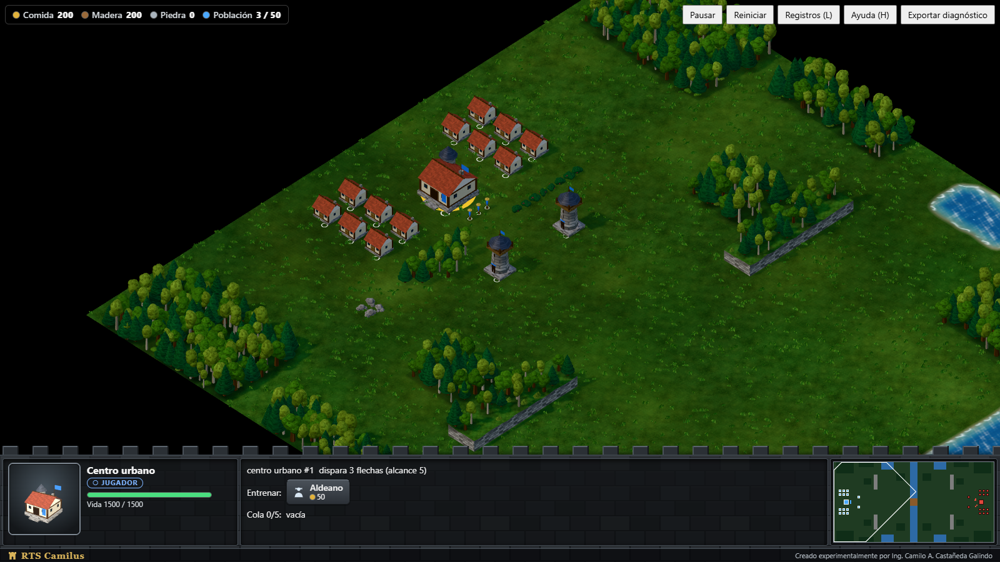

*Partida por defecto: aldea inicial con el centro urbano seleccionado, el puente al este y los bosques de alrededor.*

## Metodología

El proyecto se construye con **desarrollo guiado por especificaciones (SDD, Specification-Driven Development)**: cada etapa parte de una especificación escrita que fija el alcance, las reglas, los contratos y los criterios de aceptación, y se implementa en incrementos pequeños y verificables con pruebas automáticas (unitarias, de integración y de escenarios) antes de pasar al siguiente. Cada etapa se desarrolla en su propia rama y se integra mediante *pull request*. Las especificaciones son documentos de trabajo y no forman parte de este repositorio público.

## Etapas y capturas

| Etapa | Contenido |
|---|---|
| 0 y 1 | Base, navegación, IA en worker, economía, combate y rival completo |
| 2 | Mejoras visuales: edificios y personajes por rol, agua, llamas por daño |
| 3 | Defensa, recursos y legibilidad |
| 4 | Efectos de sonido y música ambiental procedurales |
| 5 | Realismo sonoro y visual (luz, sombras, humo, derrumbes) |
| 6 | Interfaz, río con puente, aldea inicial y ajustes de sonido |
| 7 | Bosques, aves, retratos de selección, 12 casas por bando, partida de 30 minutos, ventana final y barra de castillo |
| 8 | Identidad y pantalla: favicon y título de pestaña, bienvenida, pantalla completa, vista inicial sobre la ciudad, cursores de acción, botones de ladrillo y doble vida en centros urbanos y torres |
| 9 | Caballería y artillería: establo (con caballos a la vista) y armería abierta con chimenea, caballero (galope doble de rápido con caballo animado) y cañón (alcance de 7,5 con distancia mínima, artillero que enciende la mecha, bala parabólica con daño de área, fogonazo, estruendo y unidades lanzadas por los aires) |
| 10 | Modo batalla: segundo modo de juego sin edificios ni aldeanos, con montañas, valles, bosques y ríos, ejércitos de 91 unidades por bando (con comandante), niebla de guerra, victoria por aniquilación y una IA que planifica la batalla y deja al comandante al frente. El modo existente pasa a llamarse «Modo villa» |
Las etapas 3 y 4 no tienen captura propia: la defensa (torres con flechas) se ve en la imagen de portada y el sonido no se puede mostrar en imágenes. Las capturas de las etapas 0 a 2 conservan el aspecto de aquel momento para mostrar la evolución.

### Etapas 0 y 1: base, navegación y combate

| Cien unidades cruzando el paso central | Combate contra la IA |
|---|---|
| 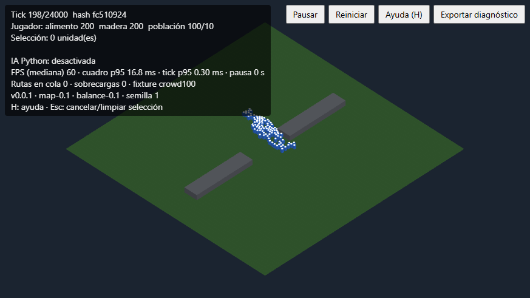 | 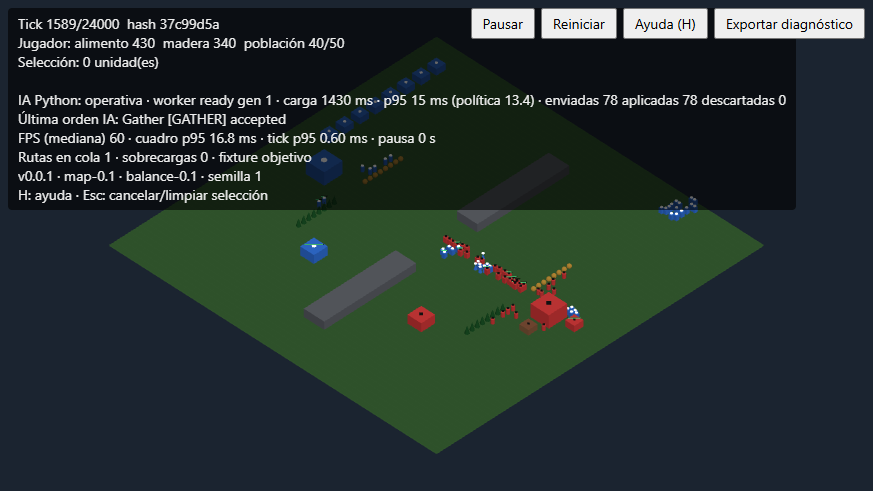 |

Los bandos se distinguen por color y por una marca de contorno: anillo blanco para el jugador (azul) y rombo oscuro hueco para el rival (rojo).

### Etapa 2: mejoras visuales

| Combate contra la IA con agua orgánica y edificios medievales | Edificios con llamas según su vida y unidades caídas |
|---|---|
| 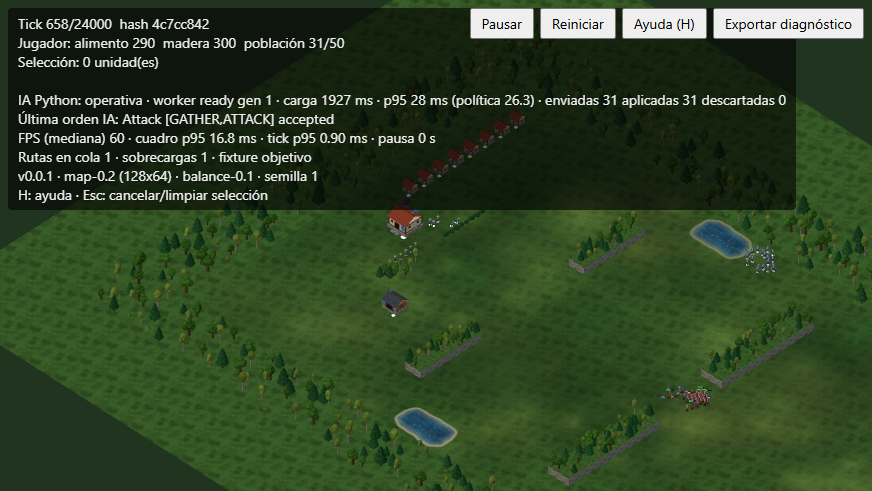 | 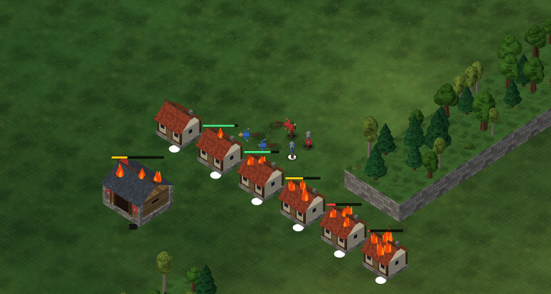 |

| Llamas adicionales al 90 %, 75 %, 50 %, 25 % y 5 % de vida | Personajes suavizados por rol (arquero, soldado, aldeano) |
|---|---|
| 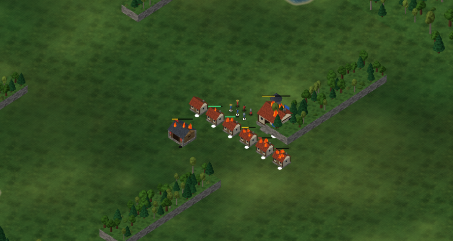 | 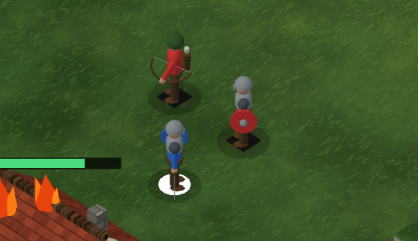 |

Novedades: edificios y personajes procedurales por rol, animaciones de trabajo y combate, agua con orilla suave y textura multiescala, llamas por daño, caída y desaparición de cuerpos a los 5 s, y desplazamiento de cámara por los bordes de la pantalla.

### Etapa 5: realismo visual

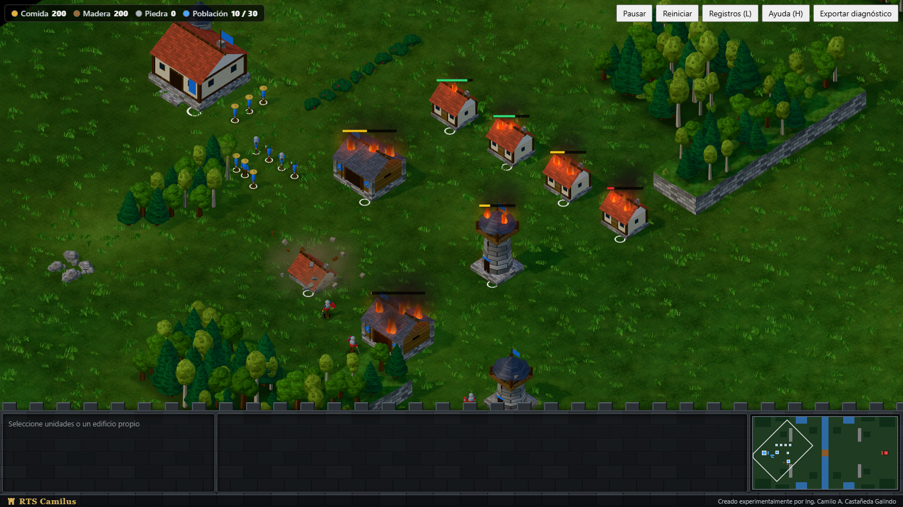

Escena `?fixture=realismo&ai=0`: fuego y humo con partículas, sombras proyectadas, materiales PBR, hierba y vegetación con viento, y derrumbes con polvo y escombros.

### Etapa 6: río, puente y aldea inicial

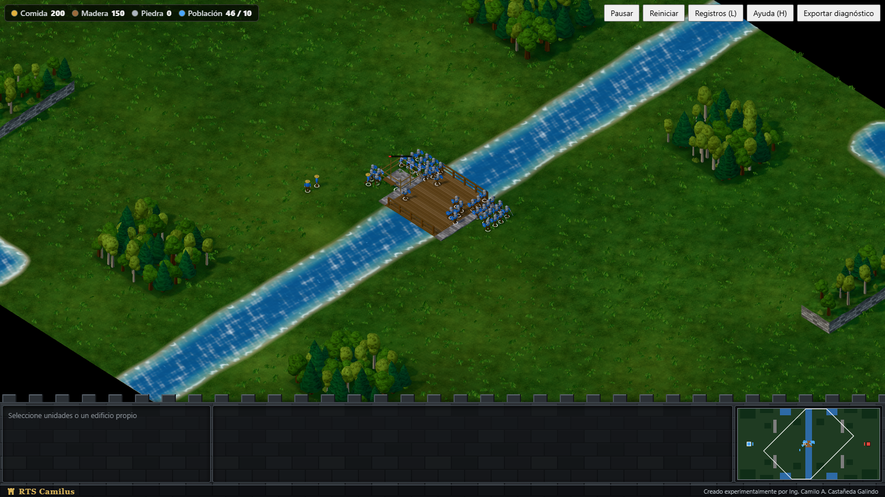

Escena `?fixture=rio&ai=0`: dos grupos de 20 unidades se cruzan por el puente, único paso entre las orillas.

### Etapa 7: bosques, retratos y barra de castillo

Capturas a 1600x900 con las escenas `?fixture=retratos` y `?fixture=sonidos`.

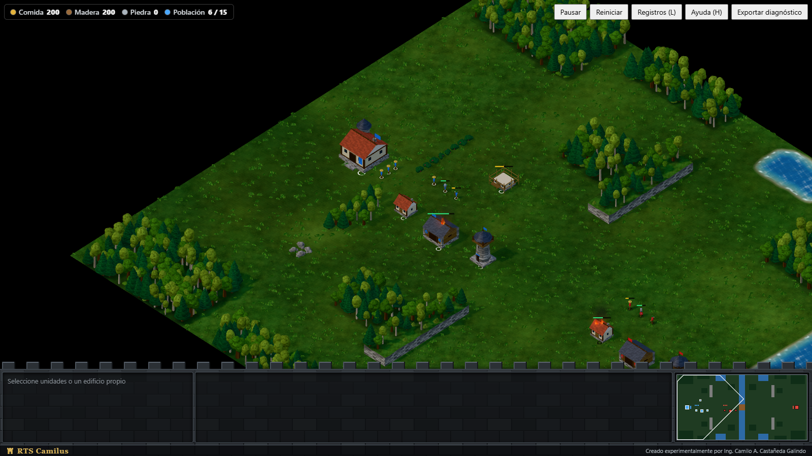

| Edificio propio seleccionado | Barra de castillo con retrato, panel y miniatura |
|---|---|
| 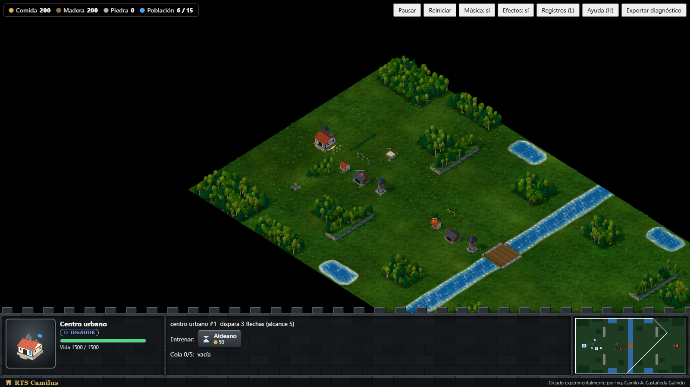 | 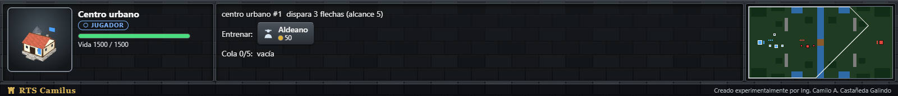 |

| Unidad propia | Recurso (naturaleza) | Edificio enemigo |
|---|---|---|
| 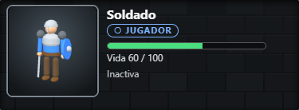 | 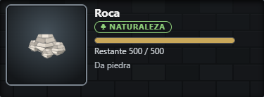 | 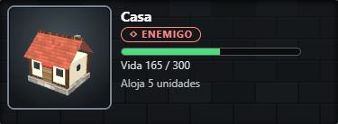 |

| Victoria | Derrota |
|---|---|
| 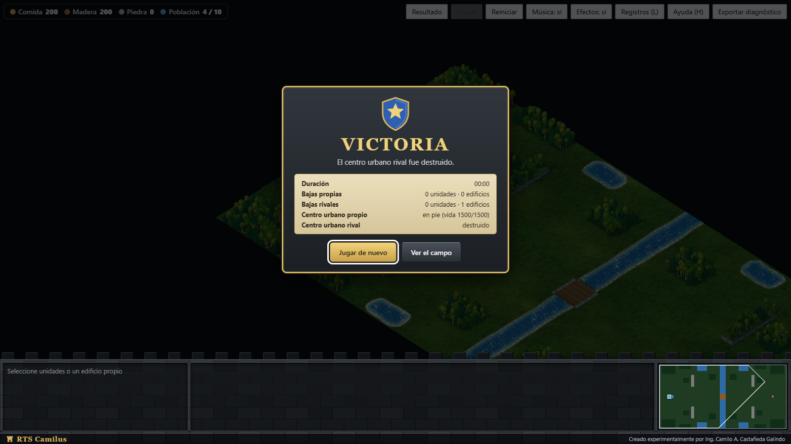 | 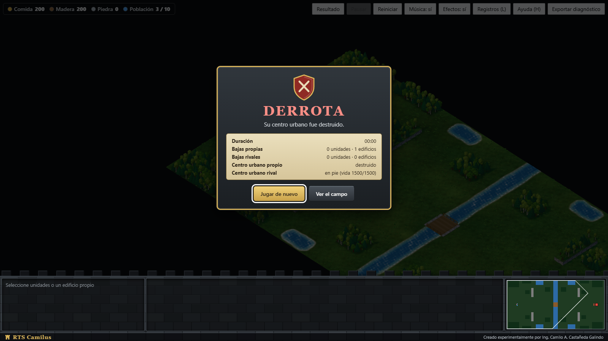 |

Indicador de recursos con nombre:


### Etapa 8: identidad, pantalla y cursores

Capturas a unos 1290x530 px (navegador integrado de VS Code).

| Ventana de bienvenida | Vista inicial sobre la ciudad del jugador |
|---|---|
| 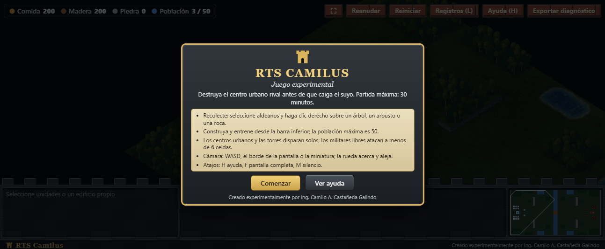 | 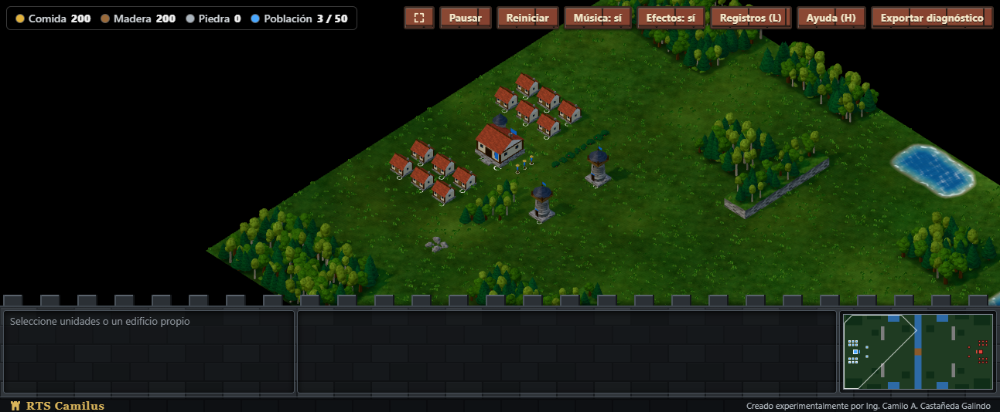 |

Botones superiores de ladrillo, con el botón de pantalla completa a la izquierda:


- **Identidad:** la pestaña se titula «RTS Camilus - Juego experimental» y usa como icono una torre dorada (`public/favicon.svg`, SVG sin recursos externos).
- **Bienvenida:** aparece en cada carga normal con el objetivo, cinco consejos y los botones «Comenzar» y «Ver ayuda». La partida queda en pausa hasta pulsar uno de ellos (o Intro o Esc) y la IA ya carga mientras tanto. No se omite ni se recuerda; `?welcome=0` y las escenas `?fixture=` no la muestran. La ayuda (H) ahora empieza cerrada.
- **Vista inicial:** la cámara arranca con zoom 3 centrada en el centro urbano del jugador, también tras reiniciar (zoom máximo 7). Las escenas `?fixture=` conservan la cámara de siempre.
- **Ataque y alcance:** la ficha de la barra inferior muestra, bajo la vida, una espada con el ataque y, si dispara a distancia, un arco con flecha con el alcance (por ejemplo, el centro urbano: espada 24 y arco 5). La actividad y la carga se muestran en una sola línea («Inactiva · carga 10 comida») y la ficha no desborda el cuadro.

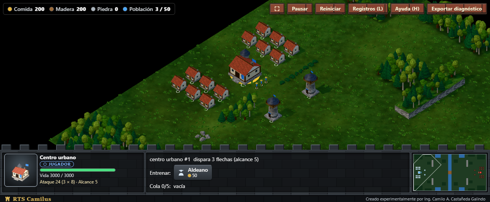
- **Aldeanas:** cada bando empieza con cuatro aldeanos, dos hombres y dos mujeres, y cada aldeano que entrena el centro urbano es hombre o mujer al azar (50/50, determinista con la semilla). La aldeana tiene su propio aspecto (toca blanca, corpiño del bando, falda y delantal) y la ficha dice «Aldeana». Las reglas son las mismas, pero su grito de muerte es una voz femenina propia (sintetizada, como el resto del audio).

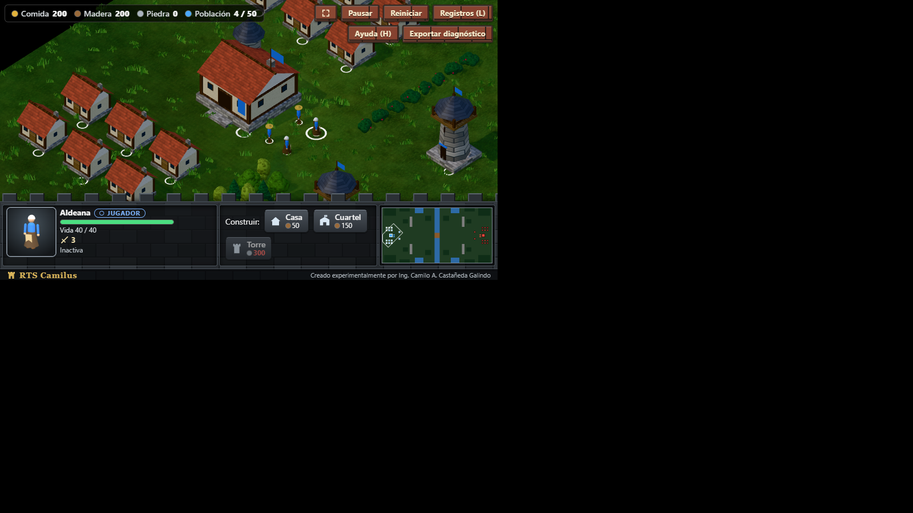
- **Aldeanos que atacan:** pueden atacar si el jugador se lo ordena con el clic derecho sobre un enemigo (el cursor cambia a espada); nunca atacan por su cuenta, salvo la defensa débil de siempre cuando los golpean. Al pelear se ve su golpe (antes se quedaban quietos aunque sí restaban vida) y se oye un puñetazo cuerpo a cuerpo; su daño es 5 por golpe (antes 3). El sonido de creación de unidades (la puerta) suena más fuerte.
- **Pantalla completa:** botón y tecla F; el estado del botón sigue al del navegador (si Esc la cierra, se actualiza).
- **Cursores de acción:** con aldeanos seleccionados, el cursor cambia a hacha sobre un árbol, cesta sobre un arbusto y pico sobre una roca; con aldeanos o militares seleccionados, a espada sobre un enemigo. Solo aparece si el clic derecho haría esa acción con la selección actual. Son SVG generados por código y no se ven en las capturas.
- **Botones de ladrillo:** mosaico SVG generado por código, texto crema con contraste mínimo de 4,5:1 y fila que se parte en varias líneas si la ventana es estrecha.
- **Vida doble:** los centros urbanos pasan de 1 500 a 3 000 y las torres de 800 a 1 600, para ambos bandos.

### Etapa 9: caballería y artillería

Capturas de la escena `?fixture=artilleria&ai=0` (navegador integrado de VS Code).

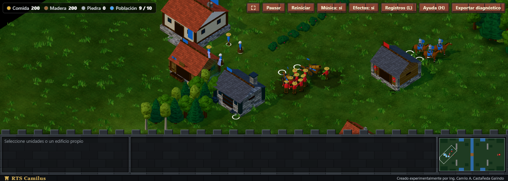

| Caballeros al galope | Cañones |
|---|---|
| 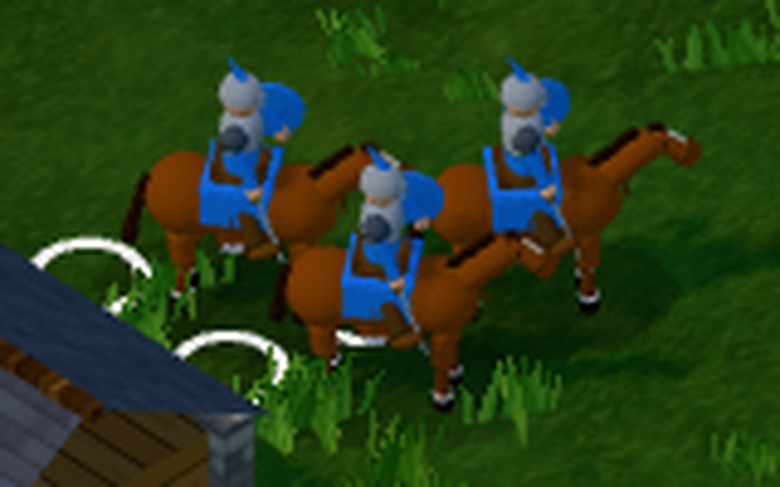 | 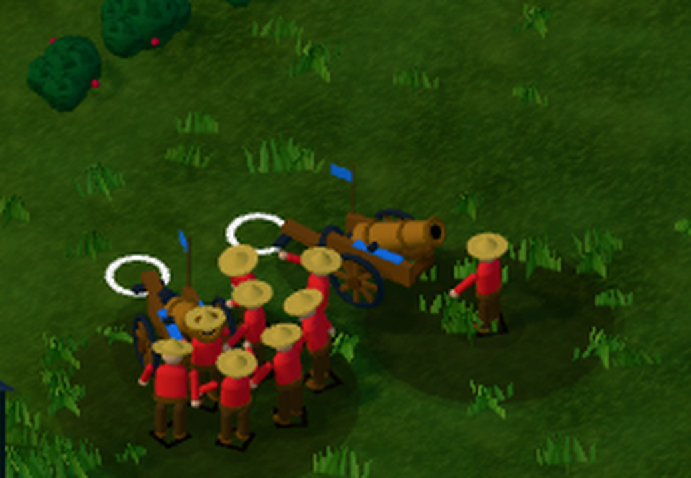 |

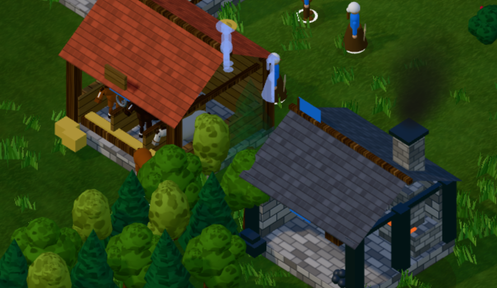

- **Establo** (175 de madera, 600 de vida): nave abierta con tres cuadras donde se ven **cuatro caballos** (castaño, oscuro y tordo; uno pasta fuera). Entrena **caballeros** (100 de comida y 50 de madera, 18 s). El caballero ataca igual que el soldado (daño 10, cada segundo, cuerpo a cuerpo) pero se desplaza al doble de velocidad (5 celdas/s). Tiene un caballo propio: cuerpo, cuello, cabeza, crin, cola, silla y cuatro patas articuladas con galope de cuatro tiempos, fase de suspensión, cabeceo, respiración y cola al viento; al parar se queda al paso, relincha al nacer (al morir suena la persona, no el caballo) y la espada suena al golpear.
- **Armería** (200 de madera y 100 de piedra, 700 de vida): taller abierto por el frente y un costado, con fragua de brasas, yunque, un tubo sobre caballetes y balas apiladas, y una **chimenea que echa humo constante** (apagada en calidad baja). Fabrica **cañones** (200 de madera y 150 de piedra, 30 s), la unidad más cara. Tienen 120 de vida, avanzan despacio (1,5 celdas/s) y disparan cada 3 s con un alcance de **7,5 celdas** (un 50 % más que el arquero) pero con una **distancia mínima de 2,5**: si el blanco está más cerca, el cañón retrocede antes de disparar.
- **Artillero:** cada cañón lo lleva una persona que lo empuja desde la cola al desplazarse y, antes de cada tiro, pasa junto a la culata y acerca la mecha encendida a la pólvora; tras el estampido se tapa un oído y se retira. Es solo un efecto visual: no es una unidad aparte, no cuenta población y desaparece con el cañón.
- **Bala y daño de área:** la bala sale de la boca del tubo, sigue una parábola rápida (12 celdas/s; entre 4 y 14 ticks de vuelo) y cae en el punto donde estaba el blanco al disparar. Hace 50 de daño en el centro, que baja hasta 25 en el borde del radio de 2 celdas; a los edificios les hace el doble. No hay fuego amigo, y la bala ya disparada impacta aunque el cañón muera.
- **Efectos:** el disparo tiene fogonazo con destello, chispas, humo y polvo, retroceso del tubo y respingo de la cureña; el impacto levanta una onda de choque, bola de fuego, humo, escombros, polvo y marcas de quemadura, y sacude la cámara y los edificios cercanos. Las unidades a menos de 2,5 celdas salen despedidas dando volteretas (solo efecto visual: no cambia las reglas ni el estado).
- **Sonido:** tres efectos nuevos sintetizados, el disparo del cañón, el estruendo del impacto y el relincho del caballo, con variantes y límite de voces simultáneas.
- **IA:** la política (policy-0.6) construye un establo y una armería, entrena caballeros y cañones (hasta 4), busca piedra para ellos, reserva madera para el cañón y hace que los caballeros esperen a que el cañón esté a unas 14 celdas del objetivo antes de cargar; también cuenta caballeros y cañones rivales como amenazas. El contrato con el worker sigue en la versión 2 (la observación ya llevaba todo; `rules` añade costes y huellas de las unidades y edificios nuevos) y la bala no se envía a Python. La IA solo se verificó con pruebas y partidas sin interfaz, no en el navegador.
- **Interfaz:** el panel ofrece construir establo y armería con sus costes, retratos 3D del caballero y del cañón, y la ayuda (H) describe las unidades nuevas.

### Etapa 10: Modo batalla

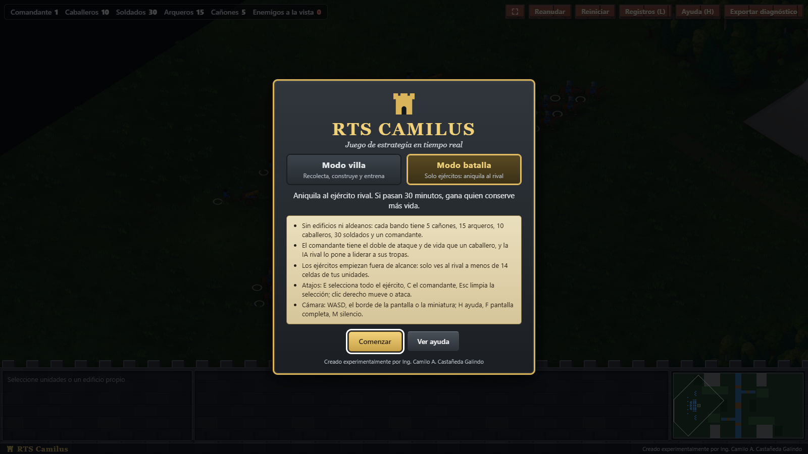

*Bienvenida con las dos tarjetas de modo (`?mode=battle` preselecciona la de batalla).*

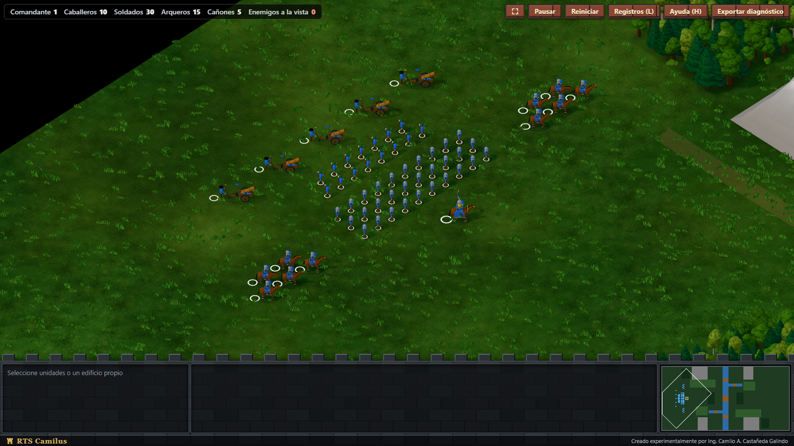

*Inicio del Modo batalla (`?mode=battle&welcome=0&ai=0`): el ejército formado, con el comandante delante, el contador de ejército y la miniatura con la niebla de guerra.*

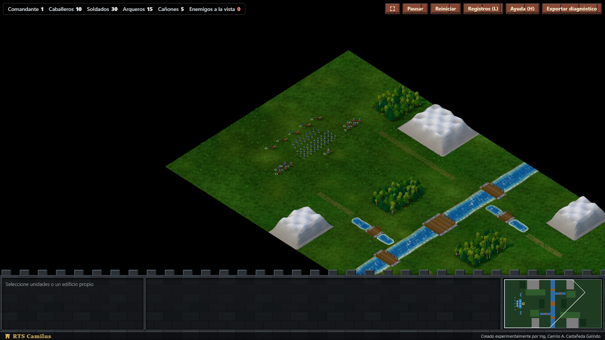

*Escena `?fixture=batalla&ai=0` con la cámara abierta: montañas, bosques, río con puentes y el ejército propio en el extremo oeste; el rival no se ve.*

| 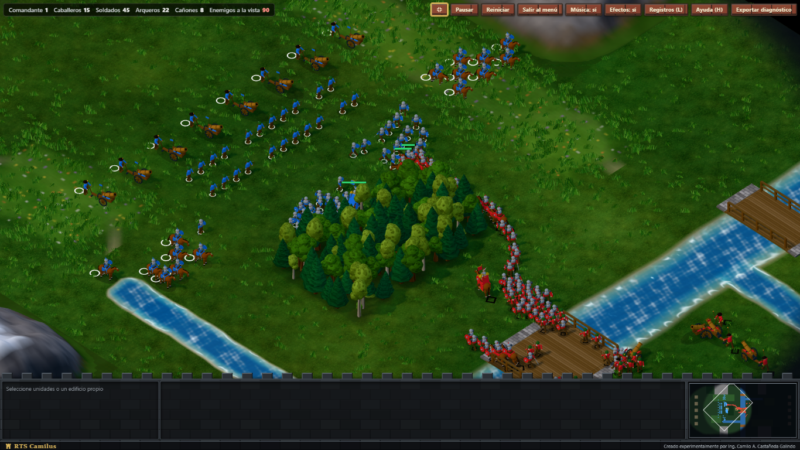 | 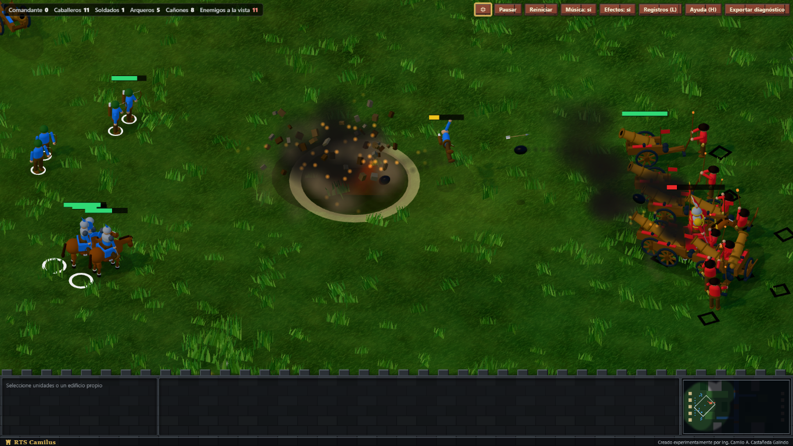 |
|---|---|
| *Partida en curso: el ejército azul avanza en formación hacia el puente del río, donde se concentra el rojo. Arriba a la derecha, el botón «Salir al menú».* | *Choque entre caballeros azules y una batería de cañones rojos: cráter y humo de un impacto, con el contador de ejército en la parte superior.* |

- **Elección de modo:** la bienvenida muestra dos tarjetas, «Modo villa» y «Modo batalla» (clic, flechas izquierda y derecha o Tab), con el objetivo y los consejos de cada una. Durante la partida, el botón «Salir al menú» de la barra superior (con confirmación en una partida en curso) abandona la partida y vuelve a esta elección; elegir cualquier modo empieza una nueva. Tras una partida, «Volver al menú» en la ventana final hace lo mismo. `?mode=battle` preselecciona el modo batalla.
- **Reglas:** sin edificios, aldeanos ni recursos. Cada bando tiene 8 cañones, 22 arqueros, 15 caballeros, 45 soldados y un comandante (91 unidades), formados en extremos opuestos del mapa y fuera de alcance de vista. Gana quien aniquila al ejército rival; a los 30 minutos (36 000 ticks) gana quien conserve más vida total y, si es igual, hay empate.
- **Comandante:** como un caballero con **cuatro veces** su ataque (40) y su vida (400, que con la resistencia del modo suben a 1 200), con uniforme de gala (penacho alto, coraza con ribetes dorados, hombreras, gola y capa con estandarte) y un caballo mayor con gualdrapa del bando.
- **Resistencia del modo:** en batalla, soldados, arqueros, caballeros, cañones y comandante tienen el triple de vida que en villa (300, 180, 300, 360 y 1 200) para que la batalla dure más. El modo villa no cambia.
- **Escenario:** mapa de 128x64 celdas con simetría de giro de 180° para que ningún bando tenga ventaja: montañas (con varias cumbres, roca, ladera y nieve) y bosques infranqueables, valles transitables con sendero y flores, y un río principal con tres puentes al que desemboca un afluente continuo por mitad (la conexión entre ejércitos se comprueba al arrancar).

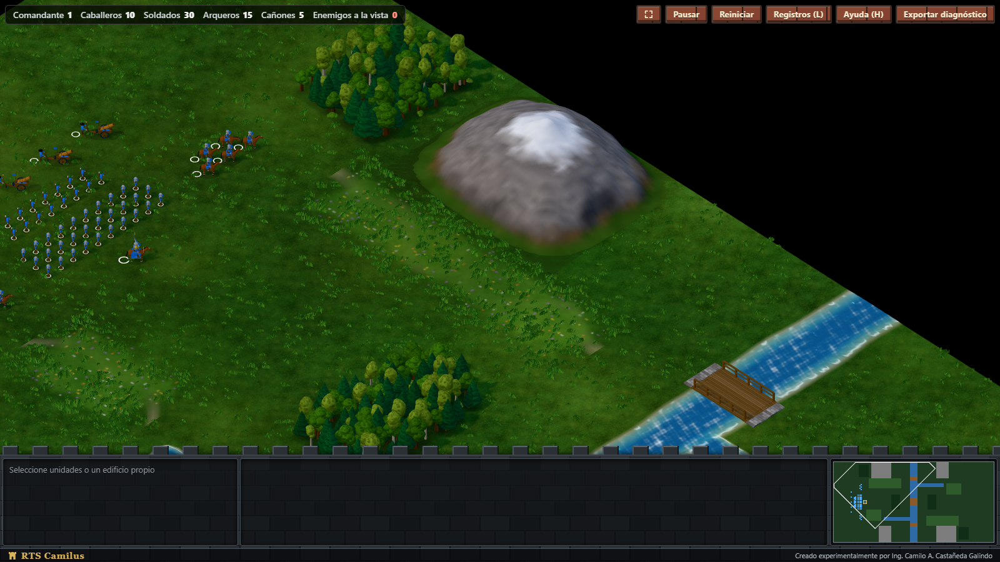

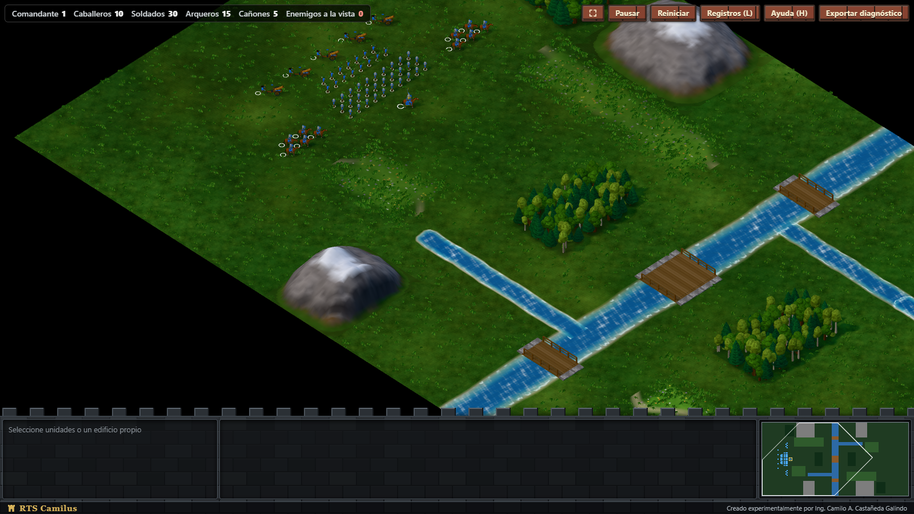

- **Niebla de guerra:** la escena se oscurece fuera de lo que ven tus unidades; lo ya explorado queda atenuado y lo desconocido casi negro. Las unidades normales ven 14 celdas y el **comandante 30**, un campo muy amplio. Un enemigo solo se ve dentro de esos radios (se oculta en la escena y en la miniatura, que también se oscurece) y la IA recibe la misma información que el jugador. `?fog=0` desactiva el velo visual (solo depuración).

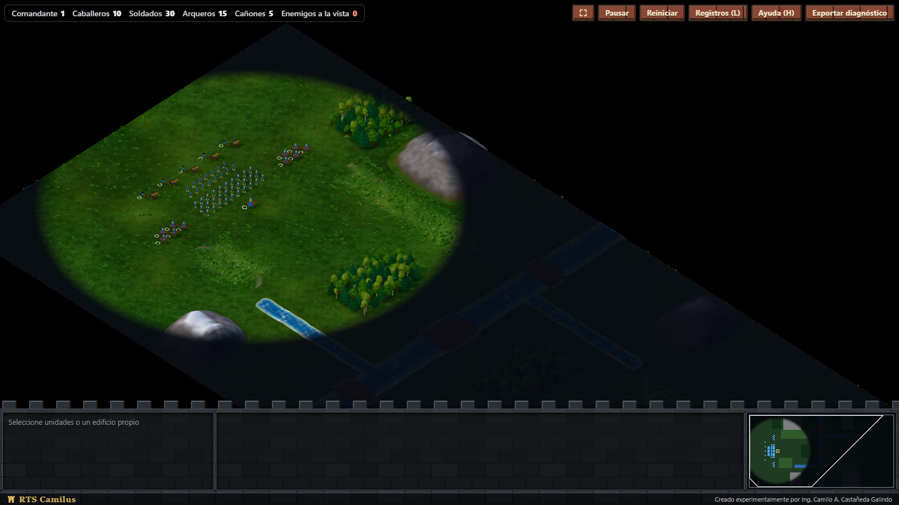
- **IA:** la política (policy-0.9) analiza el balance de fuerzas con lo que ve y elige un plan (marchar, mantener la línea, asaltar o replegarse sobre los cañones) según una personalidad (ofensiva, defensiva o envolvente) fijada por la semilla. Reparte órdenes por rol: el comandante lidera al frente y se retira si su vida baja del 40 % (si muere, el caballero más sano ocupa su lugar), los cañones disparan desde detrás de la línea, y soldados, arqueros y caballeros marchan, flanquean y asaltan. «Mantener la línea» ya no deja a nadie parado: toda unidad con un enemigo visible a 11 celdas o menos lo ataca, y los cañones sin infantería avanzan hacia el enemigo. Una orden de ataque repetida sobre el mismo blanco ya no reinicia la persecución (antes la IA repetía ~75 % de sus órdenes y la tropa trastabillaba). El contrato con el worker sigue en la versión 2. En simulación sin navegador gana 20 de 20 partidas a la carga ingenua (10 como cada jugador, semillas 1 a 10) y las partidas IA contra IA terminan en unos 1 100 a 1 450 ticks.
- **Tiendas de campaña:** cinco por bando detrás de cada ejército, como escenario fijo e indestructible (bloquean el paso; no son edificios ni se pueden atacar), con banderín azul o rojo según el bando.
- **Formación:** en batalla, un grupo que recibe una orden de mover avanza trasladando su forma (cada unidad conserva su puesto relativo) y al paso de la más lenta; al atacar cada una recupera su velocidad.
- **Interfaz:** contador de ejército (comandante, caballeros, soldados, arqueros, cañones y enemigos a la vista) en lugar de los recursos, ayuda distinta por modo, y ventana final con el resultado y las bajas de cada ejército.
- **Controles nuevos:** E selecciona todo el ejército y C selecciona el comandante y centra la cámara en él.
- **Sonido:** un cuerno de guerra suena al empezar la batalla y otro, más grave, al caer el comandante propio. Al morir un caballero o el comandante suena el grito de la persona, no el relincho; el cañón dispara con un estruendo más grave y explosivo.
- **Modo villa:** la simulación del modo villa se comprobó idéntica a la de la etapa 9 (mismo hash de partida) hasta añadir los militares iniciales (un soldado, un arquero, un caballero y un cañón por bando): los ids de aldeanos, nodos y edificios no cambian y el hash cambia solo por esas unidades.

| 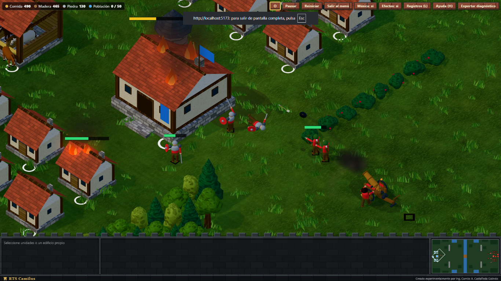 | 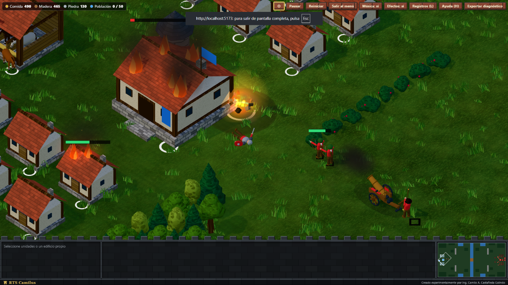 |
|---|---|
| *Modo villa: un soldado rojo y un cañón rival se acercan a la aldea azul.* | *Unos instantes después: casa en llamas y el botón «Salir al menú» en la barra superior.* |
## Controles

| Acción | Entrada |
|---|---|
| Pantalla completa | Tecla F o botón con icono de esquinas |
| Cámara | WASD o flechas, o cursor en el borde de la pantalla (24 px, 1,5 veces más rápido; hacia abajo, en el borde inferior de la pantalla, sobre la barra de abajo); rueda para acercar o alejar (hasta 7 veces); clic o arrastre en la miniatura |
| Registros técnicos | Tecla L o botón «Registros» |
| Seleccionar | Clic o arrastre; **doble clic** sobre una unidad propia selecciona las del mismo tipo a 12 celdas o menos; Shift suma o quita; Esc limpia (el clic en un edificio, enemigo o recurso solo muestra su retrato e información) |
| Ventana final | Tab recorre los botones, Intro reinicia, Esc cierra la ventana; el botón «Resultado» la reabre |
| Mover, recolectar, atacar, reanudar obra | Clic derecho según el objetivo |
| Construir | Seleccionar aldeanos y usar el panel inferior |
| Entrenar | Clic en un edificio propio |
| Ayuda | Tecla H o botón «Ayuda» |
| Modo batalla | E selecciona todo el ejército; C selecciona el comandante y centra la cámara |
| Audio | Tecla M silencia o reactiva todo; los botones «Música» y «Efectos» activan cada uno por separado (se recuerdan en el navegador) |

## Puesta en marcha

Requisitos: Node.js 22 y, para las pruebas de la política, Python 3.

```bash
npm install
npm run dev
```

Abre <http://localhost:5173/>. El primer arranque copia Pyodide 0.27.7 a `public/vendor` (no se versiona).

Parámetros de URL útiles:

| Parámetro | Efecto |
|---|---|
| `?ai=0` | Desactiva la IA |
| `?welcome=0` | Omite la ventana de bienvenida |
| `?mode=battle` | Preselecciona el Modo batalla en la bienvenida (por defecto, Modo villa) |
| `?audio=0` | Desactiva todo el audio |
| `?graphics=low` | Modo gráfico reducido (aspecto de la etapa 4): sin antialias, sombras, agua animada ni partículas, con menos decoración y flechas simples |
| `?shadows=0` | Desactiva solo las sombras proyectadas del modo gráfico alto |
| `?fixture=realismo&ai=0` | Escena de la etapa 5: edificios en llamas, derrumbes de casa, cuartel y torre, unidades y agua al sur |
| `?fixture=rio&ai=0` | Escena de la etapa 6: dos grupos de 20 unidades se cruzan por el puente y tres aldeanos intentan construir sobre el puente, junto a él y en la orilla |
| `?fixture=retratos&ai=0` | Escena de la etapa 7: unidades propias y rivales con vidas variadas, casa, cuartel y torre propios y rivales, y una obra de casa al 45 % |
| `?fixture=sonidos&ai=0` | Escena breve para oír todos los efectos (martillo, espada, flecha e impacto de flecha incluidos); añade `&final=victoria` o `&final=derrota` para oír los sonidos de fin de partida |
| `?fixture=artilleria&ai=0` | Escena de la etapa 9: establo y armería propios, tres caballeros que cabalgan, dos cañones que disparan sobre nueve aldeanos y dos edificios rivales |
| `?fixture=objetivo` | Escena de carga con IA: 100 unidades, 20 edificios y combate |
| `?fixture=batalla` | Escena de la etapa 10: los dos ejércitos completos del Modo batalla en sus posiciones iniciales |
| `?fixture=comandante` | Escena de la etapa 10: un caballero y un comandante por bando, para comparar uniformes |
| `?fixture=corridor20`, `crossing`, `crowd100`, `skirmish` | Escenas de prueba de navegación y combate, sin IA |

## Comandos

| Comando | Descripción |
|---|---|
| `npm run dev` | Servidor de desarrollo |
| `npm run build` | Comprobación de tipos y build de producción |
| `npm run typecheck` | TypeScript estricto |
| `npm test` | Pruebas de TypeScript (Vitest) |
| `npm run test:py` | Pruebas de la política Python (`unittest`) |

## Arquitectura

```
src/
  core/         Simulación determinista (estado, órdenes, economía, combate, fixtures)
  navigation/   Rejilla, rutas y movimiento
  content/      Balance y versiones
  ai-client/    Director y proveedor del worker; contrato de mensajes
  ai-worker/    Worker que carga Pyodide y ejecuta la política
  app/          Sesión de juego y bucle de ticks
  rendering/    Escena Three.js; portrait.ts dibuja el retrato de la selección en un segundo renderizador
  input/        Cámara, selección (describeSelection), cursores de acción (cursors.ts) y control de ratón y teclado
  ui/           Panel de órdenes con tarjeta de selección, avisos temporales, miniatura, ventana final (end-dialog.ts), bienvenida (welcome.ts), pantalla completa (fullscreen.ts), barra de castillo y botones de ladrillo (castle-bar.ts)
  audio/        Efectos, aves de fondo (ambient.ts) y música sintetizados con Web Audio; solo lee los eventos de la simulación
  diagnostics/  Métricas de rendimiento e informe exportable
python/policy/  Política de la IA (policy-0.9; battle.py es la del Modo batalla)
contracts/      Esquemas y fixtures del contrato del worker
tests/          Pruebas unitarias, de integración y de escenarios
```

El núcleo no depende del navegador ni de Three.js; el renderizado solo lee el estado.

Pila tecnológica: Vite 6, TypeScript 7 (modo estricto), Three.js 0.186, Pyodide 0.27.7 (Python 3.12), Ajv 8 y Vitest 4.

## Estado y mediciones

Incrementos completados: etapas 0 y 1 (base, navegación, IA en worker, economía, combate, rival completo y estabilización) y etapas 2 a 10 (mejoras visuales, defensa y recursos, sonido, realismo audiovisual, interfaz y mundo, bosques, retratos y castillo, identidad y pantalla, caballería y artillería, Modo batalla).

Pruebas: 588 de TypeScript y 109 de Python.

Medición en un equipo con Ryzen 5 5600H y RTX 3050, Chromium, 1366x768, escena `objetivo` durante unos 6 minutos (anterior a la etapa 2 y no repetida con el aspecto actual):

| Métrica | Resultado |
|---|---|
| FPS (mediana) | 60 |
| Cuadro p95 | 16,8 ms |
| Tick p95 | 0,5 ms |
| IA, ida y vuelta p95 | 12 ms (política 11,4 ms) |
| Partida de 24 000 ticks con dos IA | Sin violaciones de reglas y reproducible |
| Diez reinicios seguidos | Un solo worker y memoria estable |

En la etapa 7 solo se midió la fluidez de la partida por defecto en el navegador integrado de VS Code (ventana de unos 870x490 px, con IA, 8 s tras cargar): 300 cuadros con mediana de 16,7 ms, p95 de 16,8 ms y máximo de 17,1 ms (60 FPS). No se ha medido a 1920x1080 ni en una partida larga con 36 000 ticks en el navegador.

En simulación sin navegador (horizonte de 36 000 ticks), con la vida doble y cuatro aldeanos iniciales por bando (etapa 8): la IA gana al jugador pasivo en el tick 9 987 (6 178 en la etapa 7) y dos IA enfrentadas (semilla 5) llegan al límite y empatan en el tick 36 000 (en la etapa 7 terminaban en el tick 24 596), sin violaciones de reglas. No se comprobó la reproducción de esa partida concreta; la prueba de estabilidad sí reproduce con el mismo hash una partida de 36 000 ticks con centros urbanos indestructibles.

En la etapa 8 la verificación en el navegador integrado se limitó a lo visible (bienvenida, vista inicial, botones, pantalla completa y cursores de hacha, cesta y pico); el cursor de espada solo se probó con pruebas unitarias y no se midió el rendimiento.

En la etapa 9 la IA usa las unidades nuevas, así que las cifras cambian: gana al jugador pasivo en el tick 10 283 (9 987 en la etapa 8; construye establo y armería y entrena caballeros y cañones, sin órdenes rechazadas) y dos IA enfrentadas (semilla 5) siguen sin resolverse: a 24 000 ticks nadie ha ganado y con centros urbanos indestructibles llegan al límite de 36 000 con empate, sin violaciones de reglas, cada una con caballeros y cañones. En el navegador integrado se comprobó visualmente la escena `artilleria` (caballeros, cañones, disparo, impacto y unidades lanzadas); el panel de diagnóstico marcó una mediana de 60 FPS y un tick p95 de 0,2 ms en esa escena, una medición breve y sin repetir en una partida larga. No se comprobó en el navegador una partida contra la IA nueva. El sonido nuevo solo se probó con pruebas automáticas, no al oído.

## Limitaciones conocidas

- Solo se ha probado en Chromium; Firefox queda pendiente.
- El nombre «RTS Camilus» es provisional.
- Los retratos usan un segundo contexto WebGL; si no está disponible o se pierde, se muestra un dibujo 2D sencillo en su lugar.
- El audio es procedural y su mezcla está pendiente de la valoración auditiva del autor; el navegador solo lo activa tras el primer clic o tecla.
- Existe un único nivel de IA; no se ha medido la dificultad ni la diversión.
- La escena `objetivo` pierde unidades durante el combate, así que los p95 cubren toda la medición y no solo el pico de 100 unidades.
- Fuera de alcance por ahora: mantener posición, mover atacando y, en el Modo villa, niebla de guerra (solo existe en el Modo batalla).
- La IA del Modo batalla se verificó con pruebas y partidas sin interfaz; en el navegador solo se comprobó visualmente el arranque, la selección del comandante y la ventana final, no una batalla completa. El cuerno de guerra solo se probó con pruebas automáticas, no al oído.

## Licencia

Copyright © 2026 Camilo A. Castañeda Galindo. Publicado bajo la [PolyForm Strict License 1.0.0](LICENSE).

El código se puede leer, estudiar y ejecutar con fines no comerciales, pero **no se puede copiar, distribuir, modificar ni usar para crear obras derivadas** sin permiso escrito del autor. No es una licencia de código abierto: el repositorio se publica para mostrar el trabajo y servir de ejemplo.
