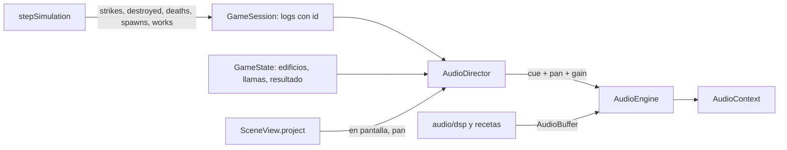

# RTS — SDD de la etapa 4: efectos de sonido y música ambiental

**Versión del SDD:** P4-1.3  
**Versión objetivo del juego:** `p4.0.0`  
**Estado:** especificación propuesta; sin implementación ni pruebas en esta entrega.  
**Rama de desarrollo:** `efectos_sonido`, creada desde `main` (que ya contiene la etapa P3, commit `139abac`).  
**Base funcional:** RTS P3, mapa 128 × 64, simulación lógica en TypeScript a 20 ticks/s, estrategia Python en Pyodide, render Three.js procedural.

## 1. Propósito

Añadir audio al juego, hoy sin sonido: efectos asociados a combate, economía, construcción, producción e incendios, y una música de fondo de estilo medieval. El audio es una capa de presentación: lee los eventos de la simulación y no decide daño, recolección, construcción, navegación ni victoria.

Coherente con P2 y P3, el audio es **procedural**: no se incorporan archivos de sonido externos ni dependencias nuevas. Los efectos y los instrumentos de la música se sintetizan en código con la Web Audio API y rutinas de procesamiento de señal propias.

## 2. Alcance

| ID | Requisito |
|---|---|
| P4-R01 | Golpe de espada cuando un soldado ataca. |
| P4-R02 | Sonido de flecha cuando atacan un arquero, una torre o el centro urbano. |
| P4-R03 | Grito sutil cuando muere un militar o un aldeano. |
| P4-R04 | Campana cuando el jugador es atacado. |
| P4-R05 | Martilleo mientras se construye. |
| P4-R06 | Hacha mientras se talan árboles. |
| P4-R07 | Pica mientras se extrae piedra (minería). |
| P4-R08 | Fuego mientras un edificio se incendia. |
| P4-R09 | Abrir y cerrar de puerta cuando un edificio entrena una persona (aldeano o militar). |
| P4-R10 | Regla común: todos los efectos, salvo la campana, la puerta y los de fin de partida, suenan si el elemento que los produce está visible en pantalla, sea del jugador o de la IA. La campana solo suena cuando el jugador es atacado y la puerta solo cuando el jugador crea una unidad. |
| P4-R11 | Música de fondo medieval, en bucle, con instrumentos de época sintetizados. |
| P4-R12 | Infraestructura de audio: desbloqueo por gesto del usuario, silenciado, pausa, límite de voces y degradación sin audio. |
| P4-R13 | Sonido de recolección mientras se recolecta alimento (arbustos). |
| P4-R14 | Sonido de golpe cuando un aldeano se defiende. |
| P4-R15 | Sonido de derrumbe cuando un edificio es destruido. |
| P4-R16 | Un sonido de victoria cuando el jugador gana la partida y otro, distinto, cuando la pierde. |

### 2.1 Decisiones explícitas

- **Quién suena:** los efectos de espada, flecha, golpe del aldeano, grito, martilleo, hacha, pica, alimento, fuego y derrumbe suenan para **ambos bandos**, siempre que el elemento que los produce esté visible en pantalla. Solo hay dos excepciones: la **puerta** (creación de unidades) suena únicamente cuando el jugador crea una unidad, y la **campana** solo cuando el jugador es atacado (un ataque del jugador a la IA no la activa). La regla se concentra en la constante `PLAYER_ONLY_CUES = ["door", "bell"]`; cualquier otro cue es audible para los dos bandos.
- **«Visible en pantalla»:** la posición del elemento productor, proyectada con la cámara actual, cae dentro del encuadre del canvas con un margen de 0,05 en coordenadas normalizadas (para absorber la altura del modelo). Estar tapado por un edificio no cuenta como «no visible». No hay niebla de guerra en el juego, así que no existe otra noción de visibilidad.
- **Elemento productor por efecto:** atacante (espada, flecha, golpe del aldeano), unidad que muere en su posición final (grito), constructor (martilleo), recolector (hacha, pica, alimento), edificio (fuego, puerta, derrumbe). La campana no tiene productor y no se condiciona a la vista.
- **Fin de partida:** el resultado se mira desde el jugador 0 (`state.outcome.winner`). Gana, pierde o empata (límite de tiempo o ambos centros urbanos destruidos); el empate reproduce el sonido de derrota, por no ser una victoria. Suena una vez por partida, no se condiciona a la vista y arranca 1,0 s después del fin para que se oiga el derrumbe del último centro urbano.
- **Aldeano que se defiende:** cada golpe de su contraataque (ya existente desde P3, solo reactivo) produce un sonido propio, un golpe seco y contundente de herramienta o palo, distinto de la espada. No se usa el sonido de espada, que sigue siendo exclusivo del soldado.
- **Alimento:** recolectar arbustos produce un sonido de recolección propio (roce de hojas y chasquido de rama), uno por unidad de alimento obtenida.
- **Centro urbano armado:** dispara 3 flechas por disparo y el núcleo emite 3 `StrikeEvent` con el mismo atacante y tick. El audio los agrupa en una salva y reproduce **tres** sonidos de flecha, el primero al momento del disparo y cada siguiente **0,5 s** después del anterior (en 0, 0,5 y 1,0 s). El escalonado es solo sonoro: el daño y el abanico visual de flechas no cambian. La salva completa (1,0 s) cabe en la cadencia del arma (1,5 s), de modo que dos salvas no se solapan. La visibilidad se evalúa una sola vez, al momento del disparo.
- **Piedra = minería:** el efecto de pica se asocia a recolectar nodos de piedra.
- **Cadencia del martilleo:** un golpe cada 10 ticks (0,5 s) de trabajo efectivo. **Hacha, pica y alimento:** un sonido por unidad de recurso recolectado (cada `harvestIntervalTicks` = 20 ticks, 1 s).
- **Estado del juego intacto:** los eventos nuevos son datos de salida de `stepSimulation`, igual que `strikes` y `destroyed`. No entran en el estado, en el hash, en la observación de Python ni en el contrato `worker-v2`. Con las mismas órdenes, la partida produce el mismo `hashState` que antes de P4.
- **Aleatoriedad del audio:** variaciones de tono y volumen usan un generador propio con semilla, separado del de la simulación. No consume ni altera la semilla del juego.
- **Rama y publicación:** se trabaja en `efectos_sonido`. No se hace merge, push ni publicación como parte de esta especificación; se requerirá instrucción expresa.
- **Pruebas:** verificaciones breves y dirigidas, como en P3. La calidad estética del sonido la juzga el autor al escucharlo; la automatización solo cubre lógica y sanidad de señal (§7).

### 2.2 Fuera de alcance

Voces habladas, sonido de selección u órdenes, sonido de interfaz (botones, mensajes), sonido de pasos, ambiente (viento, agua, pájaros), sonido posicional 3D con HRTF, varias pistas musicales o música dinámica según el estado de la partida, archivos de audio externos, cambios en la política Python, el contrato `worker-v2`, el balance o el mapa.

## 3. Historias y criterios de aceptación

### P4-H01 — Espada del soldado (P4-R01)

**Como jugador**, quiero oír el choque de acero cuando los soldados, míos o rivales, golpean.

- **CA01:** cada `StrikeEvent` con `attackerKind = "soldier"` genera un golpe de espada si el soldado, de cualquier bando, está en pantalla; el objetivo puede ser unidad o edificio.
- **CA02:** el sonido es un impacto metálico breve (≤ 0,4 s) con 3 variantes de timbre para que ataques sucesivos no suenen idénticos.
- **CA03:** soldados de ambos bandos suenan igual; los que están fuera de pantalla no suenan.
- **CA04:** el sonido sale en el tick en que se aplica el daño y no se retrasa ni se repite entre cuadros.

### P4-H02 — Flechas de arquero, torre y centro urbano (P4-R02)

**Como jugador**, quiero oír las flechas cuando arqueros, torres y centros urbanos, propios o rivales, disparan.

- **CA01:** un `StrikeEvent` con `attackerKind = "archer"` o `"tower"` genera un sonido de flecha (cuerda y silbido, ≤ 0,5 s) si el atacante, de cualquier bando, está en pantalla. `"tower"` cubre también al centro urbano armado.
- **CA02:** los 3 `StrikeEvent` de un disparo del centro urbano (mismo `attackerId` y mismo `tick`) se agrupan en una salva de tres sonidos de flecha: el primero en el instante del disparo, el segundo 0,5 s después y el tercero 0,5 s después del segundo. Un disparo de arquero o torre produce un único sonido.
- **CA03:** la posición de visibilidad es el origen del disparo (`from`), no el del objetivo.
- **CA04:** los disparos de ambos bandos suenan igual; los que ocurren fuera de pantalla no suenan.
- **CA05:** los dos sonidos diferidos se programan en el reloj del `AudioContext`: una pausa los congela junto con el resto, y un reinicio o el fin de partida los cancela. Si el centro urbano se destruye entre medias, los pendientes se reproducen igualmente (el disparo ya ocurrió) salvo reinicio. Cada flecha de la salva usa una variante distinta de timbre.

### P4-H03 — Grito al morir (P4-R03)

**Como jugador**, quiero un lamento discreto cuando cae una unidad, mía o rival.

- **CA01:** cada unidad de cualquier bando retirada del estado por vida cero (aldeano, soldado o arquero) emite exactamente un evento de muerte y un grito, si estaba en pantalla en el momento de morir.
- **CA02:** el grito es sutil: volumen bajo respecto a los demás efectos (≈ −12 dB frente a espada y flecha), duración ≤ 0,8 s, con descenso de tono. Hay variantes aguda (aldeano) y grave (militar), cada una con tonos ligeramente distintos.
- **CA03:** las muertes de ambos bandos suenan igual; las que ocurren fuera de pantalla no suenan. Los edificios destruidos no emiten grito.
- **CA04:** muertes simultáneas respetan los límites de voces de §4.4; no se acumulan gritos en una masacre.

### P4-H04 — Campana de alarma (P4-R04)

**Como jugador**, quiero una alarma cuando me atacan aunque el combate esté fuera de mi vista.

- **CA01:** un `StrikeEvent` con `attackerOwner = 1` y objetivo propiedad del jugador 0 (unidad o edificio) dispara la campana, sin comprobar la vista. El mismo golpe produce además su efecto de combate si el atacante está en pantalla.
- **CA02:** la campana es un tañido de dos golpes (segundo golpe ≈ 0,45 s después y más grave) con parciales inarmónicos y decaimiento de unos 2,5 s.
- **CA03:** separación mínima de 8 s entre campanadas, medida en tiempo de audio y de modo que una pausa no la reinicie ni la acorte. Impactos sucesivos durante ese intervalo no encolan más campanadas.
- **CA04:** la campana tiene la máxima prioridad y su volumen queda por encima de la música.
- **CA05:** ataques del jugador contra la IA, o disparos de torres propias, no hacen sonar la campana.

### P4-H05 — Trabajo: martillo, hacha, pica y recolección de alimento (P4-R05 a P4-R07, P4-R13)

**Como jugador**, quiero distinguir por el sonido qué hacen los aldeanos, míos o rivales, mientras están a la vista.

- **CA01:** un aldeano de cualquier bando que construye (etapa `work` de un trabajo de construcción) genera un golpe de martillo cada 10 ticks, si está en pantalla.
- **CA02:** un aldeano de cualquier bando que recolecta madera genera un golpe de hacha por recurso obtenido; si recolecta piedra, un golpe de pica; si recolecta alimento, un sonido de recolección (roce de hojas y chasquido de rama).
- **CA03:** no suena nada durante la aproximación, el regreso con la carga, la entrega ni cuando el trabajo está bloqueado o cancelado.
- **CA04:** los cuatro sonidos son claramente distintos: martillo (golpe seco agudo sobre clavo), hacha (golpe grave sobre madera con grieta corta), pica (tintineo metálico sobre roca) y recolección de alimento (roce suave de follaje, el más discreto de los cuatro). Duración ≤ 0,35 s y 2 variantes cada uno.
- **CA05:** con muchos aldeanos trabajando, el límite de voces de §4.4 evita saturación sin perder la sensación de actividad.

### P4-H06 — Fuego de edificios (P4-R08)

**Como jugador**, quiero oír crepitar el fuego en los edificios dañados, míos o rivales, que tengo a la vista.

- **CA01:** un edificio completo de cualquier bando con `flameCount(hp, max, complete) > 0` reproduce un bucle de fuego mientras esté en pantalla. La intensidad crece con el número de llamas (1 a 5).
- **CA02:** el bucle entra y sale con fundido (≈ 0,2 s) cuando el edificio entra o sale de la pantalla, deja de arder por reparación (si la regla del juego lo permitiese) o desaparece por destrucción. No queda ningún bucle huérfano.
- **CA03:** como máximo 3 bucles de fuego simultáneos; si hay más edificios ardiendo, suenan los 3 más cercanos al centro de la pantalla.
- **CA04:** las obras en construcción no arden, de acuerdo con la regla visual existente, y por lo tanto no suenan.
- **CA05:** el bucle no presenta clic ni salto audible al repetirse.
- **CA06:** los edificios de ambos bandos que arden suenan igual; el límite de 3 bucles se reparte entre todos los visibles, sin distinguir bando.

### P4-H07 — Puerta al entrenar (P4-R09)

**Como jugador**, quiero oír salir a mi nueva unidad del edificio.

- **CA01:** cuando un edificio del jugador 0 completa un entrenamiento y la unidad entra al estado, se emite un evento de nacimiento y suena una puerta: chirrido de apertura, golpe del pestillo y cierre al cabo de unos 0,6 s; en total ≤ 1,2 s.
- **CA02:** suena para aldeanos (centro urbano) y militares (cuartel) por igual, solo si el edificio productor está en pantalla.
- **CA03:** una unidad que no logra salir (sin celda de salida libre) no genera el evento hasta que realmente aparece.
- **CA04:** el evento se emite una sola vez por unidad creada.
- **CA05:** es un efecto exclusivo del jugador: las unidades que crea la IA no producen sonido de puerta, aunque el edificio esté en pantalla.

### P4-H08 — Música medieval sintetizada (P4-R11)

**Como jugador**, quiero una música de fondo de aire medieval que acompañe la partida sin cansar.

- **CA01:** una pista única en bucle de unos 100 s, sin silencios largos ni salto audible al cerrar el bucle. Compás 6/8, negra con puntillo = 72, modo dórico en re (re mi fa sol la si do).
- **CA02:** instrumentos sintetizados con timbres de época: laúd (cuerda pulsada, Karplus–Strong), flauta dulce (onda casi sinusoidal con soplido y vibrato tardío), zanfona o gaita (zumbido sostenido con ondas de sierra desafinadas y filtro paso bajo) como bordón en re–la, salterio (cuerda pulsada brillante) para contramelodía y tamboril (pandero de marco) para el ritmo. Una reverberación de sala suave une la mezcla.
- **CA03:** no se usan baterías, sintetizadores modernos ni armonías ajenas al modo (sin tríadas mayores de dominante con sensible).
- **CA04:** la música tiene forma (ver §4.3) y no repite un compás idéntico más de cuatro veces seguidas.
- **CA05:** la generación es determinista: la misma semilla produce la misma señal muestra a muestra.
- **CA06:** el nivel por defecto de la música queda por debajo de los efectos; la campana y los golpes de combate siempre se distinguen sobre ella.
- **CA07:** la generación no congela el juego: se hace en segundo plano y la música aparece con un fundido de entrada cuando está lista. Si falla, el juego continúa en silencio y lo indica en el HUD.

### P4-H09 — Control, desbloqueo y degradación (P4-R12)

**Como jugador**, quiero controlar el audio y que el juego no falle cuando no pueda sonar.

- **CA01:** el `AudioContext` se crea o se reanuda con el primer gesto del usuario (`pointerdown` o `keydown`), conforme a la política de reproducción automática de los navegadores. Antes de ese gesto el audio está «bloqueado» y los eventos se descartan, no se encolan.
- **CA02:** botones **Música** y **Efectos** en los controles (activos por defecto), y atajo `M` que silencia o restaura todo. El estado se guarda en `localStorage` bajo una clave versionada; si el almacenamiento falla, se usa el valor por defecto sin lanzar error.
- **CA03:** al pausar (botón, pestaña oculta o fallo) el contexto se suspende; al reanudar continúa. Al terminar la partida no se generan efectos nuevos (la simulación se detiene), los bucles de fuego se cortan, suena el sonido de victoria o derrota de P4-H12 y la música sigue con volumen reducido al 30 %.
- **CA04:** al reiniciar la partida se detienen todos los bucles de efectos y se vacían los estados del audio; la música no se interrumpe.
- **CA05:** los eventos de la simulación se consumen **siempre** por identificador creciente, aunque el audio esté bloqueado, silenciado o suspendido, para que al volver a sonar no estalle una ráfaga acumulada.
- **CA06:** `?audio=0` en la URL desactiva todo el audio (como `?graphics=low` con el render). Sin `AudioContext` en el navegador el juego funciona igual y el HUD muestra «Audio: no disponible».
- **CA07:** el HUD añade una línea breve: estado (`activo` / `bloqueado` / `silenciado` / `no disponible`), voces activas y eventos descartados por límite.
- **CA08:** el texto de ayuda de `index.html` y la sección de limitaciones del README dejan de afirmar «sin audio» y describen los controles.

### P4-H10 — Golpe del aldeano al defenderse (P4-R14)

**Como jugador**, quiero oír a los aldeanos, míos o rivales, defenderse cuando los atacan.

- **CA01:** cada `StrikeEvent` con `attackerKind = "villager"` genera un golpe sordo (`blow`) si el aldeano, de cualquier bando, está en pantalla. Como el aldeano solo ataca de forma reactiva, suena únicamente en defensa.
- **CA02:** el sonido es breve (≤ 0,3 s), sordo y sin resonancia metálica, con 2 variantes, para distinguirlo de la espada del soldado.
- **CA03:** los aldeanos de ambos bandos suenan igual; los que están fuera de pantalla no suenan.
- **CA04:** si el aldeano es golpeado por un rival del bando 1, la campana de P4-H04 suena además según sus propias reglas.

### P4-H11 — Derrumbe de edificios (P4-R15)

**Como jugador**, quiero oír caer los edificios destruidos, míos o rivales, que tengo a la vista.

- **CA01:** cada edificio de cualquier bando que sale del estado por vida cero (`BuildingDestroyedEvent`, el mismo evento que inicia el colapso visual de P3-H04) genera un derrumbe, si el centro de su huella está en pantalla en ese momento. Una obra sin terminar (`complete = false`) también suena, con la variante pequeña.
- **CA02:** el sonido acompaña la animación de colapso: arranca con ella, dura lo mismo que su animación (entre 0,8 s para una obra y 1,5 s para el centro urbano, según la huella) y su cola puede extenderse hasta 0,4 s más. Hay dos variantes: pequeña (casa, torre, obra) y grande (cuartel, centro urbano), esta última más grave y prolongada.
- **CA03:** el derrumbe se compone de un rumor grave, crujidos de madera, caída de escombros y un golpe sordo final cercano al 70 % de la duración.
- **CA04:** si el edificio ardía, el bucle de fuego de P4-H06 se detiene en el mismo cuadro y es el derrumbe el que lo sustituye, sin superposición de fundidos largos (el fundido de salida del fuego se acorta a 0,1 s).
- **CA05:** el derrumbe suena igual para edificios de ambos bandos; los que caen fuera de pantalla no suenan.
- **CA06:** el sonido se emite una vez por evento (por su `seq` en el registro), sin repetirse si el cuadro se reprocesa; un reinicio cancela el sonido en curso.
- **CA07:** no cambia las reglas: el edificio sigue saliendo del estado en el mismo tick, sin retraso por el sonido.

### P4-H12 — Sonidos de victoria y derrota (P4-R16)

**Como jugador**, quiero que el final de la partida se anuncie con un sonido que me diga si gané o perdí.

- **CA01:** cuando `state.matchStatus` pasa a `"ended"` y `state.outcome.winner = 0`, suena el sonido de **victoria**; si `winner = 1`, el de **derrota**; si `winner = null` (empate por límite de tiempo o por caída de ambos centros urbanos), también el de derrota.
- **CA02:** los dos sonidos son claramente distintos. Victoria: fanfarria ascendente de trompeta natural y chirimia sobre quintas abiertas, con tamboril, de ≈ 4 s, brillante y luminosa. Derrota: tema grave y lento descendente de cuerno y bordón sobre el modo, con tamboril apagado, de ≈ 5 s, sombrío y que se apaga. Ninguno usa el timbre de la campana de alarma.
- **CA03:** suena una sola vez por partida, aunque la vista se actualice después del fin (se detecta por `outcome.endTick`), y sin condicionarse a la vista.
- **CA04:** arranca 1,0 s después del fin de la partida, programado en el reloj del `AudioContext` (una pausa lo congela), para que se oiga antes el derrumbe del último centro urbano. Un reinicio lo cancela.
- **CA05:** mientras suena, la música baja al 10 % de su nivel y vuelve al 30 % cuando termina (mantiene el 30 % de P4-H09 CA03 como estado final); es el único sonido de efectos que se reproduce tras el fin.
- **CA06:** tiene la prioridad más alta (6) y no usa panorama ni atenuación. No cambia el overlay de resultado ni ninguna regla del juego.
- **CA07:** respeta los botones **Efectos** y la tecla `M`: silenciados, no suena.

## 4. Diseño técnico y contratos

### 4.1 Flujo de datos

TypeScript sigue siendo la autoridad de las reglas. `AudioDirector` solo lee. Python y el worker no se enteran de que existe el audio.

### 4.2 Eventos nuevos del núcleo

Se extiende `StepResult` con listas de salida, igual que `strikes` y `destroyed`. Ninguna entra en `GameState`, en `hashState` ni en `STATE_SCHEMA_VERSION`. El derrumbe no necesita evento nuevo: reutiliza `destroyed` (`BuildingDestroyedEvent` con `tick`, `id`, `owner`, `kind`, `cell`, `complete`) y `GameSession.destroyedLog` ya existentes.

| Evento | Cuándo se emite | Campos |
|---|---|---|
| `StrikeEvent` (ampliado) | Sin cambios de regla; se añade `targetOwner`. | `…`, `targetOwner: PlayerId` |
| `DeathEvent` | En `removeDead`, una vez por unidad con `hp ≤ 0`. | `tick`, `id`, `owner`, `kind`, `pos` |
| `SpawnEvent` | En `updateProduction`, cuando `addUnit` crea la unidad. | `tick`, `buildingId`, `unitId`, `owner`, `kind`, `pos` (celda de salida) |
| `WorkEvent` | Construcción: cuando `buildDone % 10 === 0` tras avanzar la obra. Recolección: en el tick en que `node.remaining` disminuye. | `tick`, `unitId`, `owner`, `kind: "build" \| "wood" \| "stone" \| "food"`, `pos` |

`GameSession` guarda cada lista con identificador creciente y un límite de retención (64 elementos para las nuevas), igual que `strikeLog` y `destroyedLog`. Las posiciones se capturan en el momento del evento, de modo que la unidad ya retirada del estado no hace falta para decidir la visibilidad. `GameState` no cambia, por lo que fixtures y guardados previos siguen siendo válidos.

### 4.3 Estructura del módulo de audio

Nuevo directorio `src/audio/`, con lógica pura separada de la Web Audio API para poder probarla en Node:

| Archivo | Responsabilidad |
|---|---|
| `cues.ts` | Tipos `CueId`, prioridades y la función pura que traduce eventos y estado en señales (`CueRequest`: cue, pan, ganancia, variante). Aplica `PLAYER_ONLY_CUES` (puerta y campana), la visibilidad, la agrupación de las 3 flechas del centro urbano en una salva escalonada 0,5 s y el espaciado de la campana. |
| `voices.ts` | `VoiceGate`: tope global de voces, tope y separación mínima por cue, robo de voces de menor prioridad. Reloj inyectado. |
| `dsp.ts` | Primitivas: PRNG con semilla, osciladores, ruido, envolventes, filtros biquad, Karplus–Strong, peines y pasa-todo para la reverberación, normalización. Operan sobre `Float32Array` sin Web Audio. |
| `sfx.ts` | Receta de cada efecto: devuelve el buffer de cada variante (§4.5). |
| `music.ts` | Partitura como datos (lista de notas por instrumento) y su render a estéreo en bucle (§4.6). |
| `engine.ts` | `AudioEngine` sobre `AudioContext`: desbloqueo, cadena maestra, reproducción de buffers con tono, volumen y retardo programado en el reloj del contexto, bucles de fuego con fundido, música, silenciado, suspensión. Acepta un contexto inyectado para pruebas. |
| `director.ts` | `AudioDirector`: consume los registros de `GameSession` por id (incluido `destroyedLog` para el derrumbe), calcula llamas por edificio, detecta el fin de la partida (una vez por `outcome.endTick`), consulta la vista y llama al motor. |
| `settings.ts` | Lectura y escritura de preferencias en `localStorage` con valores por defecto. |

`SceneView` expone una única función nueva, `project(x, z)`, que devuelve la posición normalizada del punto del suelo en pantalla (usa la cámara ortográfica existente). No modifica el renderizado. `main.ts` crea el director junto a la sesión y lo reinicia al reiniciar la partida, sin recrear el motor.

Los buffers de efectos se sintetizan una vez en la carga y se reproducen con `AudioBufferSourceNode`. Variaciones de tono (±6 % de `playbackRate`) y volumen (±1 dB) evitan la repetición sin crear nodos de síntesis por golpe.

### 4.4 Mezcla, prioridades y límites

| Cue | Prioridad | Tope simultáneo | Separación mínima | Ganancia relativa |
|---|---|---|---|---|
| `bell` | 5 | 1 | 8 s | 1,0 |
| `victory`, `defeat` | 6 | 1 | — | 1,0 |
| `death` | 4 | 4 | 120 ms | 0,45 |
| `collapse` (derrumbe) | 4 | 3 | 150 ms | 0,9 |
| `door` | 3 | 3 | 200 ms | 0,7 |
| `sword`, `arrow` | 2 | 8 | 50 ms | 0,8 |
| `blow` (golpe del aldeano) | 2 | 4 | 80 ms | 0,6 |
| `hammer`, `axe`, `pick` | 1 | 6 | 80 ms | 0,6 |
| `forage` (alimento) | 1 | 4 | 80 ms | 0,4 |
| `fire` (bucle) | 0 | 3 bucles | — | 0,25 a 0,6 según llamas |

- **Tope global:** 24 voces. Con el tope alcanzado, una señal de prioridad mayor sustituye a la voz más antigua de prioridad menor; si no hay ninguna, se descarta la nueva y se cuenta como descartada.
- **Panorama:** `pan = clamp(ndc.x × 0,7, −0,7, 0,7)`. **Atenuación por distancia al centro de la pantalla:** `ganancia × (1 − 0,3 × min(1, |ndc|/√2))`. La campana no usa panorama ni atenuación; tampoco `victory` ni `defeat`.
- **Cadena maestra:** efectos y música pasan por buses separados (`sfxGain`, `musicGain`) hacia un compresor suave y una ganancia maestra. Niveles por defecto: efectos 0,8, música 0,22 (música ≈ 10 dB por debajo de los efectos).
- **Fundidos:** música 3 s de entrada; bucles de fuego 0,2 s; silenciado y pausa 0,1 s, sin clics. Durante `victory` o `defeat` el bus de música baja a 0,1 de su nivel con un fundido de 0,3 s.
- **Con ambos bandos audibles** aumenta la probabilidad de saturación en grandes batallas: los topes por cue y global son los únicos controles y se ajustan al oído en P4-06 si hace falta.

### 4.5 Recetas de efectos (guía de diseño)

Referencias para el implementador; los parámetros exactos se ajustan al oído y se fijan en `sfx.ts`.

| Cue | Síntesis |
|---|---|
| Espada | Ráfaga de ruido filtrado paso banda (2 a 6 kHz, 50 ms) más parciales inarmónicos (razones 1; 2,76; 5,4) con decaimiento de 250 ms. |
| Flecha | Pulsación de cuerda (seno de 140 Hz, 40 ms) más ruido paso banda con barrido descendente de 3 a 1,5 kHz en 180 ms. Tres variantes de timbre; el centro urbano usa una distinta en cada flecha de la salva. |
| Golpe del aldeano | Golpe sordo: seno de 150 Hz con caída de tono, ruido paso bajo a 700 Hz (60 ms) y un leve crujido; sin resonancia metálica. |
| Grito | Diente de sierra con formantes de vocal abierta (≈ 700 y 1100 Hz), tono descendente de 330 a 180 Hz en 450 ms, vibrato leve y envolvente suave; el aldeano sube el tono ≈ 25 %. |
| Campana | Parciales inarmónicos (razones 0,5; 1; 1,2; 1,5; 2; 2,5; 3) sobre una fundamental de 220 Hz, cada uno con su decaimiento exponencial; dos golpes, el segundo una cuarta más grave. |
| Martillo | Seno de 900 Hz con caída de tono más tic de ruido paso banda a 1,8 kHz (50 ms) y cuerpo grave de 180 Hz. |
| Hacha | Golpe grave (120 Hz) más ruido paso bajo a 900 Hz (80 ms) y crujido corto de madera. |
| Pica | Ruido paso banda a 3 kHz más parciales de 1,8 y 2,9 kHz con decaimiento de 120 ms (tintineo de metal sobre piedra). |
| Recolección de alimento | Ruido paso banda ancho (1 a 4 kHz) con envolvente suave de 150 ms (roce de hojas) y un chasquido breve de rama (seno de 600 Hz con caída rápida, 20 ms). |
| Fuego | Bucle de 4 s: rumor de ruido marrón paso bajo (≈ 400 Hz), siseo filtrado modulado y chasquidos de impulsos con amplitud aleatoria. Empalme con fundido cruzado en el punto de repetición. |
| Puerta | Chirrido con pulso grave (90 a 140 Hz) y barrido paso banda (400 a 900 Hz) de 0,35 s; golpe de pestillo (seno de 70 Hz más ruido, 60 ms); tras 0,6 s, chirrido invertido más corto y segundo golpe. |
| Derrumbe | Rumor de ruido marrón paso bajo (60 a 200 Hz) con decaimiento de 1 a 1,5 s; 3 a 6 crujidos de madera (impulsos filtrados entre 200 y 800 Hz, repartidos con el PRNG en el primer 60 % de la duración); lluvia de escombros (ruido paso alto con ráfagas de decaimiento rápido); golpe final sordo (seno de 55 Hz con ruido paso bajo) hacia el 70 %. La variante grande baja el rumor, alarga la duración y añade crujidos. |
| Victoria | Fanfarria de ≈ 4 s: trompeta natural (diente de sierra con filtro paso bajo que se abre en el ataque y vibrato leve) y chirimía (pulso con formante nasal) sobre quintas y octavas abiertas ascendentes (re, la, re′, la′, re″); tamboril marcando 3 golpes; reverberación de sala; final sostenido que decae. |
| Derrota | Tema de ≈ 5 s: cuerno grave (sierra suave con filtro paso bajo) descendiendo por el modo (re′, do′, la, fa, re) sobre el bordón re–la; tamboril apagado (sin tintineo) en 2 golpes lentos; cola larga que se apaga sin resolver con brillo. |

### 4.6 Música: composición y síntesis

- **Forma (60 compases de 6/8 ≈ 100 s):** Introducción 4 (bordón y tamboril), A 8 (flauta con bordón), A′ 8 (entra el laúd), B 8 (flauta en registro agudo, salterio), A 8 (todos), C 8 (solo de laúd, flauta en silencio), A′ 8 y Coda 8 (regresa al bordón, sin tamboril; la cola enlaza con la introducción).
- **Armonía:** bordón en re–la durante toda la pieza; el laúd arpegia sobre re menor, do mayor y sol mayor del modo dórico; la melodía usa solo notas del modo y cadencia en re.
- **Instrumentos:** laúd y salterio con Karplus–Strong y amortiguación distinta; flauta dulce con seno más tercer armónico, soplido de ruido filtrado y vibrato de 5 Hz con retardo; zanfona con dos sierras desafinadas ±6 cents y filtro paso bajo; tamboril con seno descendente (110 a 70 Hz) más ruido corto.
- **Reverberación:** esquema de Schroeder (4 peines, 2 pasa-todo, mezcla del 18 %).
- **Bucle sin salto:** la cola de resonancia posterior al último compás se suma al inicio del buffer.
- **Presupuesto:** frecuencia de muestreo 22 050 Hz, estéreo, ≈ 17 MB; el audio total no supera 24 MB.
- **Generación fuera del hilo del cuadro:** preferentemente en un `Worker` dedicado, siguiendo el patrón del worker de la IA; alternativa aceptable, ceder el hilo cada compás. Ningún cuadro debe subir de 50 ms por esta causa y la música entra con fundido al terminar.
- **Determinismo:** `renderMusic(seed)` usa solo el PRNG de `dsp.ts`; la partitura es una constante en datos.

### 4.7 Visibilidad y panorama

`SceneView.project(x, z)` aplica la matriz de la cámara a `(x, 0, z)` y devuelve `{ x, y }` en coordenadas normalizadas. El director considera «en pantalla» `|x| ≤ 1,05` y `|y| ≤ 1,05`. El cálculo ocurre al consumir el evento, con la cámara de ese cuadro. Un evento que ya no puede evaluarse a tiempo se descarta y no se reproduce con retraso.

### 4.8 Fuego

El director recorre los edificios de ambos bandos una vez por cuadro y compara `flameCount(hp, maxHp, complete)` con el último valor por edificio (mapa por id). Un bucle se inicia al pasar a un valor mayor que 0 con el edificio en pantalla, se ajusta si cambia el número de llamas y se detiene al salir de pantalla, al desaparecer el edificio del estado (con fundido de salida de 0,1 s si es por destrucción, para dar paso al derrumbe) o al reiniciar. Se reutiliza `flameCount` de `src/rendering/health.ts` sin duplicar los umbrales.

### 4.9 Versiones y documentación

- `GAME_VERSION = "p4.0.0"`; se añade `AUDIO_VERSION = "audio-0.1"` en `src/content/versions.ts` y se muestra en el HUD.
- `STATE_SCHEMA_VERSION` (5), `MAP_VERSION`, `BALANCE_VERSION`, `PROTOCOL_VERSION` (2) y `POLICY_VERSION` (`policy-0.3`) no cambian: ninguna regla ni estado se modifica.
- El esquema de diagnóstico `rts-diagnostics-1` no cambia. Si algún caso de P4-00 mostrara que lo exige, se documenta antes de tocarlo.
- Se actualizan la ayuda de `index.html` (mención de «Sin audio») y el README (limitaciones, controles de audio).

### 4.10 Fixture de comprobación manual

`?fixture=sonidos&ai=0`: escena breve y determinista para escuchar todos los efectos sin esperar a una partida completa:

- un soldado, un arquero y un aldeano de cada bando en combate (los rivales a la vista suenan igual);
- una torre propia y otra rival, y el centro urbano armado de cada bando con enemigos a su alcance;
- un soldado rival que ataca una casa propia (activa la campana) y un soldado propio que ataca una casa rival (no activa la campana);
- un aldeano de cada bando que construye una casa, otro que tala, otro que mina y otro que recolecta alimento;
- un aldeano propio y otro rival que se defienden de un soldado (golpe del aldeano);
- un edificio propio con vida al 40 % y otro rival ardiendo (fuego);
- un cuartel con recursos para entrenar un militar, y un centro urbano para un aldeano (puerta, solo del jugador; el cuartel rival también entrena y debe callar);
- una casa propia con poca vida que un rival acaba de destruir y un cuartel propio que se destruye después (derrumbes pequeño y grande);
- una unidad de cada bando con poca vida junto a un enemigo que la mata (grito);
- un parámetro `&final=victoria` o `&final=derrota` que deja un centro urbano rival o propio, respectivamente, con vida mínima al alcance de un atacante, para oír los dos sonidos de fin de partida.

## 5. Secuencia de implementación

| Paso | Trabajo | Salida |
|---|---|---|
| P4-00 | Crear `efectos_sonido` desde `main`; confirmar árbol limpio, que el commit base es P3 y que `npm run typecheck`, `npm test`, `npm run test:py` y `npm run build` pasan; revisar que los consumidores de `StrikeEvent` no rompen con el campo nuevo | Base verificada y documentada |
| P4-01 | Eventos del núcleo: `targetOwner`, `DeathEvent`, `SpawnEvent`, `WorkEvent`; registros en `GameSession` | Eventos con pruebas; `hashState` idéntico al previo en las partidas de referencia |
| P4-02 | `dsp.ts`, `voices.ts`, `cues.ts` y `settings.ts` puros, con pruebas | Traducción evento → señal verificada |
| P4-03 | `engine.ts` y `director.ts`; `SceneView.project`; integración en `main.ts` (desbloqueo, pausa, reinicio, `?audio=0`, botones, tecla `M`, línea de HUD) | Audio base funcionando con un efecto de prueba |
| P4-04 | `sfx.ts`: los efectos, los sonidos de victoria y derrota y el bucle de fuego | Efectos audibles en el fixture `sonidos` |
| P4-05 | `music.ts`: partitura, instrumentos, reverberación, bucle y generación en segundo plano | Música con fundido de entrada y sin saltos |
| P4-06 | Ajuste de mezcla, límites y niveles al oído; actualización de ayuda y README; versión `p4.0.0` | Mezcla equilibrada, documentación al día |
| P4-07 | Integración y revisión acotada | Build, verificaciones dirigidas, evidencia breve ligada al commit |

Trabajar en `efectos_sonido` conservando su historial. No resetearla, forzarla ni reemplazarla. No hacer merge, push ni publicar sin instrucción expresa.

## 6. Rendimiento y recursos

| Aspecto | Presupuesto |
|---|---|
| Coste de la simulación | Los eventos nuevos añaden menos de 0,05 ms al p95 del tick. |
| Cuadro de render | Ningún cuadro sube de 50 ms por la síntesis; `?fixture=objetivo` con audio activo mantiene la mediana de 60 FPS en una medición de 45 s. |
| Memoria de audio | Música ≈ 17 MB, efectos < 3 MB; total ≤ 24 MB. |
| Voces simultáneas | ≤ 24 (§4.4). |
| Tiempo de preparación | Efectos listos en < 1 s tras el primer gesto; música en segundo plano, sin bloquear la partida. |

## 7. Verificación y cierre

No se ejecutan pruebas ni se modifica el juego al preparar este documento. Durante el desarrollo se verifican solo los riesgos introducidos por P4:

1. **Núcleo:** golpe con `targetOwner`; un `DeathEvent` por unidad muerta y ninguno por edificios; `SpawnEvent` solo cuando la unidad realmente aparece; cadencia de `WorkEvent` (cada 10 ticks al construir, cada recolección al talar o minar); `hashState` idéntico antes y después en partidas de referencia, y los tests existentes (TS y Python) sin modificaciones.
2. **Traducción a señales (puras):** cada fila de §3 con sus casos negativos: eventos de ambos bandos suenan igual cuando están en pantalla salvo puerta y campana (puerta: solo del jugador; campana: solo si el jugador es atacado, no al atacar), fuera de pantalla mudo salvo campana y fin de partida, victoria con `winner = 0`, derrota con `winner = 1` o `null`, un solo sonido de fin por `endTick`, retardo de 1,0 s y cancelación por reinicio, alimento con su propio sonido, golpe del aldeano defensor distinto de la espada, salva del centro urbano con tres sonidos en 0, 0,5 y 1,0 s (y uno solo para arquero y torre), salva cancelada por reinicio y congelada por pausa, campana con separación de 8 s.
3. **Voces:** topes por cue y global, separación mínima, robo por prioridad y contadores de descartes.
4. **Fuego:** inicio al pasar de 0 a más de 0 llamas con el edificio en pantalla, ajuste de intensidad, fin al salir de pantalla, destruirse o reiniciar; máximo de 3 bucles. **Derrumbe:** un sonido por edificio destruido de cualquier bando (con variantes pequeña y grande según la huella y para obra sin terminar), ninguno fuera de pantalla, sin repetición por el mismo `seq`, y el bucle de fuego del mismo edificio se detiene.
5. **Procesamiento de señal:** determinismo (mismo resultado con la misma semilla), valores finitos, pico ≤ 0,98, duraciones dentro de §3, continuidad en el empalme del bucle de fuego y de la música, energía en la frecuencia esperada de la campana (filtro de Goertzel), notas de la partitura dentro del modo, 60 compases y fragmento inicial de la música generado sin NaN.
6. **Motor con contexto falso:** bloqueado hasta el primer gesto, descarte de eventos mientras está bloqueado, silenciado, suspensión en pausa, comportamiento sin `AudioContext`, persistencia con `localStorage` ausente o que lanza error.
7. **Navegador:** carga del fixture `sonidos` sin errores de consola, estado de audio y contadores correctos en el HUD, ausencia de picos en el tiempo de cuadro durante la generación de la música, y los botones y la tecla `M`. Una medición breve de FPS con `?fixture=objetivo` y audio activo, sin repetir campañas largas.
8. **Compilación:** `npm run typecheck`, `npm test`, `npm run test:py` y `npm run build`.

La calidad del sonido (timbre, mezcla, estilo musical) no es verificable de forma automática; la aceptación estética final es del autor. No se marcará como probado, implementado o aceptado algo que no se haya observado.

| Historia | Estado al preparar este SDD |
|---|---|
| P4-H01 a P4-H12 | Especificadas; pendientes de implementación y verificación |

## 8. Riesgos y respuestas

| Riesgo | Respuesta |
|---|---|
| El navegador bloquea el audio hasta un gesto | Desbloqueo con el primer `pointerdown` o `keydown`; el HUD muestra «bloqueado»; eventos descartados sin acumular |
| Saturación sonora con muchas unidades de ambos bandos | Topes por cue y globales, separación mínima, prioridades y robo de voces; ajuste al oído en P4-06 |
| La síntesis musical congela el juego | Generación en segundo plano, presupuesto de 50 ms por cuadro y fundido de entrada; si falla, el juego sigue sin música |
| Memoria excesiva del buffer musical | 22 050 Hz, límite de 24 MB y duración de ≈ 100 s |
| Repetición cansina de los efectos | Variantes por cue, variación de tono y volumen con PRNG propio |
| Interpretación de qué suena para la IA distinta de la prevista | Regla concentrada en `PLAYER_ONLY_CUES` (puerta y campana); el autor puede cambiarla con una línea |
| El empate suena como derrota | Decisión explícita en §2.1; se puede añadir un tercer sonido neutro si el autor lo prefiere |
| Los eventos de audio alteran la partida | Eventos fuera del estado y del hash; prueba de `hashState` idéntico antes y después |
| Eventos obsoletos al volver de una pausa | Consumo por id aunque el audio esté suspendido; descarte de eventos que no se evalúan a tiempo |
| Bucles de fuego huérfanos tras reinicio o destrucción | El director compara por id en cada cuadro y detiene los que ya no existen; reinicio explícito |

## 9. Instrucción para el futuro agente de desarrollo

Al recibir autorización para iniciar P4, crea la rama `efectos_sonido` desde `main`, confirma que la base es P3 (`139abac` o posterior) y lee las instrucciones del repositorio. Implementa P4-01 a P4-07 en incrementos pequeños, respetando TypeScript como autoridad de reglas y la ausencia de cambios en Python, el contrato `worker-v2`, el balance, el mapa y el hash del estado. No uses archivos de audio ni dependencias nuevas. Conserva las verificaciones acotadas de §7. No hagas merge, push ni publiques sin instrucción expresa. Informa el commit, los archivos cambiados, las verificaciones realmente realizadas y lo que quede pendiente, en particular la aceptación auditiva, que corresponde al autor.
