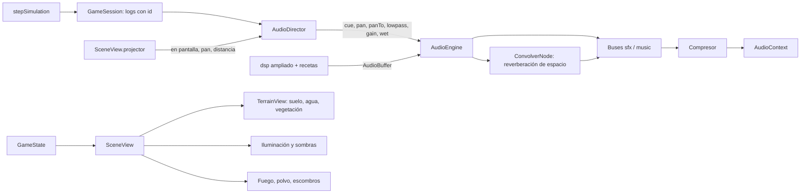

# RTS — SDD de la etapa 5: realismo sonoro y visual

**Versión del SDD:** P5-1.0  
**Versión objetivo del juego:** `p5.0.0`  
**Estado:** especificación propuesta; sin implementación ni pruebas en esta entrega.  
**Rama de desarrollo:** `realismo_audiovisual`, creada desde `efectos_sonido` (HEAD `a0ad231`), porque P4 todavía no está en `main` (que sigue en P3, `139abac`).  
**Base funcional:** RTS P4, mapa 128 × 64, simulación lógica en TypeScript a 20 ticks/s, estrategia Python en Pyodide, render Three.js procedural con cámara ortográfica, audio procedural con Web Audio.

## 1. Propósito

Elevar el realismo percibido del juego sin tocar sus reglas:

1. **Audio:** que los efectos y la música suenen más cercanos a la acción que representan (impactos metálicos reales, flechas que cruzan el aire, gritos humanos, derrumbes pesados, una campana de alarma), con una mezcla nueva: efectos más bajos y música más presente.
2. **Gráficos:** que la escena se vea más realista, en especial el **agua**, con iluminación, sombras, materiales, vegetación y efectos mejorados.

Coherente con P2, P3 y P4, todo sigue siendo **procedural**: sin archivos de sonido, texturas, modelos ni dependencias nuevas. Audio y gráficos son capas de presentación: no deciden daño, recolección, construcción, navegación ni victoria.

## 2. Alcance

### 2.1 Requisitos

| ID | Requisito |
|---|---|
| P5-R01 | Realismo general del audio: síntesis por capas (transitorio, cuerpo y cola), resonancias modales para metal, reverberación de espacio compartida, filtrado por distancia y más variantes por efecto sin repeticiones consecutivas. |
| P5-R02 | Mezcla nueva: bajar el volumen de los efectos y subir el de la música. |
| P5-R03 | Grito de muerte que se sienta: voz humana creíble, más audible y con carga emocional. |
| P5-R04 | Golpe del soldado claramente metálico, como un choque de espadas. |
| P5-R05 | Sonido de arqueros, torres y centro urbano como un viento fuerte: la flecha desplazándose por el aire. |
| P5-R06 | Derrumbe fuerte, con el peso de un final de partida, para edificios de cualquier tamaño. |
| P5-R07 | Campana de ataque aguda, no grave, con carácter de alarma. |
| P5-R08 | Resto de efectos (martillo, hacha, pica, recolección, golpe del aldeano, fuego, puerta, victoria y derrota) más realistas con las mismas técnicas. |
| P5-R09 | Música más realista: instrumentos con modelado físico más fiel, humanización de la interpretación y reverberación de mejor calidad. |
| P5-R10 | Agua realista: normales animadas, reflejo del cielo, brillo solar, color por profundidad, espuma en la orilla y cáusticas suaves. |
| P5-R11 | Iluminación realista: mapeo tonal, luz solar cálida con relleno frío, sombras proyectadas y entorno de reflejo procedural. |
| P5-R12 | Terreno y vegetación más ricos: relieve (bump), variación a gran escala, matas de hierba con viento, copas más naturales, rocas facetadas y sombras de nubes. |
| P5-R13 | Materiales de edificios y unidades más realistas (relieve, rugosidad, metal) y oclusión de contacto en la base. |
| P5-R14 | Efectos visuales más creíbles: fuego con humo y brasas, polvo y escombros en el derrumbe. |
| P5-R15 | Rendimiento y degradación: `?graphics=low` conserva el aspecto y el coste de P4; el modo alto mantiene 60 FPS de mediana. |

### 2.2 Decisiones explícitas

- **Sin cambios de reglas ni de estado:** `GameState`, `hashState`, `STATE_SCHEMA_VERSION` (5), `MAP_VERSION`, `BALANCE_VERSION`, el contrato `worker-v2`, `PROTOCOL_VERSION` (2), la política Python (`policy-0.3`) y el esquema de diagnóstico `rts-diagnostics-1` no cambian. Con las mismas órdenes, la partida produce el mismo `hashState` que antes de P5.
- **Reglas de «quién suena» de P4 intactas:** `PLAYER_ONLY_CUES = ["door", "bell"]`, visibilidad en pantalla, salva de 3 flechas del centro urbano a 0 / 0,5 / 1,0 s, fin de partida 1,0 s después, límites de voces. P5 cambia **cómo suenan** los cues, no **cuándo**.
- **Reglas de P4 que P5 sustituye:** (a) la música ya no queda por debajo de los efectos (P4-H08 CA06, §4.4 de P4); (b) el grito deja de ser «sutil» y de durar ≤ 0,8 s (P4-H03 CA02); (c) la condición de espada «más energía grave que aguda» (P4 §4.5) se sustituye por la de P5-H03; (d) la campana deja de ser grave de dos golpes (P4-H04 CA02). El resto de criterios de P4 sigue vigente.
- **Interpretación de «derrumbe… que suene así haya terminado la partida»:** el derrumbe debe tener el peso, la duración y la contundencia de un final de partida, para todos los edificios y no solo el último centro urbano. No se condiciona a que la partida termine; el sonido de victoria y derrota de P4 no cambia de momento ni de función.
- **Interpretación de «bájale volumen a los efectos y súbele a la música»:** cambio de los niveles de bus (§4.4). Los valores son punto de partida y se afinan al oído; la aceptación es del autor. Para que el cambio no oculte eventos críticos, la música se atenúa brevemente (ducking) cuando suenan campana o derrumbe grande.
- **Flecha como «viento fuerte»:** el sonido es un silbido de aire de banda ancha con perfil de paso (sube, alcanza su máximo y cae con descenso de tono), que acompaña el vuelo de la flecha y barre el panorama del origen al objetivo. Arquero, torre y centro urbano comparten el cue `arrow`, con más intensidad y duración que en P4.
- **Campana aguda:** fundamental alrededor de 1 kHz y repique rápido, como alarma de incendio o de ciudad, en lugar de dos campanadas graves.
- **Agua en la cámara ortográfica:** al ser la dirección de vista constante, el término de Fresnel es casi uniforme; el realismo del agua se obtiene de normales animadas (variación del reflejo del cielo y del brillo solar), color por profundidad, espuma y cáusticas, no de reflejos planares. No hay reflejo de edificios ni refracción real.
- **Mapeo tonal neutro:** para no desplazar la paleta existente se usa el mapeo tonal «neutral» de Three.js (conserva el tono de los colores base) en lugar de ACES; la exposición se calibra para que el aspecto general de P4 no cambie de forma brusca.
- **Calidad:** `?graphics=low` (ya existente) desactiva todo lo nuevo en gráficos y conserva el aspecto de P4. El modo alto activa agua con shader, sombras, relieve y efectos. `?shadows=0` desactiva solo las sombras, para diagnóstico y equipos lentos. `?audio=0` sigue desactivando todo el audio.
- **Sin dependencias ni archivos externos:** las texturas de relieve, normales, espuma y nubes se generan con Canvas 2D como las existentes; los sonidos, con `dsp.ts` ampliado. El módulo de procedencia de assets (`ASSET_PROVENANCE`) se actualiza con las texturas nuevas.
- **Aleatoriedad:** el audio usa su PRNG con semilla y los gráficos, `mulberry32` con semillas fijas; ninguno toca la semilla de la simulación.
- **Rama y publicación:** se trabaja en `realismo_audiovisual`. No se hace merge, push ni publicación sin instrucción expresa.
- **Pruebas:** verificaciones breves y dirigidas, como en P3 y P4. La calidad estética (sonido e imagen) la juzga el autor; la automatización solo cubre lógica, sanidad de señal, sanidad de recursos gráficos y compilación (§7).

### 2.3 Fuera de alcance

Archivos de audio o texturas externas, sonido ambiente (viento, agua, pájaros), sonido posicional con HRTF, música dinámica, voces habladas, reflejos planares o refracción real en el agua, relieve geométrico del terreno, ciclo de día y noche, clima, cambios en modelos de edificios y unidades más allá de materiales y detalle menor, cambios en la política Python, el contrato `worker-v2`, el balance o el mapa.

## 3. Historias y criterios de aceptación

### Audio

### P5-H01 — Mezcla: efectos más bajos, música más alta (P5-R02)

**Como jugador**, quiero que la música acompañe con presencia y que los efectos no la tapen.

- **CA01:** `SFX_LEVEL` baja de 0,8 a un valor inicial de 0,5 y `MUSIC_LEVEL` sube de 0,22 a un valor inicial de 0,55; ambos quedan como constantes ajustables en `engine.ts`.
- **CA02:** el nivel de música por defecto supera al de los efectos de trabajo (martillo, hacha, pica, alimento, fuego, puerta) y queda cercano al de combate; el combate, el grito, el derrumbe y la campana siguen distinguiéndose sobre la música.
- **CA03:** ducking de música: al sonar `bell` o un `collapse` grande, el bus de música baja a 0,6 de su nivel durante 0,5 s y recupera en 1,0 s, sin clics. No se aplica a `victory` ni `defeat`, que mantienen su regla de P4 (10 % durante la fanfarria y 30 % después).
- **CA04:** los botones, la tecla `M`, la suspensión y el silenciado se comportan como en P4, con los nuevos niveles.
- **CA05:** el balance entre cues se define por la tabla de §4.4; ningún cue supera el pico 0,98 tras la cadena maestra.

### P5-H02 — Realismo general de los efectos (P5-R01, P5-R08)

**Como jugador**, quiero que cada sonido se parezca a la acción que representa.

- **CA01:** cada efecto se compone por capas con la receta de §4.5 (transitorio, cuerpo, cola) en lugar de un único tipo de ráfaga.
- **CA02:** los efectos pasan por una **reverberación de espacio** compartida (convolución con una respuesta al impulso procedural), con mezcla por cue (§4.4). La campana, el derrumbe, el grito y las fanfarrias tienen más cola; martillo, hacha, pica y alimento, muy poca.
- **CA03:** **filtrado por distancia:** a mayor distancia al centro de la pantalla, el sonido pierde agudos (paso bajo de 18 kHz en el centro a 5 kHz en el borde), además de la atenuación y el panorama de P4. No se aplica a `bell`, `victory` ni `defeat`.
- **CA04:** los cues frecuentes tienen 5 variantes (espada, flecha) o 4 (martillo, hacha, pica) y el motor **no repite la misma variante dos veces seguidas** por cue; se mantiene la variación de tono (±6 %) y volumen (±1 dB).
- **CA05:** los efectos se sintetizan en el primer gesto del usuario en menos de 1,5 s en total (presupuesto ampliado frente a P4 por las capas nuevas); si no cabe, se generan por lotes cediendo el hilo entre cues. El primer gesto no debe bloquear la interfaz más de 100 ms seguidos.
- **CA06:** el fuego, la puerta, el martillo, el hacha, la pica, la recolección y el golpe del aldeano conservan sus reglas y duraciones de P4 y mejoran su timbre según §4.5.

### P5-H03 — Espada: choque metálico (P5-R04)

**Como jugador**, quiero oír el entrechocar de espadas cuando los soldados golpean.

- **CA01:** el impacto combina un transitorio seco de contacto, un cuerpo de hoja con **resonancias modales inarmónicas de acero** (razones de barra libre 1; 2,76; 5,40; 8,93) y un **raspado agudo de deslizamiento** («shing») que ocupa los primeros 120 ms.
- **CA02:** el timbre es claramente metálico, sin sonar a campanilla: los modos agudos decaen rápido (≈ 30 a 90 ms) y el modo fundamental, más lento (≈ 150 a 250 ms).
- **CA03:** la duración total es ≤ 0,5 s. Hay 5 variantes con fundamental entre 700 y 1 400 Hz, rasgueo y sesgo distintos.
- **CA04:** condición de sanidad de señal: la energía de 1 a 6 kHz es al menos el 35 % de la total y la cola posterior a 250 ms está 30 dB por debajo del pico.
- **CA05:** se conserva la regla de P4-H01: golpe de soldado, ambos bandos, en pantalla, en el tick del daño.

### P5-H04 — Flechas: viento de la flecha desplazándose (P5-R05)

**Como jugador**, quiero oír el aire que corta la flecha cuando disparan arqueros, torres y centros urbanos.

- **CA01:** el cue `arrow` es un silbido de aire fuerte: ruido de banda ancha filtrado con barrido descendente (de ≈ 4 kHz a ≈ 1,2 kHz) y un perfil de paso (ataque suave, máximo hacia el 35 % y caída), con un cuerpo grave de aire desplazado y un leve vibrato de cuerda inicial.
- **CA02:** duración de 0,5 a 0,9 s, con 5 variantes. Es más intenso que el de P4: ganancia relativa 0,9 (tabla de §4.4).
- **CA03:** el panorama **barre** del origen del disparo (`from`) al objetivo (`to`) proyectados a pantalla a lo largo de la duración de vuelo visual (`clamp(distancia / 18, 0,15; 0,6)` s de `ArrowPool`). Si el objetivo cae fuera de pantalla, el barrido se limita a ±0,7.
- **CA04:** un golpe sordo breve al final del vuelo (flecha que alcanza el blanco: `thunk` de madera, ≤ 80 ms, ganancia baja) solo si el objetivo es visible; no cambia el conteo de voces ni la separación de cues.
- **CA05:** la salva de 3 flechas del centro urbano de P4-H02 se conserva (0, 0,5 y 1,0 s, variante distinta por flecha) y suena especialmente poderosa por la superposición natural de los silbidos.
- **CA06:** el sonido se programa en el reloj del `AudioContext` como en P4 (la pausa lo congela, el reinicio lo cancela).

### P5-H05 — Grito de muerte que se sienta (P5-R03)

**Como jugador**, quiero que la caída de una unidad se sienta, sin llegar a ser molesta.

- **CA01:** el grito se sintetiza con una **fuente glotal** (pulso tipo Rosenberg/LF con *jitter* y *shimmer*), **formantes con transición** de vocal abierta a vocal cerrada (/a/ → /o/), **ruido de aspiración** y un contorno de tono expresivo: sube rápido y cae con vibrato, y termina en un resuello breve.
- **CA02:** duración de 0,9 a 1,4 s, 6 variantes: 3 de militar (grave, 110 a 180 Hz) y 3 de aldeano (más agudo, +25 %).
- **CA03:** **más audible que en P4:** ganancia relativa 0,9 (era 0,45), atenuación de distancia reducida a la mitad para este cue y mezcla de reverb moderada. Sigue por debajo del derrumbe y de la campana.
- **CA04:** se conserva la regla de P4-H03: un grito por unidad muerta, ambos bandos, solo en pantalla, nunca por edificios; topes de P4 (cap 4) con separación mínima de 90 ms.
- **CA05:** el recorte de volumen en masacres lo siguen haciendo los topes de voces, sin recortar la duración del grito individual.

### P5-H06 — Derrumbe fuerte (P5-R06)

**Como jugador**, quiero que caer un edificio retumbe de verdad, como un final.

- **CA01:** el derrumbe se compone de: golpe sub-grave inicial (30 a 60 Hz) con distorsión suave, rumor grave sostenido, crujidos fuertes de madera, caída de bloques de piedra y escombros, polvo que sisea y un golpe final profundo; la cola es larga.
- **CA02:** duración de 2,2 s (pequeño) a 3,8 s (grande); el golpe final cae cerca del 65 % de la animación visual, sincronizado con el momento en que la estructura toca el suelo en `P3-H04`.
- **CA03:** es el efecto **más fuerte** de la tabla de §4.4 (ganancia relativa 1,0, pico máximo del banco) y lleva reverb amplia.
- **CA04:** dos variantes de tamaño (pequeña y grande) × 2 de timbre cada una; la grande (cuartel, centro urbano) es más grave y más larga. La obra sin terminar usa la variante pequeña con 60 % de ganancia.
- **CA05:** conserva las reglas de P4-H11 (edificios de ambos bandos, en pantalla, una vez por `seq`, el fuego del mismo edificio se detiene en el mismo cuadro). Activa el ducking de música de P5-H01 CA03 en la variante grande.
- **CA06:** no cambia las reglas: el edificio sigue saliendo del estado en el mismo tick.

### P5-H07 — Campana de alarma aguda (P5-R07)

**Como jugador**, quiero una alarma inconfundible, aguda, cuando me atacan.

- **CA01:** campana de **alarma**: fundamental entre 950 y 1 150 Hz, parciales brillantes (razones 1; 2,0; 2,76; 4,07; 5,43) con decaimiento corto, y **repique** de 6 golpes en dos ráfagas de 3, con 0,13 s entre golpes y 0,25 s de pausa entre ráfagas (≈ 1,3 s en total, cola de 0,8 s).
- **CA02:** la energía de 800 Hz a 5 kHz es al menos 3 veces la energía por debajo de 500 Hz (comprobación con Goertzel); no hay componentes graves relevantes.
- **CA03:** conserva las reglas de P4-H04: solo suena cuando el jugador es atacado (no al atacar), sin comprobar la vista, sin panorama ni atenuación, prioridad máxima, separación de 8 s entre campanadas en tiempo de audio.
- **CA04:** aplica el ducking de música de P5-H01 CA03.
- **CA05:** no comparte timbre con el derrumbe ni con las fanfarrias.

### P5-H08 — Efectos restantes más realistas (P5-R08)

**Como jugador**, quiero que la actividad cotidiana de la partida suene creíble.

- **CA01:** martillo: golpe de metal sobre clavo con rebote y resonancia breve de madera. Hacha: impacto en madera con crujido de fibras y «tock» de hoja. Pica: golpe metálico sobre roca con grava que salta. Recolección de alimento: roce de hojas más extenso y ramillas. Golpe del aldeano: impacto de palo contra tela y cuerpo, sordo.
- **CA02:** fuego: bucle de 6 s (en lugar de 4) con rumor, siseo, chasquidos de leña de distinta altura y ráfagas ocasionales; sin clic ni salto en el empalme.
- **CA03:** puerta: madera pesada con goznes más creíbles (chirrido con parciales de formante y variación de velocidad), golpe de cierre con cuerpo y breve reverb de sala.
- **CA04:** victoria y derrota: más cuerpo gracias a la reverberación de espacio y a los instrumentos mejorados de P5-H09; mantienen sus funciones, duraciones aproximadas (4 s y 5 s) y la regla de ducking de P4.
- **CA05:** se conservan los topes, separaciones y prioridades de P4 salvo los cambios explícitos de §4.4.

### P5-H09 — Música más realista (P5-R09)

**Como jugador**, quiero una música que parezca tocada por instrumentos reales.

- **CA01:** laúd con **cuerpo resonante** (modos de caja a ≈ 100 y 220 Hz, filtros de formante de madera), pulsación con ataque de uña, y cuerdas dobles con ligera desafinación.
- **CA02:** flauta dulce con ataque de soplido, aire audible, cambio de timbre con la dinámica y vibrato tardío; los saltos de nota tienen articulación (*legato*/*staccato*) según la partitura.
- **CA03:** bordón (zanfona/gaita) con zumbido de ruedecilla y modulación lenta de la afinación; salterio con cuerdas simpáticas; tamboril con parche más natural (ataque, resonancia del aro y *rebote* leve).
- **CA04:** **humanización determinista:** pequeñas variaciones de tiempo (±12 ms), de velocidad (±8 %) y de afinación (±4 cents) con el PRNG de música, sin alterar el compás ni el modo.
- **CA05:** reverberación de mejor calidad: red de retardos con realimentación (FDN de 8 líneas) con filtrado de absorción, de modo que la cola es más suave que el esquema de Schroeder de P4.
- **CA06:** misma forma de 60 compases, 6/8, dórico en re, ≈ 100 s y bucle sin salto; misma determinismo por semilla.
- **CA07:** frecuencia de muestreo de 32 000 Hz (antes 22 050); estéreo, ≈ 25,6 MB. Generación en segundo plano y fundido de entrada de 3 s como en P4; ningún cuadro sube de 50 ms por esta causa. Si falla, el juego sigue en silencio.

### Gráficos

### P5-H10 — Agua realista (P5-R10)

**Como jugador**, quiero que los lagos parezcan agua real, con movimiento, brillo y profundidad.

- **CA01:** material de agua con shader propio (`WaterMaterial`) que sustituye al `MeshPhongMaterial` y a la capa de ondas del modo alto. En `?graphics=low` se conserva el material de P4.
- **CA02:** **normales animadas:** dos capas de normales procedurales con escalas y direcciones distintas (deriva en sentidos opuestos) más una onda lenta de baja frecuencia; el movimiento es continuo y sin saltos al repetirse (textura de mosaico perfecta).
- **CA03:** **reflejo del cielo:** el vector reflejado con la normal perturbada muestrea un degradado procedural de cielo (cénit azul, horizonte claro) y mezcla con el color del agua con un término de Fresnel.
- **CA04:** **brillo solar:** destellos especulares de alta frecuencia en la dirección del sol existente (luz direccional de la escena), con parpadeo suave y sin saturar la imagen.
- **CA05:** **color por profundidad:** de turquesa claro y translúcido en la orilla a azul profundo en el centro, usando la distancia al contorno ya codificada en los anillos (`WATER_LAYERS`); el fondo arenoso se transparenta en las zonas someras.
- **CA06:** **espuma de orilla:** línea de espuma irregular que avanza y retrocede suavemente (movimiento oscilante y ruido), sin cortes bruscos con la orilla húmeda.
- **CA07:** **cáusticas suaves** en las zonas someras (patrón animado procedural, intensidad baja).
- **CA08:** el contorno orgánico, la orilla húmeda y el obstáculo lógico (el rectángulo) no cambian; no se solapa con edificios ni unidades, y el orden de renderizado y el contorno ocluido de P3 siguen funcionando.
- **CA09:** el agua no debe mostrar patrones repetitivos evidentes con el zoom mínimo ni parpadeo con el zoom máximo.
- **CA10:** coste: ≤ 1,0 ms de GPU adicional medido en la escena con el zoom mínimo, en modo alto.

### P5-H11 — Iluminación, sombras y entorno (P5-R11)

**Como jugador**, quiero una escena con luz y sombra creíbles.

- **CA01:** mapeo tonal neutral con exposición calibrada; la paleta general no cambia de forma brusca respecto de P4.
- **CA02:** luz solar cálida direccional (la actual, posición `(-25, 80, 60)`) con luz de relleno hemisférica fría para las sombras; las intensidades de ambiente se reducen para dar más contraste.
- **CA03:** **sombras proyectadas** en modo alto: mapa de 2 048 px con frustum que sigue al encuadre de la cámara, bordes suaves y *bias* ajustado sin «acné» ni «peter-panning»; proyectan edificios, árboles, rocas, nodos de recurso y unidades; reciben el suelo y las rocas. El agua no recibe sombras proyectadas.
- **CA04:** **entorno procedural:** mapa de reflejo generado a partir del degradado del cielo (PMREM) para dar brillo a los metales y tejados, con intensidad baja.
- **CA05:** **sombras de nubes:** textura grande de ruido suave que se desplaza muy despacio sobre el suelo con opacidad ≤ 0,12; sin efecto en el agua ni en la jugabilidad.
- **CA06:** `?shadows=0` desactiva solo las sombras; `?graphics=low` desactiva sombras, nubes y entorno.
- **CA07:** las siluetas ocluidas por edificios (contorno P3), las barras de vida, los anillos de selección y la interfaz siguen leyéndose igual de bien que en P4.

### P5-H12 — Terreno y vegetación (P5-R12)

**Como jugador**, quiero un suelo y una vegetación con más riqueza visual.

- **CA01:** textura de hierba de 1 024 px con relieve (*bump*), variación cromática a gran escala (macro) y sin repetición evidente a zoom mínimo.
- **CA02:** **matas de hierba** instanciadas (cruces de dos planos) con movimiento de viento por *vertex shader*, repartidas con el PRNG con semilla; máximo 6 000 instancias y fuera de caminos, agua y rocas.
- **CA03:** **árboles** con copas de más lóbulos, oscurecimiento de base por vértice (oclusión de copa), variación de color y balanceo de viento suave; troncos con relieve.
- **CA04:** **rocas** más naturales: geometría facetada con ruido, relieve de piedra y musgo; siguen alineadas con el rectángulo lógico (no lo exceden) y conservan la altura `ROCK_HEIGHT`.
- **CA05:** matas, flores y piedrecitas decorativas no bloquean ni afectan al nodo de alimento: los arbustos de comida de P3 conservan su aspecto y su lectura clara.
- **CA06:** el número de triángulos adicionales en modo alto es ≤ 150 000 y los *draw calls* adicionales ≤ 20 gracias al instanciado.

### P5-H13 — Materiales de edificios y unidades (P5-R13)

**Como jugador**, quiero que edificios y unidades tengan aspecto de materiales reales.

- **CA01:** materiales compartidos migran de Lambert a `MeshStandardMaterial` en modo alto: roca/muro (rugoso con relieve), madera (rugosa con vetas), tejas y pizarra (relieve de teja, rugosidad media) y metal de armas y cascos (`metalness` 0,8 y `roughness` 0,35).
- **CA02:** los colores de bando (azul y rojo) y los marcadores de selección, barras de vida y siluetas ocluidas **no cambian** y siguen siendo inequívocos.
- **CA03:** **oclusión de contacto:** sombra suave bajo cada edificio, árbol y roca (decal oscuro radial con degradado) que ancla la silueta al suelo; también bajo unidades (versión pequeña) en modo alto.
- **CA04:** las unidades reciben detalle menor (casco, escudo o carcaj en los modelos donde ya existan partes; no se añaden modelos nuevos) y las poses animadas existentes no cambian.
- **CA05:** `?graphics=low` conserva los materiales Lambert de P4.

### P5-H14 — Fuego, polvo y escombros (P5-R14)

**Como jugador**, quiero que los incendios y los derrumbes se vean como tales.

- **CA01:** fuego con llamas en capas de mezcla aditiva, **humo** gris que asciende y se disipa, **brillo en el suelo** (decal aditivo cálido) y **chispas** ocasionales; el parpadeo es continuo y desfasado entre edificios. La intensidad sigue a `flameCount` (1 a 5).
- **CA02:** el humo y las chispas obedecen al mismo límite de llamas por edificio y a un máximo global de 400 partículas en pantalla.
- **CA03:** **derrumbe:** nube de polvo más voluminosa y de vida larga (≈ 2,5 s), y 12 a 30 escombros con caída balística y rebote, alineados con la animación de colapso existente de P3-H04, sin alterar su duración ni su estructura.
- **CA04:** los fragmentos y el polvo son instanciados y desaparecen con fundido al finalizar; un reinicio los elimina.
- **CA05:** ningún efecto modifica reglas ni estado; el edificio sigue saliendo del estado en el mismo tick.

### P5-H15 — Rendimiento, versiones y documentación (P5-R15)

- **CA01:** modo alto: mediana de 60 FPS en una medición de 45 s con `?fixture=objetivo`; ningún cuadro sube de 50 ms por la síntesis de audio o la creación de recursos gráficos.
- **CA02:** si las sombras impiden el objetivo, el plan de degradación es: (1) sombras solo de edificios y árboles, (2) sombras fijas de contacto en lugar de proyectadas, (3) `?shadows=0` por defecto en GPUs integradas. La decisión se documenta con la medición.
- **CA03:** el HUD muestra `GFX: gfx-0.2` además de la línea de audio.
- **CA04:** `GAME_VERSION = "p5.0.0"`, `AUDIO_VERSION = "audio-0.2"` y nueva `GRAPHICS_VERSION = "gfx-0.2"` en `src/content/versions.ts`.
- **CA05:** la ayuda de `index.html` y el README describen los parámetros `?graphics=low`, `?shadows=0` y `?audio=0`, y las limitaciones.
- **CA06:** `contracts/worker-v2/fixtures.json` incluye `game_version`; se decide en P5-00 si se regenera por el cambio de `GAME_VERSION` (ya pendiente desde P4). No se cambia el esquema del contrato.

## 4. Diseño técnico y contratos

### 4.1 Flujo de datos

TypeScript sigue siendo la autoridad de las reglas. Audio y render solo leen estado y eventos.

### 4.2 Eventos y núcleo

**Sin cambios.** P5 no añade eventos, campos ni lógica al núcleo. El barrido de panorama de la flecha usa `from` y `to` del `StrikeEvent` existente (posiciones ya capturadas en el golpe). El instante del golpe final del derrumbe se toma de la duración de colapso ya definida en P3-H04.

### 4.3 Módulos de audio

| Archivo | Cambios |
|---|---|
| `dsp.ts` | Nuevas primitivas: `modalBank` (suma de resonadores exponenciales por parcial), `glottalSource` (pulso de Rosenberg con *jitter* y *shimmer* y contorno de tono), `formantFilter` (formantes con transición temporal), `softClip` (saturación suave `tanh`), `impulseResponse` (respuesta al impulso estéreo para la reverb de espacio), `fdnReverb` (red de retardos con realimentación) y `humanize` (variaciones deterministas de tiempo, velocidad y afinación). |
| `sfx.ts` | Recetas rehechas según §4.5; más variantes; fuego de 6 s; ruta de generación por lotes (CA05 de P5-H02). |
| `instruments.ts` | Laúd con cuerpo resonante, flauta con soplido y dinámica, bordón con ruedecilla, salterio con cuerdas simpáticas, tamboril natural. |
| `music.ts` | Humanización; 32 000 Hz; reverb FDN; articulación en la partitura (campo opcional `art`). |
| `voices.ts` | Nueva tabla de ganancias, variantes y separaciones (§4.4); selección de variante sin repetición inmediata. |
| `cues.ts` | `CueRequest` gana `panTo?: number`, `panDuration?: number`, `lowpass: number`, `wet: number` y `duck?: number`. La función pura calcula el barrido de pan de la flecha, el paso bajo por distancia y el ducking. |
| `engine.ts` | `ConvolverNode` compartido con envío por cue (`wet`), `BiquadFilterNode` por voz para la distancia, rampa de pan para la flecha, ducking del bus de música, nuevos niveles. Las interfaces `ContextLike`/`NodeLike` se amplían (`createConvolver`, `createBiquadFilter`) y el contexto falso de las pruebas las implementa. |
| `director.ts` | Calcula `panTo` (flecha), la distancia para el filtro, y delega el ducking. |

La reverb de espacio se genera una vez al desbloquear el audio: IR estéreo de 1,4 s, con reflexiones tempranas y cola exponencial filtrada. Los envíos secos y húmedos por cue se resuelven en `CueRequest`.

### 4.4 Mezcla, prioridades y límites

Prioridades y topes de P4 se conservan salvo lo indicado.

| Cue | Prioridad | Tope | Separación mínima | Ganancia (P4 → P5) | Variantes | Reverb |
|---|---|---|---|---|---|---|
| `bell` | 5 | 1 | 8 s | 1,0 → 1,0 | 1 | 0,35 |
| `victory`, `defeat` | 6 | 1 | — | 1,0 → 1,0 | 1 | 0,30 |
| `collapse` | 4 | 3 | 150 ms | 0,9 → 1,0 | 2 + 2 | 0,45 |
| `death` | 4 | 4 | 120 → 90 ms | 0,45 → 0,9 | 6 | 0,25 |
| `door` | 3 | 3 | 200 ms | 0,7 → 0,5 | 2 | 0,20 |
| `sword` | 2 | 8 | 50 ms | 0,8 → 0,8 | 3 → 5 | 0,15 |
| `arrow` | 2 | 8 | 50 ms | 0,8 → 0,9 | 3 → 5 | 0,20 |
| `blow` | 2 | 4 | 80 ms | 0,6 → 0,6 | 2 → 3 | 0,10 |
| `hammer` | 1 | 6 | 80 ms | 0,6 → 0,5 | 2 → 4 | 0,05 |
| `axe`, `pick` | 1 | 1 | 300 ms | 0,6 → 0,5 | 2 → 4 | 0,05 |
| `forage` | 1 | 1 | 300 ms | 0,4 → 0,35 | 2 | 0,05 |
| `fire` (bucle) | 0 | 3 bucles | — | 0,25–0,6 → 0,2–0,5 | 1 | 0,10 |

- **Niveles de bus:** efectos 0,5 (antes 0,8), música 0,55 (antes 0,22). Tope global de 24 voces, compresor y ganancia maestra como en P4.
- **Panorama y atenuación:** como en P4 (`pan = clamp(ndc.x × 0,7, −0,7, 0,7)`, `1 − 0,3 × min(1, |ndc|/√2)`); el cue `death` usa la mitad de atenuación. Se añade el paso bajo por distancia (§P5-H02 CA03).
- **Ducking:** `bell` y `collapse` grande bajan la música a 0,6 durante 0,5 s y recuperan en 1,0 s. `victory` y `defeat` mantienen 0,1 y 0,3 de P4.
- **Reverb:** el envío húmedo de la tabla es relativo a la ganancia del cue.

### 4.5 Recetas de efectos (guía de diseño)

Referencias para el implementador; los parámetros exactos se ajustan al oído y se fijan en `sfx.ts`.

| Cue | Síntesis |
|---|---|
| Espada | Transitorio de contacto (ruido paso alto, 3 ms) + cuerpo con `modalBank` de acero (fundamental 700–1 400 Hz; razones 1; 2,76; 5,40; 8,93; decaimientos 220/90/50/30 ms) + «shing» de raspado (ruido paso banda con barrido ascendente de 2 a 6 kHz, 120 ms) + golpe sordo grave de 180 Hz (30 ms) para el peso. `softClip` ligero para el «mordiente». |
| Flecha | Silbido de aire: ruido de banda ancha con filtro de barrido descendente 4 kHz → 1,2 kHz, envolvente de paso (subida 0,15–0,3 s, caída 0,3–0,5 s), capa grave de aire de 200–500 Hz con la misma envolvente, vibrato de cuerda inicial (seno de 140 Hz, 40 ms) y, al final, `thunk` de madera de 80 ms. |
| Golpe del aldeano | Impacto sordo: seno de 150 Hz con caída, ruido paso bajo de 700 Hz (60 ms) y fricción de tela; sin resonancias metálicas. |
| Grito | `glottalSource` con contorno: nota inicial a 1,2× del tono base, subida de +15 % en 150 ms y caída de −45 % hasta el final; *jitter* del 1,5 % y *shimmer* del 4 %; `formantFilter` /a/ (700, 1 100, 2 500 Hz) → /o/ (450, 800, 2 500 Hz) en 500 ms; ruido de aspiración (−18 dB); resuello final (ruido paso banda de 800–2 500 Hz, 150 ms) y fundido suave. |
| Campana | Alarma: `modalBank` con fundamental 1 050 Hz y razones 1; 2,0; 2,76; 4,07; 5,43 (decaimientos 0,9/0,6/0,4/0,25/0,15 s), 6 golpes en dos ráfagas de 3 (0,13 s entre golpes, 0,25 s entre ráfagas) con ganancias decrecientes dentro de cada ráfaga y un transitorio de badajo (ruido paso alto, 4 ms) en cada golpe. |
| Derrumbe | Golpe inicial sub-grave (45 Hz, caída a 28 Hz, 0,4 s) con `softClip`; rumor de ruido marrón paso bajo (60–200 Hz) con decaimiento de 1,6 a 2,6 s; 5 a 9 crujidos de madera (ruido paso banda de 200–900 Hz, 150 ms, repartidos en el primer 60 %); caída de bloques de piedra (golpes sordos de 80–160 Hz con ruido, 6 a 12 repartidos entre el 20 % y el 90 %); lluvia de escombros (ruido paso alto en ráfagas); polvo (siseo paso banda 2–6 kHz con decaimiento lento); golpe final profundo cerca del 65 % (seno de 38 Hz y ruido paso bajo). La variante grande baja un 30 % todas las frecuencias y alarga la duración. |
| Martillo | Metal sobre clavo (seno 1,0–1,4 kHz con caída y rebote doble) + tic de ruido y resonancia breve de madera (`modalBank` de 3 modos graves). |
| Hacha | Impacto grave (120 Hz) + crujido de fibras (ruido paso banda, rampa) + «tock» de hoja (seno de 700 Hz, 8 ms). |
| Pica | Golpe metálico sordo (260 Hz → 130 Hz) + ruido paso banda de 1,6 kHz + 3 a 5 granos de grava que saltan (impulsos filtrados con retardo aleatorio, 150 ms). |
| Recolección | Roce de hojas (ruido paso banda ancho, envolvente de 200 ms) + ramita (`thump` de 600 Hz, 20 ms) + hojas menores. |
| Fuego | Bucle de 6 s con empalme por fundido cruzado: rumor de ruido marrón paso bajo, siseo modulado, chasquidos de leña de tres alturas (400–5 000 Hz) y ráfagas de aire ocasionales. |
| Puerta | Chirrido de goznes con barrido de velocidad variable (parciales de formante), golpe de pestillo con cuerpo y cierre con segundo golpe más grave y breve reverb de sala. |
| Victoria / derrota | Misma estructura de P4 con los instrumentos mejorados de P5-H09 y envío de reverb de espacio. |

### 4.6 Música

Se conserva la forma de 60 compases, 6/8, dórico en re, ≈ 100 s y bucle sin salto (P4 §4.6). Cambia la fidelidad:

- **Laúd:** Karplus–Strong con *pick position* (comb de ataque), dos cuerdas por orden con desafinación de 3 cents y filtro de cuerpo (resonadores a ≈ 100 y 220 Hz).
- **Flauta:** seno más armónicos con mezcla dependiente de la dinámica, ruido de soplido filtrado (más presente al inicio) y vibrato de 5 Hz con retardo y profundidad crecientes.
- **Bordón:** dos sierras desafinadas más pulso de ruedecilla (ruido modulado en amplitud a ≈ 6 Hz) y deriva lenta de afinación (±3 cents).
- **Salterio:** Karplus–Strong brillante más cuerdas simpáticas (resonadores sutiles en la quinta y la octava).
- **Tamboril:** seno con caída de tono (110 → 70 Hz), ruido de parche y resonancia del aro (parcial de 900 Hz, 30 ms).
- **Humanización:** `humanize(seed)` aplica tiempo ±12 ms, velocidad ±8 % y afinación ±4 cents por nota, con el PRNG de música; la partitura (datos) no se toca.
- **Reverberación:** `fdnReverb` de 8 líneas, mezcla de 20 %, absorción de agudos creciente con la cola, entrada estéreo decorrelacionada.
- **Presupuesto:** 32 000 Hz, estéreo, ≈ 25,6 MB; con los efectos (≈ 6 MB), la respuesta de impulso (≈ 0,4 MB) y los buffers de las fanfarrias el total de audio no supera 36 MB.

### 4.7 Gráficos: agua

Archivos nuevos: `src/rendering/water-material.ts` (shader y texturas) y ampliaciones en `terrain-view.ts` y `assets.ts`.

- **Geometría:** se conserva `buildWaterGeometry` (anillos concéntricos con alfa y color de vértice). Se añade al vértice la **profundidad normalizada** (0 en la orilla, 1 en el centro) como atributo, derivada de `layer.offset`, que alimenta el color por profundidad, la espuma y las cáusticas.
- **Texturas procedurales** (Canvas 2D, semilla fija): mosaico de normales de 256 px (suma de ondas y ruido, perfecto en mosaico), ruido de espuma de 256 px y patrón de cáusticas de 256 px.
- **Fragment shader:** `n = normalize(n1(uv·s1 + t·v1) + n2(uv·s2 − t·v2) + ondaLenta)`; `r = reflect(vista, n)`; `sky = mix(horizonte, cénit, saturate(r.y))`; `fresnel = f0 + (1 − f0)(1 − n·v)^5` con `f0 = 0,02`; color base por `profundidad`: `mix(turquesaClaro, azulProfundo, smoothstep(0, 1, p))`; fondo arenoso visible según `1 − p`; `especular = pow(max(dot(reflect(−sol, n), vista), 0), 180)`; espuma `smoothstep(umbral(t), umbral(t)+0,08, ruido) · (1 − p)^2`; cáusticas `· (1 − p)`; alfa = alfa de vértice.
- **Uniformes:** `uTime` (el mismo `animTime` de `SceneView`), `uSunDir`, colores de cielo y agua, texturas. Una sola instancia de material para todos los lagos.
- **Degradación:** en `?graphics=low`, sin shader. Si `ShaderMaterial` falla al compilar, se vuelve al material de P4 y se registra en el HUD.
- **Orden de pintado:** sin cambios (orilla con `renderOrder` 1, agua 2); la capa de ondas del modo alto se elimina porque el shader la reemplaza.

### 4.8 Gráficos: iluminación, sombras y entorno

- **Renderer:** `toneMapping = NeutralToneMapping`, `toneMappingExposure` calibrado, `outputColorSpace` sRGB (ya implícito). En modo alto, `shadowMap` activado.
- **Luces:** la `DirectionalLight` actual proyecta sombras con una cámara de sombras ortográfica ajustada al encuadre (se actualiza cada cuadro con la posición del `CameraRig`), mapa de 2 048 px y *bias* configurable. Luz hemisférica (cielo azulado, suelo verde) reduce el ambiente blanco plano actual.
- **Entorno:** `scene.environment` generado una sola vez con `PMREMGenerator` a partir de una escena de degradado de cielo; intensidad `envMapIntensity` baja (0,35) para metales y tejados.
- **Sombras de nubes:** textura de ruido de 512 px, mezcla multiplicativa sobre el suelo, deriva de 0,6 unidades/s, opacidad ≤ 0,12; solo modo alto.
- **Calibración:** una captura de referencia de P4 (misma semilla y encuadre) sirve de comparación subjetiva; no se automatiza.

### 4.9 Gráficos: terreno, materiales y efectos

- **Suelo:** hierba de 1 024 px con `bumpMap` derivado del mismo lienzo (luminancia), textura macro de variación de color (1 024 × 512, ya existe `tone`, se amplía su contraste) y sombras de nubes.
- **Matas de hierba:** `InstancedMesh` con geometría de dos planos cruzados y vertex shader de viento (`onBeforeCompile` sobre un `MeshLambertMaterial` con alfa de prueba); ≤ 6 000 instancias.
- **Árboles y rocas:** nuevas variantes de geometría en `models.ts` (copas de lóbulos con color de vértice, rocas facetadas con ruido), instanciadas como hasta ahora; viento de copa por *vertex shader*.
- **Materiales:** `Materials` en `models.ts` crea la versión «estándar» en modo alto y la «Lambert» en modo bajo, con la misma interfaz.
- **Oclusión de contacto:** un `InstancedMesh` de planos con textura radial (una sola textura compartida) bajo edificios, árboles, rocas y unidades.
- **Fuego, humo y chispas:** se amplía `fire.ts` con un grupo de partículas (humo, chispas) con *pool* fijo y un decal aditivo de brillo en el suelo; límite global de 400 partículas.
- **Polvo y escombros:** `effects.ts` añade `DebrisPool` (instanciado, 64 fragmentos máximos) y mejora la nube de polvo existente; la duración y secuencia del colapso de P3-H04 no cambian.

### 4.10 Fixtures de comprobación manual

Se reutiliza `?fixture=sonidos&ai=0` (con `&final=victoria|derrota`) de P4 para el audio, y se añade `?fixture=realismo&ai=0`: escena breve y determinista con un lago grande y uno pequeño con orilla visible, edificios de cada tipo con unidades, un edificio en llamas, otro a punto de derrumbarse y el centro urbano armado con enemigos al alcance, para revisar el agua, las sombras y los efectos sin esperar una partida completa. Los dos fixtures se pueden combinar con `?graphics=low` y `?shadows=0`.

## 5. Secuencia de implementación

| Paso | Trabajo | Salida |
|---|---|---|
| P5-00 | Crear `realismo_audiovisual` desde `efectos_sonido`; confirmar árbol limpio; `npm run typecheck`, `npm test`, `npm run test:py` y `npm run build` en verde; revisar los consumidores de `CueRequest`, `ContextLike`, `Materials` y `ArrowPool`; capturas de referencia de P4; decidir regeneración de `fixtures.json` | Base verificada y documentada |
| P5-01 | Mezcla y motor: niveles de bus, ducking, `ConvolverNode`, filtro por distancia, pan con barrido, variantes sin repetición, contexto falso ampliado; pruebas | Motor nuevo con efecto de prueba |
| P5-02 | `dsp.ts`: `modalBank`, `glottalSource`, `formantFilter`, `softClip`, `impulseResponse`, `fdnReverb`, `humanize`; pruebas de señal | Primitivas verificadas |
| P5-03 | Recetas de las cinco peticiones del autor: grito, espada, flecha, derrumbe y campana; fixture `sonidos` | Los cinco sonidos pedidos, audibles |
| P5-04 | Resto de efectos y bucle de fuego de 6 s; fanfarrias | Banco completo |
| P5-05 | Música: instrumentos, humanización, FDN, 32 000 Hz, generación en segundo plano | Música realista sin saltos |
| P5-06 | Agua: `WaterMaterial`, texturas procedurales, integración en `TerrainView`, degradación | Agua nueva en modo alto |
| P5-07 | Iluminación: mapeo tonal, sombras, entorno, nubes; calibración | Escena iluminada con sombras |
| P5-08 | Terreno y vegetación; materiales; oclusión de contacto | Suelo, árboles, rocas y materiales nuevos |
| P5-09 | Fuego, humo, polvo y escombros; fixture `realismo` | Efectos visuales nuevos |
| P5-10 | Ajuste de mezcla y calibración visual al oído y a la vista; ayuda y README; versiones `p5.0.0`, `audio-0.2`, `gfx-0.2` | Documentación al día |
| P5-11 | Integración, medición de rendimiento y revisión acotada | Build, verificaciones dirigidas, evidencia breve ligada al commit |

Trabajar en `realismo_audiovisual` conservando su historial. No resetearla, forzarla ni reemplazarla. No hacer merge, push ni publicar sin instrucción expresa.

## 6. Rendimiento y recursos

| Aspecto | Presupuesto |
|---|---|
| Cuadro de render (modo alto) | Mediana de 60 FPS en 45 s con `?fixture=objetivo`; ningún cuadro > 50 ms por creación de recursos |
| Agua | ≤ 1,0 ms de GPU adicional con zoom mínimo |
| Geometría adicional | ≤ 150 000 triángulos y ≤ 20 *draw calls* |
| Partículas | ≤ 400 en pantalla (humo, chispas) y ≤ 64 escombros |
| Sombras | Mapa de 2 048 px; plan de degradación en P5-H15 CA02 |
| Memoria gráfica | Texturas nuevas ≤ 12 MB en total |
| Audio total | Música ≈ 25,6 MB; efectos ≈ 6 MB; IR ≈ 0,4 MB; total ≤ 36 MB |
| Preparación de audio | Efectos en < 1,5 s tras el primer gesto sin bloquear la interfaz > 100 ms; música en segundo plano |
| Simulación | Sin cambios; p95 del tick idéntico al de P4 (la capa nueva no toca el núcleo) |

## 7. Verificación y cierre

No se ejecutan pruebas ni se modifica el juego al preparar este documento. Durante el desarrollo se verifican solo los riesgos introducidos por P5:

1. **Núcleo intacto:** `hashState` idéntico antes y después en partidas de referencia; los tests existentes (TS y Python) pasan sin modificarse, salvo los que fijen constantes de P4 que P5 sustituye explícitamente (niveles de bus, ganancias, duraciones del grito y de la campana).
2. **Mezcla y motor (contexto falso):** niveles de bus nuevos; ducking solo con `bell` y `collapse` grande; envío de reverb y filtro por distancia presentes; variante nunca repetida dos veces seguidas por cue; pan con barrido de la flecha; el resto de reglas de P4 (bloqueo, silenciado, suspensión, `localStorage`) sin regresión.
3. **Traducción a señales:** casos de P4 sin cambios (quién suena, visibilidad, salva, separación de campana); `CueRequest` con `panTo`, `lowpass`, `wet` y `duck` correctos; el grito usa media atenuación.
4. **Señal (por cue):** determinismo por semilla, valores finitos, pico ≤ 0,98, duraciones dentro de §3 (espada ≤ 0,5 s, flecha 0,5–0,9 s, grito 0,9–1,4 s, derrumbe 2,2–3,8 s, campana ≈ 1,3 s + cola), energía de espada en 1–6 kHz ≥ 35 % y cola a −30 dB, campana con energía de 0,8 a 5 kHz ≥ 3 × la de menos de 500 Hz y fundamental ≈ 1 kHz (Goertzel), derrumbe con la ganancia mayor del banco, bucle de fuego sin salto, notas de la partitura en el modo, 60 compases, música determinista, humanización dentro de los márgenes y sin NaN.
5. **Gráficos (lógica pura y recursos):** texturas procedurales determinísticas y con mosaico perfecto (bordes coincidentes); atributo de profundidad del agua entre 0 y 1; el contorno y los anillos de agua no salen del rectángulo lógico; recuento de instancias dentro de presupuesto; materiales en modo bajo idénticos a P4; liberación de recursos al reconstruir el terreno y al reiniciar.
6. **Navegador:** carga de `sonidos` y `realismo` sin errores de consola ni de compilación de *shaders*; el agua se ve animada, con brillo, espuma y profundidad; sombras sin acné; modo bajo sin cambios; estado de audio y HUD correctos; medición breve de FPS con `?fixture=objetivo` (45 s) en modo alto y bajo.
7. **Compilación:** `npm run typecheck`, `npm test`, `npm run test:py` y `npm run build`.

La calidad del sonido y de la imagen no es verificable de forma automática; la aceptación estética final es del autor. No se marcará como probado, implementado o aceptado algo que no se haya observado.

| Historia | Estado al preparar este SDD |
|---|---|
| P5-H01 a P5-H15 | Implementadas y verificadas con pruebas, compilación y navegador (60 FPS en alto, bajo y `objetivo`); pendiente la aceptación estética del autor (oído y vista) |

### Desviaciones registradas durante la implementación

- Se descartó el golpe seco al final del vuelo de la flecha; queda solo el viento con barrido estéreo.
- La cola de la espada se mide por RMS (de 0,15 a 0,3 s, entre −50 y −12 dB respecto a los primeros 50 ms), no con Goertzel.
- El golpe final del derrumbe cae hacia 0,85 s (pequeño) o 1,4 s (grande).
- El Fresnel del agua es estilizado (f0 mayor que 0,02) para que se perciba desde la cámara ortográfica.
- `PCFSoftShadowMap` no existe en three 0.186; se usa `PCFShadowMap`.
- Los derrumbes en calidad alta usan `CollapseFx` (polvo y escombros que sobreviven al derrumbe); las bocanadas antiguas solo se conservan en calidad baja.
- Presupuesto de partículas de fuego (400) con tres niveles: completo, reducido (humo y brillo) y sin partículas.
- `contracts/worker-v2/fixtures.json` conserva `game_version: p3.0.0` (fijado por el generador; el esquema no cambia).

## 8. Riesgos y respuestas

| Riesgo | Respuesta |
|---|---|
| El cambio de mezcla hace que la música tape el combate | Ducking en campana y derrumbe grande; niveles ajustables en una constante; ajuste al oído en P5-10 |
| El «shing» de la espada vuelve a sonar a campanilla (problema de P4) | Decaimiento rápido de los modos agudos, comprobación de cola a −30 dB y ajuste al oído |
| El grito más audible resulta molesto en batallas grandes | Topes de voces y separación de 90 ms; ganancia en tabla; reducción simple si el autor lo pide |
| Las sombras reducen los FPS | Plan de degradación en tres pasos y `?shadows=0` |
| El mapeo tonal cambia la paleta | Mapeo neutral, exposición calibrada, captura de referencia y `?graphics=low` como respaldo |
| El shader del agua no compila o falla en un navegador | Detección y retorno al material de P4; mensaje en el HUD |
| Cámara ortográfica: reflejo del agua poco perceptible | Normales animadas, destellos solares y color por profundidad compensan; sin reflejos planares (fuera de alcance) |
| Metales sin entorno se ven mates | Entorno procedural PMREM con intensidad baja |
| Memoria excesiva por 32 000 Hz | Presupuesto de 36 MB de audio; si se supera, bajar la música a 28 000 Hz o los efectos largos a 22 050 Hz |
| Primer gesto bloquea la interfaz por síntesis de efectos | Generación por lotes cediendo el hilo; música en segundo plano |
| Cambios de constantes de P4 rompen pruebas | Se actualizan en el mismo paso y se registra qué prueba cambió y por qué |
| Los efectos nuevos alteran la partida | Solo capa de presentación; prueba de `hashState` idéntico |

## 9. Instrucción para el futuro agente de desarrollo

Al recibir autorización para iniciar P5, crea la rama `realismo_audiovisual` desde `efectos_sonido` (HEAD `a0ad231` o posterior), confirma que P4 compila y pasa sus pruebas, y lee las instrucciones del repositorio. Implementa P5-00 a P5-11 en incrementos pequeños, respetando TypeScript como autoridad de reglas y la ausencia de cambios en Python, el contrato `worker-v2`, el balance, el mapa y el hash del estado. No uses archivos externos de audio, texturas o modelos ni dependencias nuevas. Empieza por los cinco sonidos pedidos por el autor (grito, espada, flecha, derrumbe y campana) y por la nueva mezcla, para que el autor los escuche cuanto antes. Conserva las verificaciones acotadas de §7. No hagas merge, push ni publiques sin instrucción expresa. Informa el commit, los archivos cambiados, las verificaciones realmente realizadas y lo que quede pendiente, en particular la aceptación auditiva y visual, que corresponde al autor.
