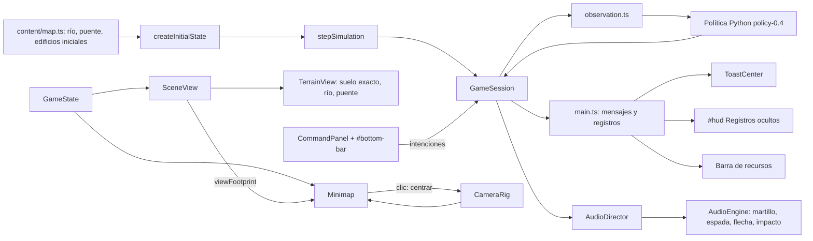
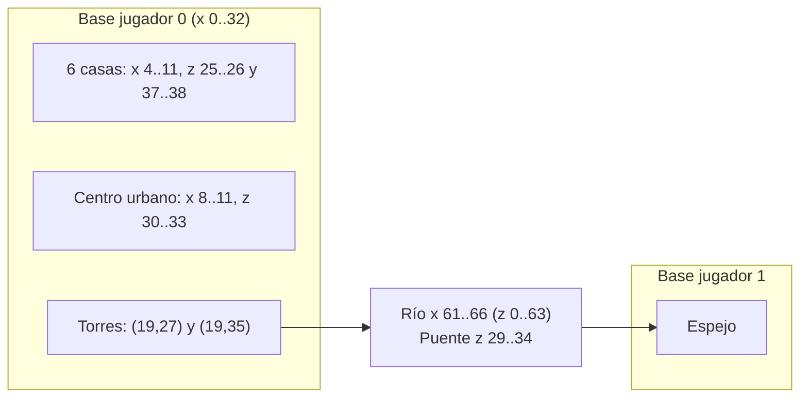

# RTS — SDD de la etapa 6: interfaz, río con puente, aldea inicial y ajustes de sonido

**Versión del SDD:** P6-1.0  
**Versión objetivo del juego:** `p6.0.0`  
**Estado:** implementada en la rama `etapa_6_ajustes` (confirmación local, sin push ni merge); pendiente la aceptación auditiva y visual del autor. Ver §7 para lo verificado y las desviaciones.  
**Rama de desarrollo:** `etapa_6_ajustes`, a crear desde `realismo_audiovisual` (HEAD `0b59c5e`), porque P5 todavía no está en `main`. Al preparar este SDD `tests/unit/p5-audio.test.ts` aparece modificado sin commit: P6-00 decide si se confirma o se descarta antes de ramificar.  
**Base funcional:** RTS P5, mapa 128 × 64, simulación lógica en TypeScript a 20 ticks/s, estrategia Python (`policy-0.3`) en Pyodide, render Three.js procedural con cámara ortográfica, audio procedural con Web Audio.

## 1. Propósito

Pulir lo que el autor detectó al jugar P5:

1. **Interfaz:** HUD técnico oculto por defecto, mensajes temporales en pantalla, barra inferior con botones mejorados, miniatura del mapa en tiempo real y algo más de zoom.
2. **Aspecto:** marcas de bando solo con contorno y nada dibujado fuera del rectángulo del mapa (negro).
3. **Sonido:** martilleo, espadas y flechas más creíbles.
4. **Mundo y partida:** un río que cruza el mapa con un puente, una aldea inicial más poblada (casas y torres) y una IA que, además del centro urbano, puede atacar torres que vea.

Coherente con P2 a P5: todo es **procedural**, sin archivos de sonido, texturas, modelos ni dependencias nuevas. A diferencia de P5, **P6 sí toca el núcleo, el mapa y la política Python** (río, puente, edificios iniciales y objetivo de la IA); por tanto `hashState` cambia respecto de P5 de forma deliberada (§2.2).

## 2. Alcance

### 2.1 Requisitos

| ID | Requisito |
|---|---|
| P6-R01 | Martilleo al construir más realista (golpe de martillo sobre clavo y madera). |
| P6-R02 | La marca de bando de unidades y edificios (círculo y rombo) se dibuja solo con contorno, sin relleno. |
| P6-R03 | La ventana de registros (HUD técnico) está oculta por defecto y se muestra con un botón. |
| P6-R04 | Mensajes temporales en pantalla (recursos insuficientes, ubicación rechazada, etc.) en lugar de una línea fija del HUD. |
| P6-R05 | Miniatura del mapa en tiempo real, abajo a la derecha. |
| P6-R06 | Barra horizontal inferior que aloja los botones de acción que ya existen, con mejor aspecto. |
| P6-R07 | Todo lo que queda fuera del rectángulo del mapa es negro. |
| P6-R08 | Un poco más de zoom con la rueda del ratón. |
| P6-R09 | Choque de espadas lo más realista posible (metal contra metal). |
| P6-R10 | Flechas que suenen a flecha (cuerda, vuelo breve, impacto) y no a ventarrón. |
| P6-R11 | Río de lado a lado por la mitad del escenario, con un puente para cruzarlo. |
| P6-R12 | Destruir el centro urbano sigue siendo el objetivo principal; la IA puede atacar de forma opcional una torre que vea. |
| P6-R13 | Cada bando empieza con más casas y algunas torres de defensa. |

### 2.2 Decisiones explícitas

- **Interpretaciones (corregibles por el autor):**
  - «Más zoom» = **acercar más** (`ZOOM_MAX` de 3 a 4,5); el alejamiento (`ZOOM_MIN` 0,6) no cambia.
  - «Ventana de Logs» = el panel de texto `#hud` (tick, hash, IA, rendimiento, audio, versiones). Los **recursos y la población no son registros**: pasan a una barra de recursos siempre visible (P6-H01), porque hoy viven en ese panel y el jugador los necesita.
  - «Mensajes temporales» = lo que hoy es la línea `message` del HUD; pasa a avisos flotantes que se desvanecen. La línea queda también en el panel de registros como «último mensaje».
  - «Río de lado a lado por la mitad» = una franja vertical (eje z) en el centro del mapa, entre las dos bases, de borde a borde (z = 0 a 64). Un **único puente** central.
  - «Barra en la parte inferior del mapa» = barra a todo el ancho **debajo** de la vista de juego (la vista se reduce; la barra no tapa unidades). La miniatura ocupa el extremo derecho de esa barra, es decir, la esquina inferior derecha de la pantalla.
  - «Que la IA vea una torre» = hay una torre enemiga completa a 14 celdas o menos de algún militar de su grupo (el juego no tiene niebla de guerra; el radio evita que la IA «adivine» torres lejanas).
- **Cambios de reglas aceptados en P6** (frente a P5, que no los tenía): terreno nuevo `kind: "bridge"` (transitable y no edificable), edificios iniciales por bando, política Python `policy-0.4`. Consecuencias: `STATE_SCHEMA_VERSION` 6, `MAP_VERSION` `map-0.4`, `BALANCE_VERSION` `balance-0.3` (arranque con más capacidad de población) y `hashState` distinto del de P5. La verificación de determinismo pasa a ser «misma semilla y mismas órdenes, mismo hash», no «igual que P5».
- **Sin cambios de esquema en el contrato `worker-v2`:** la observación sigue enviando el terreno como `{x, z, w, h}` (el esquema admite hasta 256 rectángulos). Python ve el puente como un obstáculo no edificable: es conservador (no coloca obras sobre él) y solo afecta al filtro de nodos alcanzables, que usa nodos propios cercanos a la base. Los códigos de motivo son libres (`^[A-Z_]{1,32}$`), por lo que `ATTACK_TOWER` no exige cambio de esquema. Cambia la cadena `policy` (`policy-0.4`) y `game_version`, de modo que **`contracts/worker-v2/fixtures.json` se regenera** (P6-00 actualiza el generador).
- **El puente no es una regla de navegación nueva:** sus celdas simplemente no se bloquean en la cuadrícula. «No edificable» sale de que el terreno ya impide colocar huellas encima (`footprintFree`).
- **Todo lo demás de presentación** (barra, miniatura, avisos, contornos, negro exterior, zoom, audio) no decide reglas ni toca el estado.
- **Reglas de «quién suena» de P4/P5 intactas** (`PLAYER_ONLY_CUES`, visibilidad en pantalla, topes, prioridades, ducking). P6 cambia **cómo suenan** martillo, espada y flecha y añade un cue de impacto de flecha.
- **Reglas de P5 que P6 sustituye:** (a) la condición de espada de P5-H03 (≤ 0,5 s, 4 modos) por la de P6-H09; (b) el viento de flecha de P5-H04 por la cuerda y el vuelo breve de P6-H10; (c) la nota «golpe seco final de la flecha descartado» de P5 queda sin efecto: P6 lo recupera como `arrowHit`; (d) la franja arbolada exterior y el margen de suelo de P3-R07 desaparecen por P6-R07.
- **Sin muestras externas:** si la síntesis procedural no satisface al autor en espadas o flechas, la alternativa (un banco de muestras con licencia clara) se propone como etapa aparte; no se usa en P6.
- **Rama y publicación:** se trabaja en `etapa_6_ajustes`. No se hace merge, push ni publicación sin instrucción expresa.
- **Pruebas:** verificaciones breves y dirigidas, como en P3 a P5. La calidad estética (oído y vista) la juzga el autor.

### 2.3 Fuera de alcance

Niebla de guerra, órdenes desde la miniatura (clic derecho), alertas parpadeantes de ataque en la miniatura, atajos de teclado para los botones de acción, más de un puente, vado o cruce a nado, diseño de mapas alternativos, cambios en costes, vida o daño de unidades y edificios, muestras de audio externas, sonido de agua o ambiente, selector de dificultad de la IA, y cualquier cambio del contrato `worker-v2` distinto del texto de versión.

## 3. Historias y criterios de aceptación

### Interfaz

### P6-H01 — Registros ocultos y barra de recursos (P6-R03)

**Como jugador**, quiero ver la pantalla limpia y consultar los registros solo cuando los necesite.

- **CA01:** `#hud` (registros) arranca oculto. Un botón **«Registros (L)»** en `#controls` y la tecla `L` lo muestran y ocultan; el botón refleja el estado. El estado **no se persiste**: cada carga empieza oculto.
- **CA02:** el contenido del panel conserva las líneas actuales (tick y hash, IA, rendimiento, audio, rutas, versiones, último mensaje) y agrega `?fixture` y errores como hasta ahora. Mientras está oculto no se construye el texto cada cuadro; el resumen de rendimiento (`PerfRecorder`) sigue calculándose.
- **CA03:** **barra de recursos** siempre visible, arriba a la izquierda: alimento, madera, piedra y población `vivos (+en cola) / capacidad`, con punto de color por recurso. Se actualiza cada cuadro solo si el valor cambia. No es interactiva.
- **CA04:** la selección actual (`describeEntity`) deja el HUD y pasa a la zona de información de la barra inferior (P6-H03 CA03).
- **CA05:** «Exportar diagnóstico», pausa, reinicio, música, efectos y ayuda siguen funcionando igual. La ayuda (`index.html`) documenta `L`, la barra, la miniatura y los contornos.
- **CA06:** si ocurre un error inesperado con el panel oculto, se muestra un aviso de error (P6-H02), de modo que ningún fallo pasa inadvertido.

### P6-H02 — Mensajes temporales en pantalla (P6-R04)

**Como jugador**, quiero ver un aviso breve cuando una orden falla (recursos insuficientes, ubicación inválida…) sin tener que mirar el HUD.

- **CA01:** módulo `ToastCenter` (DOM, `src/ui/toasts.ts`) con `show(texto, tipo)`, donde `tipo` es `info`, `warn` o `error`, y avisos fijos con `id` (`showSticky(id, texto)` y `clear(id)`).
- **CA02:** posición: arriba al centro, bajo la barra de recursos; ancho máximo 520 px; `pointer-events: none` (no interfiere con la selección); `aria-live="polite"`.
- **CA03:** duración por defecto 3,5 s (`info` 2,5 s; `error` 4,5 s), con entrada de 120 ms y salida de 300 ms. Máximo **3 avisos** a la vez: el más antiguo sale al llegar uno nuevo. Usan el reloj real, de modo que se ven también en pausa.
- **CA04:** un texto idéntico que llega en menos de 1,2 s no se duplica: renueva el temporizador y muestra un contador `×2`, `×3`.
- **CA05:** estilos: `warn` ámbar para rechazos de órdenes (`Orden rechazada: …`, `Ubicación rechazada: …`, `En pausa: reanude…`, `Seleccione al menos un aldeano…`), `info` neutro para confirmaciones (`Construcción: obra iniciada…`, `Diagnóstico exportado`) y `error` rojo para fallos (`Error inesperado…`).
- **CA06:** «Orden enviada…» **no** genera aviso: se sustituye por el resultado real cuando llega.
- **CA07:** el mensaje de colocación («Colocando casa: clic izquierdo confirma…») es un aviso fijo que se retira al confirmar, cancelar o perder los aldeanos seleccionados.
- **CA08:** todas las escrituras actuales de `message` en `main.ts` y los `hooks.message` del controlador pasan por `ToastCenter`; no se cambian los textos ni `REJECT_TEXT`. «Reiniciar» limpia los avisos.

### P6-H03 — Barra inferior y botones mejorados (P6-R06)

**Como jugador**, quiero una barra fija con las acciones, clara y con buen aspecto.

- **CA01:** `#bottom-bar` ocupa todo el ancho, abajo, con altura de 140 px (108 px si la ventana mide menos de 600 px de alto). La vista de juego (`#view`) ocupa el resto; `SceneView.resize()` usa el tamaño del lienzo y no el de la ventana, y `viewHeight` (68 unidades) se reparte en la altura de la vista, de modo que el zoom no cambia de escala. El borde de pantalla del desplazamiento por cursor es el de la vista (el controlador ya usa el rectángulo del lienzo), así que el cursor sobre la barra no desplaza la cámara.
- **CA02:** tres zonas: **información** (izquierda, ≈ 240 px), **acciones** (centro, flexible) y **miniatura** (derecha, P6-H04). Sustituye al panel flotante `#panel` actual.
- **CA03:** zona de información: nombre y vida de la entidad inspeccionada, o «N unidades seleccionadas» con el desglose por tipo; sin selección, la pista «Seleccione unidades o un edificio propio».
- **CA04:** zona de acciones: las mismas acciones que hoy (construir casa, cuartel y torre; entrenar; cola con cancelar; detener militares; cancelar obra), con la misma lógica y los mismos `data-act`. `CommandPanel` conserva su contrato con el núcleo (solo traduce clics en intenciones).
- **CA05:** aspecto del botón: degradado oscuro tipo metal, borde de 1 px con luz superior, esquinas de 6 px, **icono SVG en línea** (casa, cuartel, torre, aldeano, soldado, arquero, detener, cancelar) a la izquierda, nombre en la primera línea y **coste en fichas de color** en la segunda (punto de color por recurso). Estados: normal, `hover`, `active` (pulsado), `.active` (modo colocación, borde verde) y deshabilitado (en pausa).
- **CA06:** **coste insuficiente:** la ficha del recurso que falta se muestra en rojo y el botón se atenúa, pero **sigue siendo pulsable**, de modo que el clic produce el aviso «recursos insuficientes» de P6-H02. Este estado se actualiza en el sitio (sin reconstruir la estructura), conservando la regla de P2 de no destruir botones bajo el cursor.
- **CA07:** barra de progreso fina bajo el título de la cola de producción y de la obra (hoy es texto «37 %»); el texto se conserva para lectura.
- **CA08:** la barra se ve en pausa (botones deshabilitados) y con la partida terminada. `#overlay` y `#help` se reubican para no quedar bajo la barra (`#help` usa `max-height` según la altura de la vista).

### P6-H04 — Miniatura del mapa en tiempo real (P6-R05)

**Como jugador**, quiero ver el mapa completo y moverme por él.

- **CA01:** `<canvas id="minimap">` de 256 × 128 px (2 px por celda; 192 × 96 si la barra mide 108 px), en el extremo derecho de la barra inferior, con borde y fondo negro.
- **CA02:** **capa estática** (suelo verde oscuro, rocas grises, agua azul, puente marrón) dibujada una vez en un lienzo fuera de pantalla y reconstruida al cambiar el terreno (la misma clave que usa `SceneView`).
- **CA03:** **capa dinámica**, redibujada cada cuadro con los datos de `GameState`: edificios como cuadrados a escala de su huella (mínimo 3 px) en el color de bando (azul jugador, rojo rival) con la misma distinción de contorno que la marca de P6-H06; obras con relleno parcial; unidades como puntos de 2 × 2 px; edificios destruidos desaparecen en el mismo cuadro. No hay niebla: se ve todo, como en el mundo.
- **CA04:** **encuadre de la cámara:** cuadrilátero blanco con el área visible proyectada sobre el suelo (`SceneView.viewFootprint()` desproyecta las cuatro esquinas de la vista sobre `y = 0`). Al ser la cámara isométrica a 45° el encuadre es un rombo o un rectángulo girado; se recorta al lienzo.
- **CA05:** **interacción:** clic o arrastre con el botón izquierdo sobre la miniatura centra la cámara en ese punto del mapa (limitado por `CameraRig.clamp()`). La miniatura captura el puntero, no inicia selección ni arrastre en el mundo y no dispara desplazamiento por borde.
- **CA06:** la orientación es la del mapa (x a la derecha, z hacia abajo): la base del jugador a la izquierda y la rival a la derecha.
- **CA07:** coste ≤ 0,3 ms por cuadro con 100 unidades y 30 edificios (§6). Sigue dibujándose en pausa y al terminar la partida. Un reinicio la reconstruye.

### P6-H05 — Más zoom (P6-R08)

- **CA01:** `ZOOM_MAX` pasa de 3 a **4,5**; `ZOOM_MIN` (0,6) y la sensibilidad de la rueda no cambian.
- **CA02:** con zoom 4,5 no aparecen artefactos: texturas de suelo sin pixelación evidente, sombras sin salto, contornos y barras de vida legibles, partículas con el tamaño correcto (`PARTICLE_SCALE`). Si no se cumple se reduce a 4,0 y se registra.
- **CA03:** el desplazamiento por teclado y por borde sigue escalando con `1 / zoom` (más lento al acercar), como hoy.

### Aspecto

### P6-H06 — Marcas de bando solo con contorno (P6-R02)

**Como jugador**, quiero que el círculo y el rombo no tapen el modelo.

- **CA01:** unidades y edificios dibujan la marca solo con **contorno**: el jugador, un **anillo** blanco; el rival, un **rombo hueco** oscuro. Se conservan tamaño exterior (radio 0,2 en unidades, 0,28 en edificios, ×1,4 en el centro urbano), posición, orientación y color de P5.
- **CA02:** grosor del trazo ≈ 25 % del radio exterior (nunca menor de 0,05 unidades), de modo que el rival sigue siendo inequívoco: un rombo contra un círculo y blanco contra oscuro, más allá del color del cuerpo (RF-10).
- **CA03:** la geometría se crea una vez por variante, se comparte y se libera con el resto de recursos; la marca no pierde el contorno ocluido (silueta de P3), y no cambian el coste ni el número de *draw calls*.
- **CA04:** la miniatura de P6-H04 y la ayuda (`index.html`) describen los símbolos como «círculo» y «rombo» (contornos), no como «disco».
- **CA05:** si el contorno oscuro del rival se pierde sobre el suelo, se mantiene el color y se añade un halo claro de 0,02 unidades; se decide al verlo y se registra.

### P6-H07 — Negro fuera del escenario (P6-R07)

**Como jugador**, quiero que el mundo termine en el borde del rectángulo y lo demás sea negro.

- **CA01:** `scene.background` y el color de limpieza del renderizador pasan a `0x000000`; `html` y `body` de `index.html` usan `#000`.
- **CA02:** el suelo mide exactamente `mapWidth × mapDepth`: se elimina `GROUND_MARGIN` (190). Lo mismo para la textura de tono, las sombras de nubes y el decal de sombras de contacto: nada se dibuja más allá del rectángulo.
- **CA03:** se elimina la **franja arbolada exterior** (`BORDER_BAND`) y su bucle en `planScenery`. La vegetación sobre bloques de roca dentro del mapa se conserva.
- **CA04:** los árboles y edificios del borde pueden proyectar sombra hacia fuera, pero no hay suelo que la reciba: no debe verse nada fuera del rectángulo, y con zoom mínimo y la cámara en una esquina se ve el negro limpio.
- **CA05:** el agua del río llega exactamente al borde del mapa (P6-H11).
- **CA06:** el fondo de la miniatura y el del marco de la barra son negros, consistentes con el exterior.

### Sonido

### P6-H08 — Martilleo realista (P6-R01)

**Como jugador**, quiero oír un martillo de obra de verdad, con golpe y madera, no un «pip» sintético.

- **CA01:** cada golpe se compone de: (1) **transitorio de contacto** de ruido paso alto de 1 a 2 ms; (2) **tabla de madera** con `modalBank` de 4 a 6 modos inarmónicos entre 280 y 1 200 Hz con decaimientos de 25 a 90 ms (el tono de la tabla cambia por variante); (3) **cabeza de metal / clavo**, parcial agudo entre 2,5 y 4,5 kHz de 10 a 25 ms; (4) **golpe de estructura** sordo de 90 a 160 Hz, 40 ms. Se retira la receta actual de barridos sinusoidales (`thump`) que suena a «pew».
- **CA02:** **6 variantes** (antes 4), de duración ≤ 0,45 s: 2 de golpe único firme, 2 de golpe con rebote suave (segundo impacto a 70 a 110 ms con el 35 % de la energía) y 2 de doble golpe rápido (segundo impacto a 110 a 150 ms con el 80 %). Variación de tono ±8 % y volumen ±1 dB; nunca se repite la misma variante dos veces seguidas (regla de P5).
- **CA03:** ganancia relativa 0,6 (antes 0,5) y reverb 0,08 (antes 0,05), como eco corto de exterior. Se conservan tope 6, separación de 80 ms, prioridad 1 y la regla de P4: un `hammer` por cada evento de trabajo de construcción, visible en pantalla, ambos bandos.
- **CA04:** sanidad de señal: valores finitos, pico ≤ 0,98, determinismo por semilla; centroide espectral entre 1,2 y 3,5 kHz; al menos el 40 % de la energía en los primeros 60 ms; cola 35 dB por debajo del pico a 0,35 s; ninguna banda de 1/3 de octava reúne más del 45 % de la energía (sin tono sostenido).

### P6-H09 — Espadas: choque de metales (P6-R09)

**Como jugador**, quiero oír acero contra acero con peso, brillo y vibración, no una campanilla.

- **CA01:** el impacto se compone de: (1) **transitorio de contacto** de ruido de banda ancha (1 a 3 ms, con energía fuerte entre 3 y 8 kHz); (2) **dos hojas** modeladas como dos bancos modales de **10 o más parciales cada uno** entre 1 y 9 kHz, con razones inarmónicas de barra libre (1; 2,76; 5,40; 8,93) y de placa (1,59; 3,16; 4,93; 6,70 …), desafinados entre sí 6 a 30 Hz para producir *batido* (reverberación metálica «nadando»), con **T60 decreciente con la frecuencia** (≈ 0,35 s el modo más grave, ≈ 0,04 s los más agudos); (3) **«shing» de deslizamiento** de 80 a 180 ms: ruido paso alto de 2 kHz con banda ascendente y rizado de peine de 0,3 a 0,5 ms para textura metálica; (4) **golpe de la guarda**: choque sordo de 90 a 220 Hz (25 ms) y *knock* de 500 a 900 Hz (15 ms) para el peso; (5) en la mitad de las variantes, un **segundo micro-impacto** a 12 a 35 ms con el 45 % de energía (rebote de las hojas). `softClip` ligero para el «mordiente».
- **CA02:** duración ≤ 0,7 s (antes 0,5 s) y **8 variantes** (antes 5) con fundamentales, desafinaciones, rasgueo y rebote distintos; sin repetición consecutiva.
- **CA03:** sanidad de señal (sustituye a P5-H03 CA04): finitos, pico ≤ 0,98, determinismo; centroide espectral ≥ 2,5 kHz; al menos el 35 % de la energía entre 2 y 10 kHz; pasados 100 ms, la banda de 1/12 de octava más fuerte reúne ≤ 30 % de la energía (sin tono de campanilla); RMS entre 0,5 y 0,7 s al menos 40 dB por debajo del de los primeros 50 ms.
- **CA04:** ganancia 0,85 (antes 0,8); reverb 0,20 (antes 0,15). Se conservan prioridad 2, tope 8, separación de 50 ms y la regla de P4-H01 (soldado, ambos bandos, en pantalla, en el tick del daño).
- **CA05:** el presupuesto de síntesis de P5 (efectos listos en < 1,5 s tras el primer gesto, sin bloquear la interfaz > 100 ms) se mantiene; si las espadas lo rompen, se generan por lotes.

### P6-H10 — Flechas: cuerda, vuelo y impacto (P6-R10)

**Como jugador**, quiero que una flecha suene a flecha: el chasquido de la cuerda, un silbido corto y el golpe al llegar.

- **CA01:** el cue `arrow` (disparo) se rehace como: (1) **cuerda**: pulsación amortiguada con 2 o 3 modos entre 140 y 260 Hz que bajan un 5 % (60 a 120 ms) más un chasquido de ruido paso alto de 2 ms; (2) **golpe de brazo** grave de 90 Hz (30 ms); (3) **«fiit» del asta**: ruido de **banda estrecha** (paso banda con Q ≥ 6) entre 2,2 y 3,4 kHz que cae un 12 % durante 0,12 a 0,25 s, con nivel del 30 % del de la cuerda. Se eliminan el barrido de ruido ancho de 4 kHz a 1,2 kHz y la capa grave de aire de P5.
- **CA02:** duración 0,35 a 0,45 s, **6 variantes** (antes 5), ganancia 0,8 (antes 0,9), reverb 0,20. Sanidad de señal: al menos el 60 % de la energía en los primeros 120 ms (sonido de «ataque», no de ráfaga sostenida); el tramo de 150 a 400 ms al menos 12 dB por debajo del pico; finitos, pico ≤ 0,98, determinismo.
- **CA03:** **nuevo cue `arrowHit`** (impacto): golpe seco de madera y cuerpo, ≤ 0,2 s, 3 variantes (modos de 400 a 700 Hz de 60 ms y un *thud* de 120 Hz). Ganancia 0,5, prioridad 2, tope 6, separación 50 ms, reverb 0,10.
- **CA04:** `arrowHit` se programa en el reloj del `AudioContext` con un retardo igual a la duración de vuelo visual (`flightSeconds(distancia)` = `clamp(distancia / 18, 0,15; 0,6)`), y suena solo si el objetivo está en pantalla. El disparo sigue rigiéndose por la visibilidad del origen (regla de P4). El panorama del disparo es el del origen y el del impacto es el del objetivo; el barrido de P5 (`panTo`) se mantiene solo para el «fiit».
- **CA05:** la salva de 3 flechas del centro urbano (0, 0,5 y 1,0 s) genera tres pares disparo + impacto. Arquero, torre y centro urbano comparten ambos cues.
- **CA06:** la pausa congela el sonido pendiente y el reinicio lo cancela (como en P4); la cuenta del disparo y del impacto no cambia el conteo de voces ni la separación de otros cues.

### Mundo y partida

### P6-H11 — Río con puente (P6-R11)

**Como jugador**, quiero un río que separe las bases y un puente para cruzarlo.

- **CA01:** el mapa (128 × 64) tiene un **río vertical** de 6 celdas de ancho en `x = 61..66`, de `z = 0` a `z = 63`, con un **puente** de 6 × 6 celdas en `z = 29..34`. Terreno nuevo: dos rectángulos de agua (`{x:61, z:0, w:6, h:29}` y `{x:61, z:35, w:6, h:29}`) y un rectángulo `kind: "bridge"` entre ellos (`{x:61, z:29, w:6, h:6}`). Los dos bloques de roca centrales de P2 (`x 62..65`) se eliminan; las rocas laterales (`x 32..34`) y los lagos (`x 38..47`) se conservan. La simetría especular se cumple (el río es su propio espejo).
- **CA02:** el agua es obstáculo (como los lagos); el puente es **transitable** (sin bloqueo en `NavGrid`) y **no edificable** (`footprintFree` ya lo impide por solapar terreno). Con un solo paso, `wouldBlockPath` sigue rechazando obras que cortarían el camino entre las bases.
- **CA03:** `validateMapLayout` y `validateInitialReachability` comprueban: celdas no solapadas con nodos ni edificios, simetría, y **centro urbano de cada bando alcanzable desde el otro** únicamente a través del puente. Las unidades de ambos bandos cruzan el puente sin quedar atascadas con 100 unidades en cruce (fixture `crowd100` ampliado o `rio`, §4.9).
- **CA04:** **render del río:** una sola cinta de agua continua de borde a borde (`z = 0` a `z = 64`) que pasa **bajo** el puente, con el shader de agua de P5 (profundidad normalizada de 0 en la orilla a 1 en el eje), orilla húmeda y espuma; las orillas serpentean con ruido a lo largo de z dentro del rectángulo lógico, y los extremos en `z = 0` y `z = 64` son rectos y terminan exactamente en el borde del mapa. En `?graphics=low` se usa el material de P4.
- **CA05:** **render del puente:** tablero de madera con tablones (material de madera existente), dos barandillas con postes y travesaño a lo largo de los lados norte y sur (los extremos quedan abiertos), dos pilotes por lado visibles bajo el tablero, y estribos de piedra bajos en ambas orillas. Altura de la cubierta 0,16 unidades sobre el suelo.
- **CA06:** unidades, anillos de selección y barras de vida se elevan sobre el tablero con una función `walkHeight(x, z)` (0,16 sobre el tablero, rampa de 0,6 celdas en los extremos), sin alterar la posición lógica.
- **CA07:** la vegetación de `planScenery` y las matas de hierba no aparecen sobre el puente ni sobre el río; el puente se considera terreno (margen de 0,15) para las matas.
- **CA08:** la miniatura (P6-H04) dibuja río y puente; el sonido y la IA no cambian por el río salvo lo indicado en P6-H13.

### P6-H12 — Aldea inicial: más casas y torres (P6-R13)

**Como jugador**, quiero empezar con una aldea hecha y con defensas.

- **CA01:** cada bando empieza con **6 casas** y **2 torres** completas, además del centro urbano. Posiciones del jugador 0 (el jugador 1 es el espejo `x' = 128 − x − tamaño`):
  - Casas (2 × 2): `(4,25)`, `(7,25)`, `(10,25)`, `(4,37)`, `(7,37)`, `(10,37)` (dos hileras con calle de 1 celda entre casas y de 3 celdas hasta el centro urbano).
  - Torres (2 × 2): `(19,27)` y `(19,35)`, flanqueando el corredor de salida hacia el puente (z 29 a 34, de 6 celdas, igual que el puente).
- **CA02:** `MapLayout` gana `startBuildings: readonly { owner, kind, cell }[]` (datos, no código). `validateMapLayout` comprueba que cabe en el mapa, no solapa nada, mantiene la simetría y deja libres las celdas de aparición de aldeanos, los accesos a los nodos y el camino al puente.
- **CA03:** `createInitialState` añade los edificios completos (vida máxima, `complete: true`) y fija `popCapacity` con `capacityOf` (10 + 6 × 5 = **40** por bando; el tope global 50 no se supera). Se mantienen 3 aldeanos y los recursos iniciales de P5.
- **CA04:** la IA y el jugador parten en igualdad de condiciones (mismos edificios espejados). Los edificios iniciales cuentan para los límites de la política (§4.4) y no se pueden cancelar.
- **CA05:** el balance de combate no se modifica: la defensa sale de los edificios que ya existen (torre: arma de arquero, alcance 5; centro urbano: 3 flechas).
- **CA06:** medición en P6-11: IA contra pasivo gana antes del límite de 20 minutos y IA contra IA no se estanca en empate; si falla, se ajusta el número o la posición de las torres (§8) y se documenta.

### P6-H13 — La IA puede atacar torres que vea (P6-R12)

**Como jugador**, quiero una IA que sigue buscando mi centro urbano pero que no ignora las torres que la amenazan.

- **CA01:** el objetivo principal sigue siendo el centro urbano enemigo. La IA solo evalúa torres cuando ya lanza una expedición (≥ 8 militares libres, sin cambios respecto de P3) y no hay unidades militares enemigas a 8 celdas del grupo (la prioridad de combatir unidades enemigas se conserva).
- **CA02:** una torre es **visible** si está completa (`complete`), tiene vida y está a ≤ **14 celdas** de al menos un militar de la expedición (`VISION_RADIUS`).
- **CA03:** **regla opcional:** entre las torres visibles se elige la más cercana al grupo, y se ataca solo si está **más cerca del grupo que el centro urbano enemigo**; en caso contrario (o si no hay torre visible) el objetivo es el centro urbano, como en P3. Desempate por ID.
- **CA04:** sin estado entre decisiones: la misma observación produce los mismos comandos. Al ser la distancia a la torre decreciente mientras el grupo se acerca, el objetivo no oscila; al destruirse la torre, la siguiente decisión vuelve al centro urbano o a otra torre visible.
- **CA05:** código de motivo `ATTACK_TOWER` (el de siempre sigue siendo `ATTACK` cuando el objetivo es otro). `VERSION = "policy-0.4"`; `MAX_COMMANDS`, límites de población y el resto de prioridades no cambian.
- **CA06:** `MAX_TOWERS` pasa de 2 a **4** (2 iniciales + 2 construidas), para que la IA conserve el comportamiento de P3 de reunir piedra y construir torres.
- **CA07:** no se modifica el núcleo de combate: un ataque a un edificio ya existe en `orders.ts`/`combat.ts` (cede ante agresores y se reanuda).

### P6-H14 — Versiones, ayuda y documentación

- **CA01:** `GAME_VERSION = "p6.0.0"`, `STATE_SCHEMA_VERSION = 6`, `MAP_VERSION = "map-0.4 (128x64, río y puente)"`, `BALANCE_VERSION = "balance-0.3"`, `AUDIO_VERSION = "audio-0.3"`, `GRAPHICS_VERSION = "gfx-0.3"` y `POLICY_VERSION = "policy-0.4"` (en `src/content/versions.ts` y `src/ai-client/protocol.ts`). El panel de registros las muestra.
- **CA02:** la ayuda de `index.html` y el README describen la barra, la miniatura, `L` para registros, el río y el puente, la aldea inicial, el zoom, los contornos y los parámetros existentes (`?graphics=low`, `?shadows=0`, `?audio=0`).
- **CA03:** `contracts/worker-v2/generate-fixtures.mjs` y `fixtures.json` se actualizan a `policy-0.4` y `game_version` actual; el esquema no cambia (§2.2).

## 4. Diseño técnico y contratos

### 4.1 Flujo de datos

TypeScript sigue siendo la autoridad de las reglas. La interfaz y el render solo leen estado.

### 4.2 Núcleo y contrato

| Archivo | Cambio |
|---|---|
| `content/map.ts` | `TerrainRectSpec.kind?: "water" \| "bridge"`; `CENTER_TERRAIN` sustituido por `RIVER`; `MapLayout.startBuildings`; constantes `START_HOUSES` y `START_TOWERS`; `validateMapLayout` ampliado. |
| `core/types.ts` | `TerrainRect.kind?: "water" \| "bridge"`. |
| `core/obstacles.ts` | `build()` no bloquea los rectángulos `kind === "bridge"`. |
| `core/placement.ts` | Sin cambios: el puente es terreno y bloquea la huella. |
| `core/state.ts` | `createInitialState` añade `startBuildings` completos y fija `popCapacity` con `capacityOf`. |
| `core/map-check.ts` | Comprueba el cruce entre bases a través del puente. |
| `core/fixtures.ts` | Nuevo fixture `rio` (§4.9) y el resto adaptado al mapa nuevo. |
| `ai-client/observation.ts` | Sin cambios de forma: el puente viaja como `{x, z, w, h}`. |
| `ai-client/protocol.ts` | `POLICY_VERSION = "policy-0.4"`. |
| `rendering/scenery.ts` | `SceneryRect.kind` admite `"bridge"`; `planScenery` omite agua y puente, y elimina el bucle de `BORDER_BAND`. |

`hashState` incluye ahora los edificios iniciales; la partida con la misma semilla sigue siendo determinista.

### 4.3 Mapa y aldea inicial

Esquema del jugador 0 (el jugador 1 es el espejo; el río y el puente son su propio espejo):

- Nodos de recursos, aparición de aldeanos y rocas laterales **no cambian**; las casas (x ≤ 11) y las torres (x 19 a 20) no los tocan: alimento en `x = 15, z 22..29`, madera en `x 15..17, z 35..41`, piedra en `x 15..16, z 46..47`, aparición en `(13,5; 31..33)`.
- Las torres dejan entre sí un corredor de 6 celdas (z 29 a 34), alineado con el puente.
- Todos los números son **constantes de datos** en `map.ts`; ajustarlos no exige tocar código.

### 4.4 Política Python (`policy-0.4`)

Cambios acotados en `python/policy/policy.py`:

- Constantes nuevas `VISION_RADIUS = 14`; `MAX_TOWERS = 4`; `VERSION = "policy-0.4"`.
- `_attack`: con el grupo `group` (centroide) y sin militares enemigos a `ENGAGE_RADIUS`:
  1. `towers` = torres enemigas `complete`, `hp > 0`, con distancia mínima a algún militar del grupo ≤ `VISION_RADIUS`;
  2. si hay torre, `tower` = la más cercana al centroide (desempate por ID) y `center` = centro urbano enemigo (el de menor ID);
  3. si `tower` y `dist(group, tower) < dist(group, center)`: objetivo `tower` y motivo `ATTACK_TOWER`; en otro caso, la lógica de P3.
- `ATTACK_TOWER` cumple `^[A-Z_]{1,32}$` y entra en `reason_codes` (máx. 8). Sin cambios en `contract.py` salvo la versión.
- Pruebas nuevas en `python/tests/test_strategy.py`: torre visible más cercana que el centro → `ATTACK_TOWER`; torre fuera de 14 celdas → centro; torre incompleta → centro; centro más cerca que la torre → centro; determinismo; límite de 4 comandos.
- Las torres iniciales cuentan para `MAX_TOWERS` y para `_choose_cell` (celdas ocupadas), lo que no requiere cambios más allá del valor de la constante.

### 4.5 Interfaz

| Archivo | Cambio |
|---|---|
| `index.html` | `#bottom-bar` (tres zonas), `#resources`, `#minimap`, `#toasts`, botón «Registros (L)», `#hud` oculto, estilos de botones y fondos negros; ayuda actualizada. |
| `ui/toasts.ts` (nuevo) | `ToastCenter` (P6-H02). |
| `ui/minimap.ts` (nuevo) | `Minimap` con capa estática, capa dinámica, encuadre y captura del puntero (P6-H04). |
| `ui/command-panel.ts` | Se monta en la zona de acciones; iconos SVG en línea, fichas de coste, estado de coste insuficiente en sitio y barras de progreso; misma lógica y mismos `data-act`. |
| `ui/messages.ts` | Sin cambios de textos; se añade el mapeo de tipo de aviso por prefijo. |
| `input/camera-rig.ts` | `ZOOM_MAX = 4.5`; método `centerOn(x, z)` (clamp incluido) para la miniatura. |
| `input/controller.ts` | `hooks.message(text)` pasa a `hooks.notify(text, kind)`; avisos fijos de colocación. |
| `main.ts` | Conecta `ToastCenter`, `Minimap`, barra de recursos y botón/atajo `L`; `viewFootprint`; no construye el texto de registros si está oculto. |

Estructura de la barra: `display: grid; grid-template-columns: 240px 1fr auto;`, con la vista de juego en el contenedor superior (`#view` deja de ser `inset: 0` y usa `bottom: var(--bar-h)`).

### 4.6 Render

| Archivo | Cambio |
|---|---|
| `rendering/scene-view.ts` | Fondo negro; `resize()` con el tamaño del lienzo; `viewFootprint()`; `walkHeight` aplicado a unidades, anillos y barras; la vista no cambia de escala. |
| `rendering/terrain-view.ts` | Suelo exacto (sin `GROUND_MARGIN`); cinta de agua del río continua; puente (`addBridge`); tono y sombras limitados al rectángulo. |
| `rendering/water.ts` y `water-material.ts` | Geometría de cinta con extremos abiertos y atributo de profundidad normalizada desde las dos orillas. |
| `rendering/units.ts`, `buildings.ts`, `models.ts` | Marcas de contorno: anillo (`RingGeometry`) y rombo hueco (`ShapeGeometry` con agujero), geometrías compartidas. |
| `rendering/lighting.ts` | Sombras de nubes y entorno limitados al rectángulo del mapa. |
| `rendering/scenery.ts` | Sin franja exterior; omite puente. |

### 4.7 Audio

| Archivo | Cambios |
|---|---|
| `sfx.ts` | Recetas nuevas de `hammer`, `sword`, `arrow`; nueva `arrowHit`; generación por lotes si hace falta. |
| `dsp.ts` | Reutiliza `modalBank`, `filterSweep` y `softClip` de P5; añade `combFilter` (rizado de peine) y `pluckedString` (pulsación amortiguada con caída de tono) si no existen. |
| `voices.ts` | Nuevo `CueId` `arrowHit` y tabla actualizada (abajo). |
| `cues.ts` | Dos peticiones por disparo (`arrow` al origen, `arrowHit` al objetivo con `startDelay`); visibilidad por separado. `CueRequest` gana `startDelay?: number`. |
| `engine.ts` | Programa `start = currentTime + startDelay`; la pausa congela y el reinicio cancela los retardos. El contexto falso de las pruebas lo implementa. |
| `director.ts` | Sin cambio de reglas. |

| Cue | Prioridad | Tope | Separación | Ganancia (P5 → P6) | Variantes | Reverb |
|---|---|---|---|---|---|---|
| `sword` | 2 | 8 | 50 ms | 0,8 → 0,85 | 5 → 8 | 0,15 → 0,20 |
| `arrow` | 2 | 8 | 50 ms | 0,9 → 0,8 | 5 → 6 | 0,20 |
| `arrowHit` (nuevo) | 2 | 6 | 50 ms | — → 0,5 | 3 | 0,10 |
| `hammer` | 1 | 6 | 80 ms | 0,5 → 0,6 | 4 → 6 | 0,05 → 0,08 |

Presupuesto de memoria de audio: efectos nuevos ≈ +1,5 MB sobre los 6 MB de P5; total ≤ 38 MB (música ≈ 25,6 MB, efectos ≈ 7,5 MB, respuesta de impulso ≈ 0,4 MB).

### 4.8 Receta de referencia (guía de diseño)

Los parámetros exactos se ajustan al oído y se fijan en `sfx.ts`.

| Cue | Síntesis |
|---|---|
| Martillo | Transitorio (ruido paso alto, 1 a 2 ms) + tabla (`modalBank` de 280 a 1 200 Hz) + cabeza metálica (parcial de 2,5 a 4,5 kHz, 10 a 25 ms) + golpe de estructura (90 a 160 Hz, 40 ms); variantes con rebote o doble golpe. |
| Espada | Transitorio de banda ancha + dos `modalBank` de 10 o más parciales (barra y placa) con T60 decreciente y desafinación de 6 a 30 Hz + «shing» de 2 a 6 kHz con peine + golpe de guarda y *knock* + micro-impacto opcional + `softClip`. |
| Flecha (disparo) | Cuerda amortiguada (2 o 3 modos, 140 a 260 Hz, caída del 5 %) + chasquido de 2 ms + golpe de brazo (90 Hz) + «fiit» de banda estrecha (2,2 a 3,4 kHz, Q ≥ 6, 0,12 a 0,25 s). |
| Flecha (impacto) | Golpe de madera (modos de 400 a 700 Hz, 60 ms) + *thud* de 120 Hz + roce breve; 3 variantes. |

### 4.9 Fixtures de comprobación manual

- `?fixture=sonidos&ai=0` (existente) se amplía para oír martillo, espada, flecha e impacto en secuencia.
- Nuevo `?fixture=rio&ai=0`: dos grupos de 20 unidades que se cruzan por el puente y un aldeano que intenta construir sobre el puente y junto a él. Como los fixtures desactivan la IA (salvo `objetivo`), el objetivo de torres de la IA se comprueba con las pruebas Python y con partidas headless, no con este fixture.
- Los fixtures se pueden combinar con `?graphics=low` y `?shadows=0`.

## 5. Secuencia de implementación

| Paso | Trabajo | Salida |
|---|---|---|
| P6-00 | Crear `etapa_6_ajustes` desde `realismo_audiovisual`; resolver el cambio sin confirmar en `p5-audio.test.ts`; `npm run typecheck`, `npm test`, `npm run test:py` y `npm run build` en verde; capturas de referencia de P5; revisar consumidores de `TerrainRect`, `CueRequest` y `message`; actualizar generador de fixtures | Base verificada |
| P6-01 | Mapa y núcleo: río, puente, `startBuildings`, `createInitialState`, `popCapacity`, validaciones y alcanzabilidad; ajustar pruebas que dependan del arranque | Mundo nuevo jugable sin render |
| P6-02 | Política Python `policy-0.4`: objetivo de torres, `MAX_TOWERS`, pruebas Python, versión del contrato y fixtures | IA con torre opcional |
| P6-03 | Render del mundo: suelo exacto y fondo negro, sin franja exterior, río en cinta, puente, `walkHeight`, marcas de contorno | Escena nueva |
| P6-04 | Interfaz: avisos, registros ocultos, barra de recursos, barra inferior y botones, `ZOOM_MAX` | UI nueva sin miniatura |
| P6-05 | Miniatura: capa estática y dinámica, encuadre, interacción | Miniatura en tiempo real |
| P6-06 | Audio: martillo, espada, flecha, `arrowHit`, `startDelay`; fixture `sonidos` ampliado | Cuatro sonidos pedidos, audibles |
| P6-07 | Fixture `rio`, ayuda y README, versiones y contrato | Documentación al día |
| P6-08 | Ajuste al oído y a la vista; medición de rendimiento; partidas de referencia (IA vs pasivo, IA vs IA) | Evidencia breve |
| P6-09 | Integración, revisión acotada y commit local | Build y verificaciones dirigidas |

Trabajar en `etapa_6_ajustes` conservando el historial. No resetearla ni forzarla. No hacer merge, push ni publicar sin instrucción expresa.

## 6. Rendimiento y recursos

| Aspecto | Presupuesto |
|---|---|
| Cuadro de render (modo alto) | Mediana de 60 FPS en 45 s con `?fixture=objetivo`; ningún cuadro > 50 ms por creación de recursos |
| Miniatura | ≤ 0,3 ms por cuadro con 100 unidades y 30 edificios; lienzo estático reconstruido solo al cambiar el terreno |
| Avisos y barra | Sin reconstrucción de DOM por cuadro; actualización de texto solo si cambia el valor |
| Registros ocultos | 0 coste de construcción de texto mientras están ocultos |
| Río y puente | ≤ 0,3 ms de GPU adicional (la cinta sustituye a lagos y rocas centrales); ≤ 10 *draw calls* adicionales |
| Suelo | Menos área de suelo y de sombras que en P5 (sin margen de 190) |
| Audio | Memoria total ≤ 38 MB; efectos listos en < 1,5 s tras el primer gesto; sin bloqueos > 100 ms |
| Simulación | p95 del tick sin diferencias apreciables respecto de P5 (la capa nueva añade 16 edificios y 8 rectángulos de terreno) |
| Política Python | p95 de decisión ≤ el de P5 + 1 ms |

## 7. Verificación y cierre

No se ejecutan pruebas ni se modifica el juego al preparar este documento. Durante el desarrollo se verifican solo los riesgos de P6:

1. **Núcleo y mapa:** `validateMapLayout` y `validateInitialReachability` pasan con el río, el puente y los edificios iniciales; el puente es transitable y no edificable; `wouldBlockPath` rechaza obras que lo cortan; `popCapacity` inicial 40; misma semilla y mismas órdenes, mismo `hashState`; migración de las pruebas que fijan el arranque de P5 (capacidad 10, número de edificios, `ZOOM_MAX`, `BORDER_BAND`, `GROUND_MARGIN`, variantes de audio) con registro de qué cambió y por qué.
2. **Política Python:** casos de §4.4; determinismo; `reason_codes` válidos; pruebas de P3 sin regresión (salvo `MAX_TOWERS`).
3. **Partidas de referencia (headless):** IA contra pasivo gana antes del tick 24 000; IA contra IA termina con vencedor o, si empata, se registra y se ajusta (§8); cruce de 100 unidades por el puente sin atascos ni violaciones de población; reproducción idéntica por semilla.
4. **Interfaz (jsdom o pruebas de lógica):** `ToastCenter` (máximo 3, duplicados, tiempos, avisos fijos); estado del botón de registros; mapeo de mensajes a tipos; barra de recursos; `CommandPanel` con coste insuficiente en sitio y sin reconstruir al cambiar los recursos; conversión de coordenadas de la miniatura (ida y vuelta) y `centerOn` con `clamp`.
5. **Render (lógica y recursos):** marcas con contorno sin relleno (geometría con agujero); suelo del tamaño exacto del mapa; `planScenery` sin franja exterior ni vegetación en puente o río; atributo de profundidad del río entre 0 y 1; liberación de recursos al reconstruir y reiniciar; `walkHeight` continuo.
6. **Audio (señal y motor con contexto falso):** condiciones de §3 por cue (H08 CA04, H09 CA03, H10 CA02), determinismo, finitos, pico ≤ 0,98, 6, 8 y 6 variantes, sin repetición consecutiva, `startDelay` igual a `flightSeconds`, pausa y reinicio, topes y separaciones, presupuesto de memoria y de tiempo de síntesis.
7. **Navegador:** carga de `sonidos` y `rio` sin errores de consola ni de *shaders*; registros ocultos por defecto y botón y `L` funcionan; avisos visibles al intentar construir sin recursos; barra inferior sin tapar la vista; miniatura en tiempo real y clic para mover la cámara; zoom 4,5 sin artefactos; negro limpio fuera del mapa con la cámara en una esquina; río continuo hasta el borde y puente transitable; aldea inicial visible; medición de FPS de 45 s con `?fixture=objetivo` en alto y bajo.
8. **Compilación:** `npm run typecheck`, `npm test`, `npm run test:py` y `npm run build`.

La calidad del sonido y de la imagen no es verificable de forma automática; la aceptación auditiva y visual final es del autor. No se marcará como probado, implementado o aceptado algo que no se haya observado.

| Historia | Estado tras la implementación |
|---|---|
| P6-H01 a P6-H14 | Implementadas. Verificado: `npm run typecheck`, `npm test` (369 pruebas de TypeScript), `npm run test:py` (59 pruebas) y `npm run build`; partidas headless (IA contra pasivo: victoria de la IA a los 5,2 min de partida; IA contra IA: termina con vencedor a los 18,9 min); en el navegador integrado: carga de `rio`, `sonidos` (con audio activo), `objetivo` y `?graphics=low` sin errores de consola, registros ocultos y `L` y botón alternan, aviso «Orden rechazada: recursos insuficientes», barra inferior sin tapar la vista, miniatura con clic para mover la cámara, zoom máximo sin artefactos visibles, negro fuera del mapa, río continuo y puente con unidades elevadas, aldea inicial visible; 45 s con `?fixture=objetivo` en modo alto: 2 701 cuadros (60 FPS), mediana 16,7 ms, p95 16,8 ms, máximo 17,2 ms (el navegador integrado limita a 60 FPS, así que no mide el margen). **No verificado:** aceptación auditiva y visual del autor, FPS en modo bajo, coste en GPU de río y puente, coste por cuadro de la miniatura, pruebas de DOM de `ToastCenter` y `CommandPanel` (solo la lógica pura de `ToastModel`), cruce de 100 unidades (se probó con 40 en el fixture `rio`). |

### 7.1 Desviaciones respecto de lo especificado

- `CueRequest` conserva el campo `delay` de P4 en lugar de añadir `startDelay`; el impacto de flecha se agenda con `delay` igual al retardo de la salva más `flightSeconds`.
- Los edificios iniciales se crean al final de `createInitialState` (los identificadores de unidades y nodos no cambian) y `createInitialState(seed, false)` los omite; los fixtures `objetivo`, `sonidos`, `realismo`, `defensa` y `rio` lo usan.
- El panel de construcción avisa «Orden rechazada: recursos insuficientes» sin iniciar la colocación cuando faltan recursos.
- El terreno que llega a Python no lleva `kind`: allí el puente es un hueco entre dos rectángulos de agua, y el fixture de contrato solo tiene esos dos.
- El encuadre de la cámara en la miniatura se recorta al mapa para que siempre sea un polígono cerrado.
- Las pruebas de espada y flecha de P5 se sustituyeron por las de P6 (`tests/unit/p6-audio.test.ts`); la duración máxima del martillo pasa a 0,45 s en `p4-sfx.test.ts`.
- Las condiciones de señal de martillo, espada y flecha se miden con una FFT propia en la prueba, sin ventana de Hann en el inicio (ocultaba el golpe); los márgenes de algunas condiciones son estrechos (banda de 1/3 de octava del martillo ≤ 0,45 con máximo 0,44; banda de 1/12 de octava de la espada ≤ 0,30 con máximo 0,29).

## 8. Riesgos y respuestas

| Riesgo | Respuesta |
|---|---|
| Con 2 torres y un centro urbano armado por bando, la IA no logra vencer (empate = derrota a los 20 min) | Medición en P6-08; ajustes por orden: 1 torre inicial por bando, mover las torres para que no solapen el alcance del centro urbano, subir `EXPEDITION_SIZE`; se documenta la medición |
| Un solo puente crea un cuello de botella que atasca unidades | Puente de 6 celdas, fixture `rio` con 40 unidades y criterio de no atasco; si falla, ensanchar a 8 celdas o añadir un segundo puente (cambio de datos) |
| El jugador construye junto al puente y lo estrecha | El puente es no edificable y `wouldBlockPath` impide cortarlo; el estrechamiento parcial se acepta y se vigila en la medición |
| La capacidad inicial de 40 hace innecesarias las casas al principio | Es intencional (aldea inicial); si desequilibra, bajar a 4 casas (dato) |
| Las espadas siguen sonando a campanilla o las flechas a ráfaga | Condiciones espectrales de §3, ajuste al oído en P6-08 y, si no basta, propuesta de muestras externas en otra etapa |
| El contorno oscuro del rombo rival se pierde sobre el suelo | Halo claro opcional (P6-H06 CA05) |
| La vista reducida y el zoom 4,5 afectan a la legibilidad | Verificación de CA02 de P6-H05; si falla, `ZOOM_MAX = 4,0` |
| Ocultar los registros esconde errores | Aviso de error automático (P6-H01 CA06) y contador en el botón si hay errores |
| La cinta de agua del río deja huecos en los bordes o bajo el puente | Geometría de cinta con extremos abiertos y prueba de recursos de §7.5 |
| Python trata el puente como obstáculo y filtra mal nodos | Solo afecta a nodos propios cercanos a la base; se verifica en pruebas Python |
| Cambios de arranque rompen muchas pruebas | Se migran en P6-01 con registro de cada cambio; ninguna se borra sin sustituto |
| Las dos peticiones de sonido por flecha agotan voces | Topes y separaciones de §4.7; el impacto es corto y se descarta primero |

## 9. Instrucción para el futuro agente de desarrollo

Al recibir autorización para iniciar P6, crea la rama `etapa_6_ajustes` desde `realismo_audiovisual` (HEAD `0b59c5e` o posterior), resuelve el cambio sin confirmar de `tests/unit/p5-audio.test.ts` según el autor, confirma que P5 compila y pasa sus pruebas, y lee las instrucciones del repositorio. Implementa P6-00 a P6-09 en incrementos pequeños, empezando por el mapa y el núcleo (río, puente, aldea inicial) y la política Python, que son lo único que altera reglas, y deja para el final el pulido estético. Mantén TypeScript como autoridad de las reglas, no cambies el esquema del contrato `worker-v2` (solo las versiones y los fixtures), ni el balance de combate. No uses archivos externos de audio, texturas o modelos ni dependencias nuevas. Conserva las verificaciones acotadas de §7. No hagas merge, push ni publiques sin instrucción expresa. Informa el commit, los archivos cambiados, las verificaciones realmente realizadas y lo que quede pendiente, en particular la aceptación auditiva y visual, que corresponde al autor.
