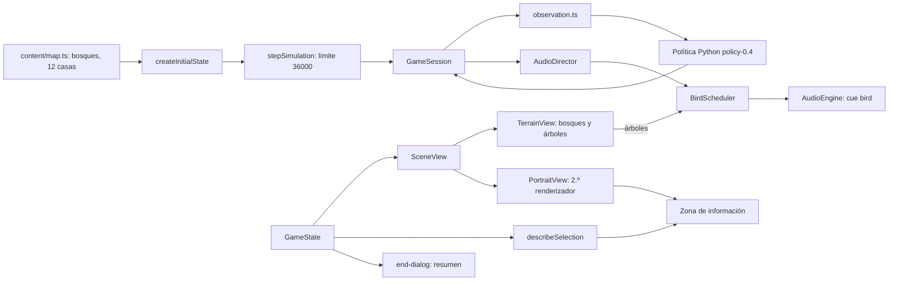
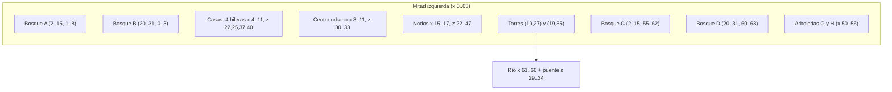

# RTS Camilus — SDD de la etapa 7: bosques, aves, retratos de selección y barra de castillo

**Versión del SDD:** P7-1.0  
**Versión objetivo del juego:** `p7.0.0`  
**Estado:** propuesta, sin implementar. Al preparar este documento no se ha modificado el juego ni se han ejecutado pruebas.  
**Rama de desarrollo:** `etapa_7_ajustes`, a crear desde `main` (HEAD `e43b87d`, que ya contiene P6 mediante la PR #5). El árbol de trabajo estaba limpio al redactar el SDD.  
**Base funcional:** RTS P6 (`p6.0.0`), mapa 128 × 64 con río y puente, simulación lógica en TypeScript a 20 ticks/s, estrategia Python (`policy-0.4`) en Pyodide, render Three.js procedural con cámara ortográfica, audio procedural con Web Audio.

## 1. Propósito

Dar vida y carácter al juego tras P6:

1. **Mundo:** muchos más árboles (bosques), aves que cantan al azar, más zoom y seis casas más por bando.
2. **Interfaz:** nombres en el indicador de recursos, un **retrato tipo fotografía** del elemento seleccionado con su barra de vida y su bando, una ventana de fin de partida con estilo y una barra inferior con aspecto de muralla de castillo.
3. **Partida:** el empate por tiempo pasa de 20 a 30 minutos.
4. **Identidad y documentación:** nombre provisional **RTS Camilus**, crédito del autor en la barra inferior y README actualizado con todo lo desarrollado y capturas nuevas.

Coherente con P2 a P6: todo es **procedural**, sin archivos de sonido, texturas ni modelos y sin dependencias nuevas. A diferencia de P6, P7 toca el núcleo solo en tres datos (terreno `forest`, casas iniciales y límite de tiempo) y **no toca la política Python ni el contrato `worker-v2`** salvo el texto de versión de los fixtures. `hashState` cambia respecto de P6 de forma deliberada (§2.2).

## 2. Alcance

### 2.1 Requisitos

| ID | Requisito |
|---|---|
| P7-R01 | Muchos más árboles. |
| P7-R02 | Sonidos aleatorios de aves. |
| P7-R03 | Un poco más de zoom máximo. |
| P7-R04 | El indicador de recursos muestra el nombre: Comida, Madera, Piedra. |
| P7-R05 | Al seleccionar un edificio, unidad o recurso (arbusto, árbol, roca), mostrar una vista tipo fotografía del elemento con su barra de vida e indicar si es jugador, enemigo o naturaleza. |
| P7-R06 | Seis casas más para el jugador y seis para la IA. |
| P7-R07 | El empate por tiempo se declara a los 30 minutos. |
| P7-R08 | Ventana con estilo para el mensaje final de la partida. |
| P7-R09 | La barra inferior conserva su color pero parece una muralla de ladrillos de castillo. |
| P7-R10 | Nombre provisional **RTS Camilus** en la barra inferior y el texto «Creado experimentalmente por Ing. Camilo A. Castañeda Galindo». |
| P7-R11 | README actualizado con todo lo desarrollado y capturas del juego actual, conservando las anteriores. |

### 2.2 Decisiones explícitas

- **Interpretaciones (corregibles por el autor):**
  - «Muchos más árboles» = **bosques**: un terreno nuevo `kind: "forest"` (obstáculo, como la roca, pero dibujado como suelo con arbolado denso) con unos 900 árboles decorativos en total (hoy hay unos 70, entre los de las rocas y los de recolección). Los árboles decorativos **no se pueden seleccionar** ni talar; solo los 32 árboles de los nodos de madera son recursos. Los árboles sin colisión repartidos por el campo se descartan: las unidades los atravesarían.
  - «Sonidos aleatorios de aves» = una **capa ambiental** de cantos breves con intervalos y especies al azar, sin botón nuevo: la rige el interruptor «Efectos» y `M`.
  - «Un poco más de zoom» = `ZOOM_MAX` de 4,5 a **5,5** (acercar). `ZOOM_MIN` no cambia.
  - «Recurso (arbusto, madera, piedra)» = los nodos del mapa: arbusto de bayas (comida), árbol (madera) y roca (piedra). Los recursos no tienen vida: su «barra de vida» es la **barra de cantidad restante**.
  - «Vista tipo fotografía» = un **retrato** del modelo 3D procedural del elemento, renderizado en un marco pequeño dentro de la zona de información de la barra inferior. Una unidad o edificio muestra su pose en reposo; no se anima. Con **varias unidades** seleccionadas no hay retrato: se conserva el resumen actual (cuántas y de qué tipo).
  - «Naturaleza» = lo que no pertenece a ningún bando: los nodos de recurso. «Jugador» = el humano (bando 0), «Enemigo» = la IA (bando 1).
  - «Seis casas más» = 6 casas iniciales adicionales **por bando**, en total 12 casas y 2 torres por bando.
  - «Empate a 30 minutos» = `MAX_ACTIVE_TICKS` de 24 000 a **36 000** (30 × 60 × 20). El empate sigue siendo el resultado por `TIME_LIMIT` (`winner: null`).
  - «Ladrillos de castillo» = **muralla de piedra con ladrillos y almenas** dibujada solo con CSS y SVG en línea, sobre el degradado actual (`#262a2e` a `#14171a`), de modo que el color general no cambia.
- **Consecuencia aceptada de las casas:** con 12 casas, `capacityOf` suma 10 + 12 × 5 = 70 y se recorta al tope global (`maxPopulation` = 50), por lo que cada bando **arranca con capacidad 50**. Las casas extra son defensa pasiva (vida 300 cada una, objetivos) y aldea más poblada, no más población. La IA ya no construye casas (`plan.capacity < max_population` es falso) y ahorra madera. **Alternativa, si el autor quiere que sirvan para algo:** subir `maxPopulation` a 80 (cambia balance y la medición de P7-H06 CA04); no se hace en P7 salvo instrucción.
- **Cambios de reglas aceptados:** terreno `forest`, 6 casas más por bando y límite de 36 000 ticks. Consecuencias: `STATE_SCHEMA_VERSION` 7, `MAP_VERSION` `map-0.5`, `BALANCE_VERSION` `balance-0.4` y `hashState` distinto del de P6. El criterio de determinismo sigue siendo «misma semilla y mismas órdenes, mismo hash».
- **Sin cambios de esquema en `worker-v2`:** la observación sigue enviando el terreno como `{x, z, w, h}` (el esquema admite hasta 256 rectángulos; con los bosques habrá unos 27). Python ve el bosque como un obstáculo no edificable, igual que la roca. `policy-0.4` no cambia; los fixtures de `contracts/worker-v2` se regeneran solo por `game_version`.
- **Todo lo demás es presentación** (aves, retrato, ventana final, barra, nombres, zoom) y no decide reglas ni toca el estado de la simulación.
- **Reglas de «quién suena» de P4 a P6 intactas.** Las aves son un cue nuevo de prioridad 0 que nunca desplaza a otro.
- **Rama y publicación:** se trabaja en `etapa_7_ajustes`. No se hace merge, push ni publicación sin instrucción expresa.
- **Pruebas:** verificaciones breves y dirigidas, como en P3 a P6. La calidad estética (oído y vista) la juzga el autor.

### 2.3 Fuera de alcance

Árboles talables o que se agoten fuera de los nodos, bosques que ralentizan o dan cobertura, niebla de guerra, retratos animados o giratorios, retrato de varias unidades a la vez, selección de árboles decorativos, aves visibles o que huyen, otros sonidos ambientales (agua, viento, grillos), un control de volumen de aves, cambios de balance de combate o de costes, cambios en la política Python, muestras de audio externas, música nueva y cualquier cambio del contrato `worker-v2` distinto del texto de versión.

## 3. Historias y criterios de aceptación

### Mundo

### P7-H01 — Bosques: muchos más árboles (P7-R01)

**Como jugador**, quiero un escenario con bosques densos y no un campo casi pelado.

- **CA01:** `TerrainRect.kind` admite `"forest"`. Un rectángulo `forest` es **obstáculo** (no transitable ni edificable) y se dibuja como suelo con arbolado denso, sin bloque de roca. `core/obstacles.ts` y `core/placement.ts` lo tratan como terreno bloqueante sin cambios de lógica (solo el puente es excepción); `wouldBlockPath` lo considera.
- **CA02:** disposición inicial del lado izquierdo (el derecho es el espejo `x' = 128 − x − w`; todos los números son datos en `map.ts`):

  | Bosque | Rectángulo `{x, z, w, h}` | Celdas |
  |---|---|---|
  | A, noroeste | `{2, 1, 14, 8}` | 112 |
  | B, norte | `{20, 0, 12, 4}` | 48 |
  | C, suroeste | `{2, 55, 14, 8}` | 112 |
  | D, sur | `{20, 60, 12, 4}` | 48 |
  | E, junto a la roca norte | `{24, 13, 6, 5}` | 30 |
  | F, junto a la roca sur | `{24, 46, 6, 5}` | 30 |
  | G, arboleda central norte | `{50, 9, 7, 6}` | 42 |
  | H, arboleda central sur | `{50, 49, 7, 6}` | 42 |

  Total 464 celdas por lado, 928 en el mapa. Ningún bosque toca la aldea (x 4 a 11, z 22 a 41), los nodos (x 15 a 17, z 22 a 47), las torres, el puente (z 29 a 34), los lagos (x 38 a 47) ni las rocas laterales (x 32 a 34); el pasillo central sigue abierto. Si al verlo en pantalla algún bosque estorba o queda muy vacío, se ajusta el dato y se registra.
- **CA03:** `validateMapLayout` y `validateInitialReachability` comprueban que los bosques no solapan nada, que son simétricos (el chequeo de espejo ya compara `kind`) y que el centro urbano de cada bando sigue alcanzable desde el otro por el puente.
- **CA04:** `planScenery` planta árboles en cada celda `forest` con densidad de **1,2 árboles por celda** (≈ 1 100 en total), posición jitterada dentro de la celda, escala 0,8 a 1,3, rotación y tono al azar, con la misma semilla determinista de siempre y sin consumir la aleatoriedad de la lógica. Los árboles sobre roca (0,5 por celda) y los arbustos se conservan. La densidad de `?graphics=low` es la mitad y sin sombras de contacto.
- **CA05:** los árboles de los bosques usan los `InstancedMesh` existentes (tres variantes de tronco y copa); no se añaden *draw calls* por bosque. Cada bosque añade además un **borde suave** de matas de hierba y arbustos en sus lindes (sin colisión) para que no parezcan bloques.
- **CA06:** la miniatura dibuja el bosque en verde oscuro (`#14301a`) distinguible del suelo (`#1f3b22`) y de la roca.
- **CA07:** los árboles decorativos no son seleccionables ni tienen colisión propia más allá de la celda `forest`; no aparecen sobre el puente, el río ni fuera del mapa (P6-H07 sigue vigente).
- **CA08:** ningún fixture existente coloca unidades o edificios dentro de un bosque; una prueba lo comprueba.

### P7-H02 — Aves al azar (P7-R02)

**Como jugador**, quiero oír aves de vez en cuando entre los árboles, sin patrón reconocible.

- **CA01:** nuevo cue `bird` (ambiental) con **12 variantes** procedurales de cuatro especies sintéticas:
  1. **Gorrión:** 2 a 5 notas cortas (40 a 90 ms) de seno modulado en frecuencia, 3 a 5,5 kHz.
  2. **Trino:** serie rápida (14 a 24 Hz) de modulación de tono, 2,5 a 4 kHz, 0,6 a 1,2 s.
  3. **Silbo:** dos o tres notas deslizantes (200 a 300 ms) entre 1,6 y 2,4 kHz, la última descendente.
  4. **Arrullo:** tres pulsos graves y huecos entre 400 y 600 Hz (paloma), 0,8 a 1,2 s.
  Cada variante lleva armónicos suaves, ataque de 3 a 10 ms y caída exponencial; reutiliza `dsp.ts` (`modalBank`, `filterSweep`, envolventes) y añade el barrido de tono con vibrato (`chirp`) si no existe.
- **CA02:** especificación del cue: prioridad 0, tope 3 voces, separación mínima 0,4 s, ganancia 0,35, reverb 0,25 (eco de bosque). Memoria de las 12 variantes ≤ 1,5 MB.
- **CA03:** **planificador** `BirdScheduler` (`src/audio/ambient.ts`) con su propio generador aleatorio inyectable (en producción semilla de reloj, en pruebas semilla fija; nunca el de la simulación). Cada llamada espera un intervalo al azar de **3 a 11 s**; cada 3 a 6 llamadas, una pareja o bandada de 2 a 3 cantos con 0,3 a 1,5 s entre ellos. Nunca repite la misma variante dos veces seguidas.
- **CA04:** **posición:** se elige al azar un árbol decorativo que esté **en pantalla** (se prueban hasta 12 al azar por llamada, sin recorrer la lista entera) y se usa su proyección para el panorama (−0,7 a 0,7) y la atenuación por distancia (`lowpass` entre 2,5 y 9 kHz según lo lejos del centro). Si no hay ninguno en pantalla, el intervalo se duplica y el canto suena lejano (panorama al azar, `lowpass` 2,5 kHz, ganancia ×0,6).
- **CA05:** **silencios:** no suenan con el audio bloqueado, silenciado (`M`) o con «Efectos» desactivado; en pausa se congela el temporizador (no hay ráfaga al reanudar: el avance por cuadro se limita a 0,25 s); callan durante **6 s** tras cualquier golpe, flecha o muerte visible en pantalla (`strikes`, `deaths`) y no suenan con la partida terminada, para no tapar `victory` y `defeat`. El reinicio reinicia el planificador.
- **CA06:** `bird` no es `PLAYER_ONLY_CUES`; no sube el volumen de la música ni la agacha (`duck` no se usa).
- **CA07:** sanidad de señal por variante: valores finitos, pico ≤ 0,98, determinismo por semilla, duración ≤ 1,4 s, energía dominante entre 350 Hz y 8 kHz (centroide ≥ 1,8 kHz salvo el arrullo, ≥ 350 Hz), cola 30 dB por debajo del pico al final y sin ningún tramo continuo superior a 0,5 s con energía constante (no es un silbido sostenido).
- **CA08:** el presupuesto de síntesis de P5 y P6 (efectos listos en < 1,5 s tras el primer gesto, sin bloquear la interfaz más de 100 ms) se mantiene; si las aves lo rompen, se generan por lotes.

### P7-H03 — Más zoom (P7-R03)

- **CA01:** `ZOOM_MAX` pasa de 4,5 a **5,5**; `ZOOM_MIN` (0,6) y la sensibilidad de la rueda no cambian. La ayuda dice «hasta 5,5×».
- **CA02:** con zoom 5,5 no aparecen artefactos: suelo sin pixelación evidente, sombras sin salto, contornos y barras de vida legibles, partículas con su tamaño (`PARTICLE_SCALE`), copas de los bosques sin recortes. Si no se cumple se reduce a 5,0 y se registra.
- **CA03:** el desplazamiento por teclado y por borde sigue escalando con `1 / zoom`.

### P7-H06 — Seis casas más por bando (P7-R06)

**Como jugador**, quiero empezar con una aldea todavía más poblada.

- **CA01:** `START_BUILDINGS_HALF` añade 6 casas de 2 × 2 al jugador 0 (el jugador 1 es el espejo): `(4,22)`, `(7,22)`, `(10,22)`, `(4,40)`, `(7,40)`, `(10,40)`. Resultan cuatro hileras de tres casas (z 22 a 23, 25 a 26, 37 a 38 y 40 a 41) con una calle de 1 celda entre hileras. Total por bando: **12 casas y 2 torres**.
- **CA02:** `validateMapLayout` comprueba que cabe en el mapa, no solapa ni toca nodos, centro urbano, aparición de aldeanos (x 13,5), torres ni bosques, y que cada casa tiene su simétrica (código existente).
- **CA03:** `createInitialState` las añade al final, como el resto de edificios iniciales (los ids de unidades y nodos de P6 no cambian; las casas nuevas toman ids posteriores a las de P6). `popCapacity` inicial = **50** (tope global; ver §2.2).
- **CA04:** medición en P7-09: IA contra pasivo gana antes del límite de 30 minutos y IA contra IA no se estanca en empate habitual. Si el empate pasa a ser frecuente, se ajusta por datos (menos casas iniciales o torres más separadas) y se documenta; el balance de combate no cambia.
- **CA05:** la IA y el jugador parten en igualdad (mismo diseño espejado). Las casas iniciales no se pueden cancelar.

### P7-H07 — Empate a 30 minutos (P7-R07)

- **CA01:** `MAX_ACTIVE_TICKS = 36_000` en `content/balance.ts` (comentario: 30 min × 60 s × 20 ticks). El resultado por `TIME_LIMIT` sigue siendo empate y no cambia ninguna otra regla de fin de partida.
- **CA02:** el HUD técnico muestra `Tick n/36000` derivado de `MAX_ACTIVE_TICKS` (hoy `main.ts` lo escribe como `TICKS_PER_SECOND * 1200`); la ayuda, el README y `describeEnd` dicen 30 minutos.
- **CA03:** las pruebas que fijan 24 000 (`stability.test.ts`, `ai-match.test.ts`, `combat.test.ts`) usan la constante o 36 000. Se anota el aumento de duración de la prueba de estabilidad.
- **CA04:** el anillo de rendimiento del diagnóstico (`WINDOW = 24_000` en `recorder.ts`) es una ventana móvil independiente y no se modifica; se comprueba que el diagnóstico de una partida de 30 minutos sigue acotado.

### Interfaz

### P7-H04 — Nombres en el indicador de recursos (P7-R04)

- **CA01:** cada recurso de `#resources` muestra **punto + nombre + cifra**: «Comida 200», «Madera 200», «Piedra 0». La población pasa a «Población 3/50» (con `(+cola)` como hoy).
- **CA02:** «Comida» sustituye a «Alimento» en la interfaz visible: `title` del indicador, ayuda, `describeEntity` (`RESOURCE_NAME`), mensajes y README. Los identificadores internos (`food`, protocolo Python) no cambian.
- **CA03:** el nombre de cada recurso usa un `` fijo; solo cambia la cifra, sin reconstruir DOM por cuadro. En pantallas estrechas (< 720 px de ancho) los nombres se ocultan y quedan los `title`.
- **CA04:** las fichas de coste de la barra inferior conservan el punto de color y añaden el nombre solo en el `title` (para no ensanchar los botones).

### P7-H05 — Retrato de la selección con bando y vida (P7-R05)

**Como jugador**, quiero ver qué tengo seleccionado, de quién es y cuánta vida le queda.

- **CA01:** aparece con **un solo elemento** seleccionado o inspeccionado: unidad propia, edificio propio, unidad o edificio enemigo, o nodo de recurso. Con varias unidades, el resumen de P6; sin selección, la pista de P6.
- **CA02:** la zona de información pasa de 240 a **380 px** (`grid-template-columns: 380px 1fr auto`). Dentro: el **retrato** (lienzo cuadrado de 112 px; 88 px con barra baja) a la izquierda y un bloque de datos a la derecha.
- **CA03:** el bloque de datos muestra: **nombre** en español (Aldeano, Soldado, Arquero, Centro urbano, Casa, Cuartel, Torre, Arbusto, Árbol, Roca), **etiqueta de bando** en una ficha, **barra de vida** con cifras y las líneas de estado de `describeEntity` (actividad, carga, obra, cola) sin duplicar el nombre.
- **CA04:** **bando:** ficha «JUGADOR» (azul, símbolo ○), «ENEMIGO» (rojo, símbolo ◇) o «NATURALEZA» (verde, símbolo hoja). El fondo del retrato y el marco toman el mismo color, pero el texto y el símbolo bastan para distinguir el bando sin depender del color (RF-10).
- **CA05:** **barra de vida:** `hp / máx` con el color de `barState` (verde, ámbar, rojo). En una obra se añade una segunda barra fina de progreso. En un **recurso** la barra es «Restante n / 500» con el color del recurso (comida dorada, madera marrón, piedra gris); un nodo agotado muestra «Agotado» y su tocón o arbusto seco. Se actualiza cada cuadro solo si cambia el valor.
- **CA06:** **render del retrato** (`src/rendering/portrait.ts`, nuevo): un segundo `WebGLRenderer` sobre `<canvas id="portrait">` (con `alpha`, sin antialiasing en modo bajo), una escena propia con luz hemisférica y direccional, y una cámara en perspectiva (FOV 28°) en vista 3/4 que encuadra el modelo (cálculo por esfera envolvente, con margen del 12 %). Las geometrías y los materiales se **comparten** con la escena principal (los recursos de `three` se cachean por renderizador), de modo que no se duplica memoria de modelos.
- **CA07:** los modelos del retrato (`UnitFactory`, `buildBuilding`, `NodeFactory`) se crean **una vez por variante** (tipo × bando, unos 17) la primera vez que se necesitan y se reutilizan visibles u ocultos; no se crean recursos por selección. El retrato se redibuja solo al cambiar la selección o su **clave de aspecto** (obra: paso del 5 %; edificio completo; llamas por daño; nodo agotado), a ≤ 4 Hz. Las marcas de bando (anillo y rombo) y las siluetas no se dibujan en el retrato.
- **CA08:** **respaldo:** si no se puede crear el segundo contexto WebGL, el retrato se sustituye por el icono SVG del tipo (los de `command-panel.ts`) con el mismo fondo y marco; la información y las barras siguen. No es un error: se anota una línea en los registros.
- **CA09:** el retrato es solo lectura: no altera `Selection` ni el estado. `pruneSelection` limpia la selección cuando la entidad desaparece y el retrato se oculta en ese mismo cuadro. Un reinicio libera el retrato y lo reconstruye.
- **CA10:** accesibilidad y seguridad: el lienzo lleva `role="img"` y `aria-label` («Retrato: Soldado, enemigo»); todo texto procedente del estado se escribe con `textContent`, nunca con `innerHTML`.
- **CA11:** `describeSelection(state, id)` (nueva, en `input/selection.ts`) devuelve los datos puros (`name`, `side`, `hp`, `max`, `barLabel`, `lines`) para poder probar la lógica sin DOM; `describeEntity` se conserva para diagnóstico y pruebas.

### P7-H08 — Ventana de fin de partida (P7-R08)

**Como jugador**, quiero un cierre de partida con presencia, no una línea de texto sobre fondo oscuro.

- **CA01:** al terminar la partida se muestra `#end-dialog` (`role="dialog"`, `aria-modal="true"`, `aria-labelledby`) centrado en la vista de juego (sobre la barra, no bajo ella). Sustituye al texto del `#overlay` cuando la partida terminó; las pausas y los avisos de la IA siguen usando el `#overlay` actual.
- **CA02:** contenido: escudo heráldico SVG (azul con corona si hay victoria, rojo roto si hay derrota, gris si hay empate), **título** «Victoria», «Derrota» o «Empate», **motivo** (`describeEnd`, con «tras 30 minutos» en el empate por tiempo) y un **cuadro de resumen**: duración (`mm:ss` desde `outcome.endTick`), unidades propias perdidas, unidades enemigas derrotadas, edificios propios perdidos y edificios enemigos destruidos (de `state.losses`).
- **CA03:** botones: **«Jugar de nuevo»** (igual que Reiniciar; tiene el foco) y **«Ver el campo»** (oculta la ventana para ver el escenario; mientras dura el fin de partida aparece un botón «Resultado» en `#controls` que la vuelve a abrir). `Enter` equivale a jugar de nuevo y `Esc` a ver el campo.
- **CA04:** estilo coherente con la barra de castillo (P7-H09): marco de piedra con ladrillos, interior de pergamino oscuro, tipografía con serifa para el título, color de acento por resultado (dorado, carmesí, gris azulado), sombra y velo oscuro con desenfoque suave. Entrada con fundido y escala de 250 ms; con `prefers-reduced-motion` aparece sin animación.
- **CA05:** el texto de la ventana sale de funciones puras (`describeEnd`, `endSummary`) compartidas con la evidencia exportada, de modo que pantalla y diagnóstico no pueden discrepar (como en P3-H08). La música y los cues `victory` y `defeat` no cambian.
- **CA06:** se ve también con la ventana pequeña (hasta 640 × 360) sin desbordar; el cuadro de resumen pasa a una columna.
- **CA07:** un reinicio la oculta y la reconstruye vacía; no queda foco atrapado.

### P7-H09 — Barra inferior de castillo (P7-R09)

**Como jugador**, quiero que la barra parezca la muralla de mi fortaleza, con el mismo color de siempre.

- **CA01:** el degradado actual (`#262a2e` a `#14171a`) y el borde (`#3d444b`) **se conservan** como base; encima se añade textura de **ladrillos de piedra** con hiladas de 24 px de alto y ladrillos de 48 px de ancho, trabados (cada hilada desplazada medio ladrillo), juntas de mortero oscuras (`rgba(0,0,0,.45)`, 2 px) y un filo de luz de 1 px en la cara superior de cada ladrillo (`rgba(255,255,255,.06)`).
- **CA02:** la textura es un mosaico SVG en línea (`data:image/svg+xml`, sin archivos) de 192 × 96 px con **8 tonos de ladrillo** (variaciones de ±4 % de luminosidad) para que no se vea un patrón repetido evidente; el color medio de la barra queda dentro de ±5 % del de P6.
- **CA03:** **almenas:** una franja de 14 px sobre el borde superior de la barra (`::before`, `pointer-events: none`) con merlones de 28 px separados por huecos de 18 px, con la misma textura de ladrillo y un borde superior más claro. Se solapa sobre la vista sin cambiar el tamaño del lienzo ni capturar el puntero.
- **CA04:** las tres zonas (información, acciones y miniatura) se presentan como **troneras** hundidas: fondo más oscuro con bisel de piedra (luz arriba a la izquierda, sombra abajo a la derecha). Los botones de acción conservan su aspecto de P6.
- **CA05:** la barra gana una **franja inferior** de 22 px, interior a la barra, con el nombre y el crédito (P7-H10). La altura de la barra pasa a `--bar-h: 166px` (134 px con ventanas de menos de 600 px de alto); son valores a confirmar al implementar, y la vista de juego, el viewport del lienzo, `#overlay`, `#help`, `#hud` y `#end-dialog` usan la variable.
- **CA06:** el resultado se verifica con capturas en 1920 × 1080, 1366 × 768 y 1280 × 600: sin solapes de textos ni botones, minimapa completo y almenas visibles.
- **CA07:** coste: solo CSS; sin *draw calls* ni trabajo por cuadro. Se respeta `prefers-reduced-motion` y `prefers-contrast` (sin textura con contraste alto).

### P7-H10 — Nombre y crédito (P7-R10)

- **CA01:** nombre provisional **«RTS Camilus»**, definido en una constante `GAME_NAME` (`content/versions.ts`) junto con `GAME_CREDIT = "Creado experimentalmente por Ing. Camilo A. Castañeda Galindo"`.
- **CA02:** la franja inferior de la barra (P7-H09 CA05) muestra a la izquierda «RTS Camilus» (serifa, versalitas, dorado `#d9b45a`, con una pequeña torre SVG) y a la derecha el crédito en 11 px, color arena apagado, alineado a la derecha; ambos como texto, no imagen. En ventanas estrechas el crédito se recorta con puntos suspensivos y el texto completo queda en su `title`.
- **CA03:** el nombre también aparece en `<title>` («RTS Camilus»), la ayuda, el encabezado del panel de registros y el README. «Provisional» se indica en el README y en la ayuda; no en la barra.
- **CA04:** ninguna otra cadena de la interfaz cambia salvo «Alimento» a «Comida» (P7-H04).

### P7-H11 — Versiones, ayuda y README (P7-R11)

- **CA01:** `GAME_VERSION = "p7.0.0"`, `STATE_SCHEMA_VERSION = 7`, `MAP_VERSION = "map-0.5 (128x64, río, bosques)"` (el contrato limita `Version` a 32 caracteres), `BALANCE_VERSION = "balance-0.4"`, `AUDIO_VERSION = "audio-0.4"`, `GRAPHICS_VERSION = "gfx-0.4"`; `POLICY_VERSION` sigue en `policy-0.4`. El panel de registros las muestra.
- **CA02:** la ayuda de `index.html` documenta: bosques, aves, zoom 5,5×, retrato, nombres de recursos, 12 casas, límite de 30 minutos, ventana final y la barra de castillo; actualiza «Partida máxima: 20 minutos» a 30.
- **CA03:** `contracts/worker-v2/generate-fixtures.mjs` y `fixtures.json` se actualizan a `game_version` `p7.0.0`; el esquema no cambia.
- **CA04:** **README actualizado** (`README.md`):
  1. Título «RTS Camilus (nombre provisional)» y el crédito del autor.
  2. **Resumen y características al día**: todo lo desarrollado en las etapas 0 a 7, agrupado por etapa y con enlace a su SDD (`RTS_SDD_v0.3.md` y `SDD_Etapa_2` a `SDD_Etapa_7`): base, navegación e IA en Python/Pyodide, economía y combate, mejoras visuales, defensa y recursos (torres, piedra), efectos de sonido, realismo audiovisual (música, espadas, flechas, martillo), interfaz y mundo de P6 (barra, miniatura, río y puente, aldea inicial) y lo nuevo de P7.
  3. **Capturas**: se **conservan todas las secciones y las imágenes existentes** (`combate-ia.png`, `multitud-100.png`, `escaramuza.png` y las `etapa2-*`) y se añade una sección «Etapa 7: estado actual» con las capturas nuevas (ver CA05). Si hubiese capturas intermedias de las etapas 3 a 6, se agregan como secciones propias; no se reemplaza ni se borra ninguna imagen.
  4. **Controles, comandos, arquitectura, pila y limitaciones** actualizados: retrato, 5,5×, 30 minutos, nuevos módulos (`rendering/portrait.ts`, `audio/ambient.ts`, `ui/end-dialog.ts`), terreno `forest`, aves, parámetros `?graphics=low` y `?shadows=0`, y fixtures.
  5. **Estado y mediciones**: se repiten y se actualizan con el estado real (pruebas y rendimiento) o se indica la fecha de la última medición; no se copian cifras viejas.
- **CA05:** **capturas nuevas** en `docs/images/` (PNG, ≤ 1920 × 1080, sin datos personales), tomadas del juego en ejecución con el navegador integrado:

  | Archivo | Contenido |
  |---|---|
  | `etapa7-vista-general.png` | Vista inicial: aldea de 12 casas, bosques, río y barra de castillo |
  | `etapa7-bosques.png` | Bosque denso con zoom medio |
  | `etapa7-zoom-maximo.png` | Zoom 5,5× sobre una unidad y su entorno |
  | `etapa7-retrato-unidad.png` | Unidad propia seleccionada con retrato, bando y vida |
  | `etapa7-retrato-enemigo.png` | Edificio enemigo con la ficha «ENEMIGO» |
  | `etapa7-retrato-recurso.png` | Árbol o arbusto con «NATURALEZA» y cantidad restante |
  | `etapa7-barra-castillo.png` | Recorte de la barra inferior con nombre y crédito |
  | `etapa7-fin-partida.png` | Ventana de victoria o derrota |

  Se usan los fixtures `retratos` y `final` (§4.8) para obtener las escenas sin jugar una partida entera. Cada captura se revisa a ojo antes de enlazarla.
- **CA06:** las rutas de imagen del README se escriben como las existentes (`docs/images/...`) y se comprueba que todas existen en disco.

## 4. Diseño técnico y contratos

### 4.1 Flujo de datos

TypeScript sigue siendo la autoridad de las reglas. La interfaz, el retrato, las aves y la ventana final solo leen estado.

### 4.2 Núcleo y contrato

| Archivo | Cambio |
|---|---|
| `content/balance.ts` | `MAX_ACTIVE_TICKS = 36_000`; `validateBalance` sin cambios. |
| `content/map.ts` | `TerrainRectSpec.kind` admite `"forest"`; constante `HALF_FOREST` (tabla de P7-H01) y su espejo en `TERRAIN`; 6 casas más en `START_BUILDINGS_HALF`; `validateMapLayout` ampliado (bosques sin solapes ni contacto con la aldea, simétricos). |
| `core/types.ts` | `TerrainRect.kind?: "water" \| "bridge" \| "forest"`. |
| `core/obstacles.ts`, `core/placement.ts` | Sin cambios de lógica: el bosque bloquea como la roca; se añaden pruebas. |
| `core/state.ts` | Sin cambios: los edificios iniciales ya salen de `startBuildings`; `popCapacity` inicial pasa a 50 por el tope. |
| `core/map-check.ts` | Comprueba que los bosques no aíslan ninguna base. |
| `core/fixtures.ts` | Nuevos fixtures `retratos` y `final`; el resto se adapta si algún caso cae dentro de un bosque (P7-H01 CA08). |
| `core/result.ts` | Nueva `endSummary(state, perspective)`; `describeEnd` añade «tras 30 minutos» al empate por tiempo. |
| `ai-client/observation.ts` | Sin cambios: el bosque viaja como `{x, z, w, h}`. |
| `ai-client/protocol.ts` | Sin cambios. |
| `python/policy/*` | Sin cambios. `python/tests/test_strategy.py` se ejecuta tal cual como prueba de regresión. |

`hashState` incluye ahora más edificios y terreno nuevo; la partida con la misma semilla sigue siendo determinista.

### 4.3 Mapa: aldea y bosques

Todos los números son **constantes de datos** en `map.ts`; ajustarlos no exige tocar código.

### 4.4 Interfaz

| Archivo | Cambio |
|---|---|
| `index.html` | `--bar-h`, textura de ladrillos y almenas, franja inferior con nombre y crédito, nombres en `#resources`, `#portrait` y bloque de datos dentro de `#info`, `#end-dialog`, botón «Resultado», `<title>` y ayuda. |
| `input/selection.ts` | Nueva `describeSelection` (datos puros); `RESOURCE_NAME.food = "comida"`. |
| `ui/command-panel.ts` | `updateInfo` pinta nombre, ficha de bando, barras y líneas con `textContent`; conserva el resumen de varias unidades. |
| `ui/end-dialog.ts` (nuevo) | Ventana de fin: contenido, foco, `Enter` y `Esc`, botón «Resultado». |
| `input/camera-rig.ts` | `ZOOM_MAX = 5.5`. |
| `ui/minimap.ts` | Color y capa de bosque. |
| `main.ts` | Conecta retrato, ventana final y nombres de recursos; `Tick n/${MAX_ACTIVE_TICKS}`; `refreshOverlay` deja de pintar el fin de partida. |
| `content/versions.ts` | Versiones nuevas, `GAME_NAME`, `GAME_CREDIT`. |

### 4.5 Render

| Archivo | Cambio |
|---|---|
| `rendering/scenery.ts` | `SceneryRect.kind` admite `"forest"`; `planScenery` planta árboles de bosque (1,2 por celda) y deja el comportamiento actual en roca, agua y puente. |
| `rendering/terrain-view.ts` | `addRock` omite `forest`; borde de matas y arbustos por bosque; árboles instanciados como hoy; sombra de contacto para los de bosque solo en modo alto. |
| `rendering/portrait.ts` (nuevo) | `PortraitView`: segundo renderizador, escena, cámara, caché de modelos, clave de aspecto y respaldo. |
| `rendering/scene-view.ts` | Expone `sceneryTrees()` (lectura) para las aves; sin otros cambios. |
| `rendering/units.ts`, `buildings.ts`, `nodes.ts` | Sin cambios de forma: sus fábricas se reutilizan desde `PortraitView`. |

### 4.6 Audio

| Archivo | Cambio |
|---|---|
| `voices.ts` | Nuevo `CueId` `bird`; entrada en `CUES`: prioridad 0, tope 3, separación 0,4 s, ganancia 0,35, 12 variantes, reverb 0,25. |
| `sfx.ts` | Cuatro recetas de ave (gorrión, trino, silbo, arrullo) y 12 variantes. |
| `dsp.ts` | Reutiliza `modalBank`, `filterSweep`; añade `chirp` (barrido de tono con vibrato y armónicos) si no existe. |
| `ambient.ts` (nuevo) | `BirdScheduler`: temporizador, elección de variante y árbol en pantalla, silencios por combate, pausa y fin de partida. |
| `director.ts` | Llama a `BirdScheduler.update` una vez por cuadro y envía las peticiones al motor; `reset` lo reinicia. |
| `engine.ts` | Sin cambios de reglas: `play` ya admite `delay`, `lowpass`, `wet` y panorama. |

Memoria de audio: aves ≈ +1,5 MB sobre los ≈ 38 MB de P6; total ≤ 40 MB.

### 4.7 Receta de referencia de las aves (guía de diseño)

Los parámetros exactos se ajustan al oído y se fijan en `sfx.ts`.

| Especie | Síntesis |
|---|---|
| Gorrión | Seno con barrido ascendente-descendente (±15 %) de 40 a 90 ms, 2 a 5 notas con 40 a 120 ms entre ellas; segundo armónico a −12 dB. |
| Trino | Portadora de 2,5 a 4 kHz con modulación de frecuencia de 14 a 24 Hz y profundidad ±8 %; envolvente que crece y cae. |
| Silbo | Notas deslizantes largas (200 a 300 ms), terminación descendente, vibrato suave de 5 Hz. |
| Arrullo | Tres pulsos graves de 400 a 600 Hz con filtro paso bajo y caída de 120 ms; poco armónico. |

### 4.8 Fixtures de comprobación manual

- Nuevo `?fixture=retratos&ai=0`: un grupo junto a la cámara con una unidad de cada tipo de cada bando, un edificio de cada tipo de cada bando (uno en obra y uno dañado) y los tres tipos de recurso; sirve para comprobar el retrato, el bando y las barras, y para las capturas del README.
- Para ver la ventana final se reutiliza `?fixture=sonidos&ai=0&final=victoria` o `&final=derrota` (existentes desde P6, con el centro urbano rival o propio a 1 de vida); no se creó un fixture `final` nuevo.
- Los fixtures se pueden combinar con `?graphics=low` y `?shadows=0`.

## 5. Secuencia de implementación

| Paso | Trabajo | Salida |
|---|---|---|
| P7-00 | Crear `etapa_7_ajustes` desde `main`; `npm run typecheck`, `npm test`, `npm run test:py` y `npm run build` en verde; capturas de referencia de P6; revisar consumidores de `TerrainRect.kind`, `RESOURCE_NAME`, `MAX_ACTIVE_TICKS` y el límite de 24 000 | Base verificada |
| P7-01 | Núcleo y mapa: terreno `forest`, 6 casas más, `MAX_ACTIVE_TICKS`, validaciones y alcanzabilidad; migración de pruebas que fijan 6 casas, capacidad 40 o 24 000 | Mundo nuevo jugable sin render |
| P7-02 | Contrato y Python: `game_version` en fixtures y pruebas Python de regresión con el terreno nuevo | IA sin regresión |
| P7-03 | Render del mundo: bosques, árboles instanciados, bordes y miniatura; zoom 5,5 | Escena con bosques |
| P7-04 | Aves: receta, `bird`, `BirdScheduler`, integración en el director y pruebas de señal | Aves audibles |
| P7-05 | Interfaz de datos: nombres de recursos, `describeSelection`, zona de información ampliada | Datos de selección |
| P7-06 | Retrato: `PortraitView`, caché, clave de aspecto, respaldo y fixture `retratos` | Fotografía de selección |
| P7-07 | Ventana final: `end-dialog.ts`, `endSummary`, fixture `sonidos&final=` | Cierre con estilo |
| P7-08 | Barra de castillo, nombre y crédito, versiones, ayuda | Aspecto final de la barra |
| P7-09 | Medición: rendimiento (FPS, bosques y retrato), partidas de referencia (IA contra pasivo, IA contra IA a 30 minutos), ajuste de datos | Evidencia breve |
| P7-10 | Capturas con el navegador y actualización del README | Documentación al día |
| P7-11 | Integración, revisión acotada y commit local | Build y verificaciones dirigidas |

Trabajar en `etapa_7_ajustes` conservando el historial. No resetearla ni forzarla. No hacer merge, push ni publicar sin instrucción expresa.

## 6. Rendimiento y recursos

| Aspecto | Presupuesto |
|---|---|
| Cuadro de render (modo alto) | Mediana de 60 FPS en 45 s con `?fixture=objetivo`, con bosques y zoom 1; ningún cuadro > 50 ms por creación de recursos |
| Árboles | ≈ 1 100 decorativos + 32 de nodo; ≤ 12 *draw calls* adicionales; si no cabe, densidad 0,9 por celda y sin sombra proyectada en árboles de interior de bosque |
| Retrato | ≤ 4 Hz, ≤ 1 ms por redibujo; 0 recursos nuevos por selección tras el primer uso; memoria ≤ 5 MB adicionales |
| Aves | ≤ 0,05 ms por cuadro en el planificador; memoria de audio ≤ +1,5 MB; efectos listos en < 1,5 s tras el primer gesto |
| Barra y ventana final | Solo CSS y SVG, sin trabajo por cuadro; el DOM de la zona de información se actualiza solo si cambia el valor |
| Simulación | p95 del tick sin diferencias apreciables respecto de P6 (la capa nueva añade 12 edificios y 16 rectángulos de terreno) |
| Política Python | p95 de decisión ≤ el de P6 + 1 ms |
| Partida de 30 minutos | Sin degradación: entidades acotadas, sin violaciones y reproducible (como RNF-04, con 36 000 ticks) |

## 7. Verificación y cierre

No se ejecutan pruebas ni se modifica el juego al preparar este documento. Durante el desarrollo se verifican solo los riesgos de P7:

1. **Núcleo y mapa:** `validateMapLayout` y `validateInitialReachability` con bosques y 12 casas; el bosque es obstáculo no edificable; `wouldBlockPath` sigue funcionando; `popCapacity` inicial 50; `MAX_ACTIVE_TICKS` = 36 000 y un empate exactamente en ese tick; misma semilla y mismas órdenes, mismo `hashState`; ningún fixture coloca algo dentro de un bosque; migración de las pruebas que fijan P6 (6 casas, capacidad 40, 24 000 ticks, `ZOOM_MAX`, texto «alimento», `CUES` y variantes) con registro de qué cambió y por qué.
2. **Política Python:** las 59 pruebas actuales pasan sin cambios; la observación con bosques cumple el esquema (≤ 256 rectángulos).
3. **Partidas de referencia (headless):** IA contra pasivo gana antes de 36 000 ticks; IA contra IA termina con vencedor o, si empata, se registra; reproducción idéntica por semilla; partida de 30 minutos estable.
4. **Interfaz (lógica pura y jsdom):** `describeSelection` para cada tipo de elemento y bando (nombre, bando, vida, recurso restante, agotado, obra); `endSummary` y `describeEnd`; estado de `#end-dialog` (apertura, `Enter`, `Esc`, «Resultado», reinicio); nombres de recursos presentes y sin reconstrucción por cuadro.
5. **Render (lógica y recursos):** `planScenery` con bosques (cantidad ≈ 1,2 por celda, determinismo, nada sobre agua o puente); `addRock` no dibuja `forest`; `PortraitView` con contexto falso (caché por variante, clave de aspecto, respaldo cuando falla el contexto, liberación de recursos); el retrato no crea recursos por selección.
6. **Audio (señal y motor con contexto falso):** condiciones de P7-H02 CA07 por variante, determinismo, finitos, pico ≤ 0,98, 12 variantes; `BirdScheduler` con generador fijo: intervalos entre 3 y 11 s, duplicados cuando no hay árboles en pantalla, sin repetir variante consecutiva, silencio en combate, pausa, fin de partida y `Efectos` desactivado; tope de 3 voces.
7. **Navegador:** carga de `retratos` y `sonidos&final=` sin errores de consola; retrato correcto para cada tipo (revisión visual) con la ficha de bando y las barras; ventana final en victoria, derrota y empate; barra de castillo en 1920 × 1080, 1366 × 768 y 1280 × 600; nombre y crédito visibles; zoom 5,5 sin artefactos; bosques densos sin ralentizar; aves audibles; medición de FPS de 45 s con `?fixture=objetivo` en alto y bajo.
8. **README y capturas:** existen todos los archivos de imagen enlazados; las imágenes anteriores siguen enlazadas; las cifras de estado coinciden con las mediciones reales.
9. **Compilación:** `npm run typecheck`, `npm test`, `npm run test:py` y `npm run build`.

La calidad del sonido y de la imagen no es verificable de forma automática; la aceptación auditiva y visual final es del autor. No se marcará como probado, implementado o aceptado algo que no se haya observado.

| Historia | Estado |
|---|---|
| P7-H01 a P7-H11 | Implementadas en `etapa_7_ajustes`; verificadas con `npm run typecheck`, `npm test` (415), `npm run test:py` (59) y `npm run build`, y revisadas en el navegador. Pendiente la aceptación auditiva y visual del autor (aves, aspecto de retratos, ladrillos y ventana final). |

### 7.1 Resultado real y desviaciones

- **Navegador (verificado):** retratos correctos de unidad, edificio completo, edificio en obra, edificio enemigo y roca (nombre, bando, barra de color y texto); el cuadro de información no desborda en 1366 × 768 ni en ventanas bajas (~490 px); ventana final de victoria y derrota con Intro, Tab, Esc, «Ver el campo» y «Resultado»; bosques densos a 1600 × 900; fluidez de la partida por defecto (IA activa, ventana ~870 × 490 del navegador integrado): mediana de cuadro 16,7 ms, p95 16,8 ms, máximo 17,1 ms en 300 cuadros.
- **Partidas de referencia (headless, horizonte de 36 000 ticks):** IA contra pasivo gana en el tick 6 178 sin violaciones; IA contra IA (semillas 5 y 7) termina en el tick 24 596 con victoria del jugador 0 por centro urbano destruido (bajas 63/72 unidades y 4/6 edificios), sin violaciones y con el mismo hash al reproducir el registro de órdenes. No hay empate por tiempo en estas partidas, por lo que no se ajustaron casas ni torres.
- **No medido:** los 45 s con `?fixture=objetivo` en alto y bajo, 1920 × 1080 en un equipo real, la ventana de empate en el navegador (cubierta solo por pruebas de lógica) y la partida de 30 minutos en el navegador.
- **Desviaciones:** (1) el respaldo del retrato es un dibujo 2D en un `canvas`, no el icono SVG de `command-panel.ts`; (2) el retrato no dibuja llamas de daño; (3) la barra inferior mide 172 px (138 px en ventanas de menos de 600 px de alto) para alojar el retrato y la franja de nombre; (4) los paneles de la barra pasan a ser semitransparentes (62 %) para que los ladrillos se aprecien; (5) los bosques A y C quedaron en z 0 y z 55 con 9 de alto para no tocar las bases; (6) la ventana final se prueba con el fixture `sonidos&final=` y no con un fixture nuevo; (7) `p4-music.test.ts` recibió un límite de 30 s para su primer caso, que agotaba los 5 s con la suite completa en paralelo.

## 8. Riesgos y respuestas

| Riesgo | Respuesta |
|---|---|
| ~1 100 árboles de bosque más sus sombras bajan los FPS | Instanciación ya existente; presupuesto de §6; mitigaciones por orden: densidad 0,9, sin sombra proyectada en el interior del bosque, sin sombras de contacto, y en `?graphics=low` la mitad de árboles |
| Los bosques cierran rutas de flanqueo o estorban a la IA | Disposición lejos del pasillo central; alcanzabilidad validada; medición de IA contra IA en P7-09; los bosques son datos |
| El jugador espera talar o seleccionar los árboles de los bosques | La ayuda aclara que solo los árboles de nodo (junto al bosque de la base) son recurso; ampliación posible en otra etapa |
| Las 12 casas hacen inútil construir casas y la IA queda igual | Es consecuencia declarada del tope de 50; alternativa de `maxPopulation` = 80 en §2.2 |
| La IA gana o empata demasiado con más edificios y límite de 30 minutos | Medición en P7-09; ajuste de datos (casas o torres) y registro |
| Un segundo contexto WebGL falla o consume memoria en equipos modestos | Respaldo con icono SVG; modelos cacheados y ≤ 4 Hz; la información no depende del retrato |
| Los modelos compartidos entre renderizadores dan problemas con materiales especiales (viento, siluetas, *stencil*) | El retrato oculta marcas y siluetas y usa materiales base; si un material falla se usa uno equivalente y se anota |
| Las aves molestan, sobre todo en combate o con música | Silencio de 6 s tras combate visible, ganancia baja, intervalos largos y apagado con «Efectos»; si no basta, se añade un interruptor «Aves» (cambio mínimo) |
| Las aves sintéticas suenan a pitidos electrónicos | Condiciones espectrales de P7-H02 CA07, ajuste al oído en P7-09 y, si no basta, propuesta de muestras externas con licencia clara en otra etapa |
| La textura de ladrillos cambia el color percibido de la barra o recarga mucho el CSS | Mosaico SVG pequeño con tonos de ±4 %, color medio dentro de ±5 % de P6; comparación con captura de referencia de P7-00 |
| La barra más alta reduce la vista de juego en pantallas bajas | 134 px en ventanas de menos de 600 px de alto; revisión en 1280 × 600 |
| El retrato de un recurso agotado o de una obra confunde | Clave de aspecto (tocón, obra por pasos del 5 %) y etiqueta «Agotado» / porcentaje de obra en los datos |
| El cambio de 20 a 30 minutos alarga las pruebas de estabilidad | Se acepta; la prueba usa la constante y se anota el tiempo |
| Cambios de arranque rompen muchas pruebas | Se migran en P7-01 con registro de cada cambio; ninguna se borra sin sustituto |

## 9. Instrucción para el futuro agente de desarrollo

Al recibir autorización para iniciar P7, crea la rama `etapa_7_ajustes` desde `main` (HEAD `e43b87d` o posterior), confirma que P6 compila y pasa sus pruebas, y lee las instrucciones del repositorio. Implementa P7-00 a P7-11 en incrementos pequeños, empezando por el núcleo y el mapa (bosques, casas, límite de tiempo), que es lo único que altera reglas, y deja para el final el pulido estético. Mantén TypeScript como autoridad de las reglas; no cambies la política Python ni el esquema del contrato `worker-v2` (solo el texto de versión de los fixtures) ni el balance de combate. No uses archivos externos de audio, texturas o modelos ni dependencias nuevas. Escribe todo texto procedente del estado con `textContent`. Conserva las verificaciones acotadas de §7. En el README conserva todas las secciones y capturas anteriores y añade las nuevas sin reemplazar ninguna. No hagas merge, push ni publiques sin instrucción expresa. Informa el commit, los archivos cambiados, las verificaciones realmente realizadas y lo que quede pendiente, en particular la aceptación auditiva y visual, que corresponde al autor.
